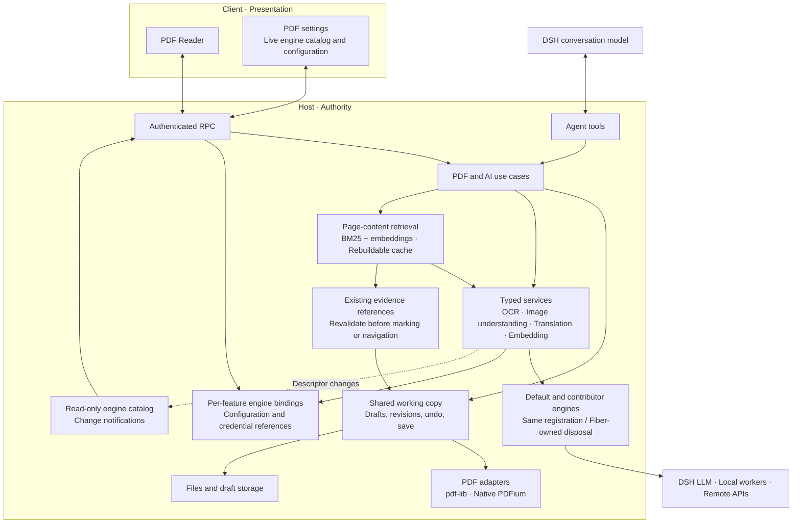
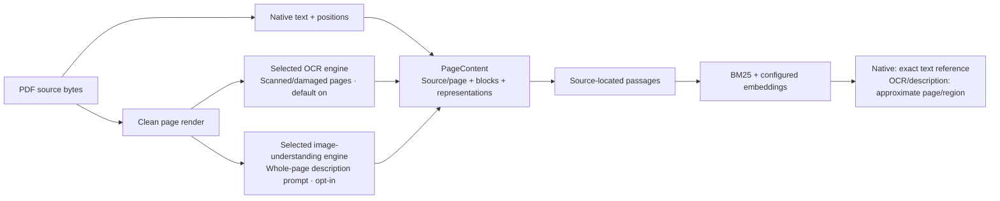

# DSH PDF Reader

English | [中文](README.zh.md)

Read a PDF alongside your [DeepSeek Harness](https://github.com/deepseek-ai/deepseek-harness) conversation. Ask a rough question, find the relevant passage, mark it in the document, and return to where you were reading.

I built this plugin because I often read papers and books in PDF form. The readers I tried were missing small but important conveniences—especially a way back after several jumps—while the ones with AI explanation and translation often required another subscription. This is the reader I wanted for my own DSH workspace.

## What it does

- **Read and find.** Continuous scrolling, zoom and fit modes, page thumbnails, text selection, and text search.
- **Navigate and return.** Jump through pages, links, bookmarks, or annotations, then choose an earlier position from multi-step back history.
- **Annotate.** Add highlights, underlines, strikeouts, comments and draggable, resizable page notes; edit colors and comment threads.
- **Edit bookmarks.** Add, rename, delete, reorder and nest the PDF's built-in bookmarks, then save them into the document.
- **Fill forms.** Fill existing AcroForm controls manually or let the model inspect numbered controls and fill one page at a time.
- **Save your work.** Undo/redo, recover drafts, save or save as, and detect source-file conflicts. User and model edits share the same draft; model-requested saves require approval.
- **Translate selections.** Get pronunciation, meanings, parts of speech and examples for words; meanings and examples for phrases; direct translations for sentences and readable fragments. Model corrections and completions are shown alongside the original text, with inferred readings clearly marked.
- **Ask in context.** Select several text passages or single-page image regions, attach a question to each, and send them together to the current conversation.
- **Capture and recognize.** Copy or download a page region, run OCR on a page or region, and use the configured image-understanding backend.
- **Let the model work with the PDF.** Read unread pages, find related passages, mark evidence, edit forms and bookmarks, and navigate an already visible Reader.
- **Extend AI engines.** Register OCR, image-understanding, translation and embedding implementations through plugin APIs; available engines appear in PDF settings.
- **Search by meaning (experimental).** Find paraphrases and cross-language passages with a configured embedding model. Background indexing combines native text, selected-engine OCR for scanned or damaged pages, and optional whole-page image descriptions while retaining source locations. Incomplete coverage is reported explicitly. Embedding is off by default; image descriptions require a separate opt-in.

## Agent tools

The current source provides the following composable tools. Image/OCR availability depends on the current model and selected backend; navigation requires an already visible Reader. See the [tool contracts](docs/AI_READER_TOOLS.md) for inputs and limits.

- `pdf_current` — List PDFs visible in the current conversation and their page hints.
- `pdf_open` — Open a PDF in the background and obtain its shared document reference.
- `pdf_close` — Release the model's document reference; Reader tabs keep their own references.
- `pdf_info` — Inspect file metadata without creating a persistent working-copy reference.
- `pdf_status` — Inspect revisions, unsaved changes, conflicts and available capabilities.
- `pdf_page_read` — Read bounded page text and return reusable evidence references.
- `pdf_keyword_search` — Search exact or explicitly normalized text and return source references.
- `pdf_semantic_search` — Find passages related to a question or concept and return source references.
- `pdf_evidence_read` — Read or narrow saved evidence, or resolve a continuous text range across pages.
- `pdf_page_render` — Produce a page image and a trusted image handle, without OCR or model inference.
- `pdf_form_inspect` — Return a page image with numbered writable controls and their types/options.
- `pdf_form_fill` — Fill one inspected page atomically in the shared draft.
- `pdf_annotation_list` — List a page's annotations, comments and exact IDs.
- `pdf_annotation_create` — Add a highlight, underline, strikeout or page note; text ranges can span pages.
- `pdf_annotation_update` — Update text-mark colors or the text of a mark, note or comment reply.
- `pdf_annotation_delete` — Delete an editable annotation or comment reply by ID.
- `pdf_bookmark_list` — Read the PDF's built-in bookmark tree and IDs.
- `pdf_bookmark_edit` — Add, rename, delete, reorder or reparent built-in bookmarks.
- `pdf_page_jump` — Jump to a verified passage or page in a visible Reader, preserving back history.
- `pdf_save` — Request user approval and save the current draft over its source PDF.
- `ocr_recognize` — Transcribe a session-scoped image handle through the configured OCR engine.
- `image_understand` — Process an image handle through the configured image-understanding backend.

## Preview

The agent can mark a passage and add a comment directly to the PDF draft:


After several jumps, pick any earlier reading position from the back-history menu:


See also [bookmarks and outline](docs/screenshots/02-bookmarks-and-outline.png) and [notes and annotations](docs/screenshots/03-notes-and-annotations.png).

## Install

Validated with DSH `0.2.1-rc.5`. Supported runtime versions are declared in [package.json](package.json); the test SDK and browser-test host are pinned to the validated release.

In DSH's plugin manager, add **`@dylanl1/dsh-plugin-pdf`**, then install and enable it. The main package automatically selects the prebuilt native package for your OS and CPU; no compiler or install-time build script is needed. Supported targets are `darwin-arm64`, `darwin-x64`, `linux-arm64`, `linux-x64` and `win32-x64`; Linux builds require glibc.

You can also use the CLI. Replace `<profile>` with the profile you actually use:

```sh
dsh plugin --profile <profile> add @dylanl1/dsh-plugin-pdf
```

For Desktop, use its own CLI installed through **Manage dsh Command…** in the app menu. A separately installed npm `dsh` command does not manage the Desktop profile. Reopen or reload DSH after installing if the plugin is not activated immediately.

If you previously installed `@local/dsh-pdf`, save pending PDF changes and back up the old plugin storage before switching. Disable the old bundle before enabling the new package; do not run both together. Settings, drafts and reading positions from the old package need separate migration checks, even though the `pdf-*` patch row IDs remain unchanged.

Open an accessible local PDF from DSH's file sidebar to start reading. The plugin uses your configured DSH models and credentials; it does not provide a free model. Image understanding and OCR depend on the selected model or a separately configured backend.

Pages with broken character mappings are repaired locally for selection and reading, without uploading or rewriting the PDF. This is an approximate OCR fallback, not automatic OCR for scanned documents.

## Architecture



The Client and agent tools share one Host-side working copy per resource session and canonical path. A background-opened PDF can later be adopted by the Reader with the same document ID, draft and undo history; changes synchronize in both directions. Closing a view releases its reference, not the draft. Idle resource eviction keeps the document identity and restores its working set on demand. Reading does not open a sidebar tab, and an agent-requested overwrite still requires approval. The native worker handles rendering and text extraction behind the Host boundary.

Host plugins can register OCR, image-understanding, translation and embedding engines. The settings catalog updates on registration and removal; unloaded selections remain visible. Requests capture their engine/configuration, and unloading cancels that engine's active work. Each service retains its typed API; the catalog is not another execution registry. The semantic-search tool requires an available embedding engine; unavailable engines are reported explicitly. Keyword search remains independently available. See [engine extensions](docs/ENGINE_EXTENSIONS.md) for contributor contracts. Repairing the Reader's selectable character layer remains a separate local-only path. Semantic indexing uses the selected OCR engine when its scanned-page option is enabled.

Image processing uses two contracts: OCR recognizes text with optional geometry; image understanding takes an image and prompt and returns generated text. Index descriptions reuse the selected image engine. The built-in DSH image adapter defaults to **Follow current session**; choose **Specify model** in PDF settings to select a visual model from DSH's provider-grouped list, without typing IDs or changing the chat model. Sending an image directly to a visual conversation is handled by explanation orchestration. See the buildable [extension example](examples/http-engines) and its [contract tests](tests/examples/engine-extensions.test.ts).

The `pdf_keyword_search` and `pdf_semantic_search` tools start with a document, query and options, then return `searchId` and `hasMore`. To continue, the model passes only that ID to the same tool; Host retains the query and progress. Related results are ranked after processing the requested scope; failed optional enrichment can leave coverage incomplete. See the [tool contracts](docs/AI_READER_TOOLS.md) for coverage and search-session lifetime rules.

Bookmark edits use the shared outline domain and the existing pdf-lib save transaction. The agent can obtain exact `outlineId` values with `pdf_bookmark_list`, then submit an atomic draft edit through `pdf_bookmark_edit`. New outline-edit interactions still need real Desktop and external-reader acceptance testing.

See the [architecture](docs/ARCHITECTURE_V2.md), [AI reader tools](docs/AI_READER_TOOLS.md), and [specification](SPEC.md) for contracts and implementation status. Some advanced tool interactions still need real Desktop and model-based acceptance testing.

Form inspection returns a numbered page image and the writable controls on that page, including their types, options and shared-field identities. Each small translucent F label sits inside its control. The calling model matches those controls to the printed content; inspection does not make an additional model or OCR request.

## Development

For a source checkout, run `npm ci`, `npm run native:build`, and `npm run build`, then install the directory with `dsh plugin --profile <profile> add .` using your actual profile. Source development stages the worker in `dist/native/`; installing the published package obtains a matching native dependency automatically. Run `npm run check` for type and Node tests, `npm run test:web` for browser interactions, and `npm run test:coverage:project` for project coverage.

Semantic retrieval uses an **embedding model you configure**, independently of the current conversation model. The built-in **Embedding service** connects to a local or third-party service through OpenAI-compatible `/models` and `/embeddings` endpoints. Configure its endpoint, model and vector dimensions in PDF settings; optional authentication uses a DSH credential reference. Local HTTP and HTTPS are supported; other endpoints require HTTPS. Qwen3 is the default configuration example; configure a query instruction explicitly if the model requires one. Protocol requirements and other integrations are documented in [engine extensions](docs/ENGINE_EXTENSIONS.md).

With semantic retrieval enabled, opening a PDF in the Reader or through `pdf_open` starts background content/vector indexing. **Text recognition indexing** is on by default and calls the selected OCR engine for pages with missing or damaged native text. **Visual description indexing** is off by default and uses the same selected image-understanding engine with an indexing prompt to generate text, rather than embedding raw images. Both options can run together; there is no separate visual-description engine setting. Missing engines remain visible without automatically switching providers. Descriptions add model calls, waiting time and possible fees. These options do not enable semantic search by themselves. Preparation generates no query vectors. Opening remains responsive; an early search may wait for remaining work. Selected remote services can receive page images or extracted/derived text during preparation, before the first search. A successful OCR result with no text is a valid blank-page result, not an extraction failure. If optional OCR or description fails after usable text is available, that text remains searchable with incomplete coverage; explicitly rebuild the document to retry the failed step.

`PageContent` is the reusable page model: source-byte and extraction identities, exact native UTF-16 offsets, PDF rectangles, and separate native-text, OCR-text and image-description representations with producer/input digests. Retrieval projects those representations into bounded passages without rewriting native text. The first image implementation uses one whole-page `visual-region`; it does not detect individual figures, tables or formula regions.



Native hits retain exact text references and still require fresh glyph validation before precise annotation. OCR and descriptions retain approximate page/region references; they cannot certify native text marks. Within one Host, authorized Sessions share eligible indexes and builds only when source bytes, scope, preprocessing identities and embedding configuration match. Permissions, drafts, queries, continuation handles and evidence references remain session-scoped; sharing derived content grants no file access.

Open **Search** to start or rebuild the current PDF's semantic index. Rebuilding rereads that document and recomputes its embeddings without clearing unrelated indexes. The task panel shows filenames and page/chunk progress, with **Cancel** while running, **Rebuild index** after failure, and **Done** after completion. Done dismisses only that notification; the ready index remains usable, and later runs appear again. Cancellation stops this Session's preparation without interrupting other subscribers to the same build. Source/configuration changes or reopening can resume preparation. Indexes and persistent caches have budgets and may be evicted.

Cache identity is managed internally. OCR/image contributors may supply a stable `cacheIdentity` to permit reuse across restarts; without one, their derived cache is isolated by Session and provider registration lifetime. Source, clean rendered input, producer/model/configuration and embedding identities separate reusable results. If a service changes the model behind an unchanged identity, use **Rebuild index** in PDF settings. It stops background preparation, clears this profile's retrieval caches and invalidates existing searches, then resumes preparation for still-open PDFs when enabled. Other documents are indexed on their next open or search. PDFs and drafts are unchanged.

See the [experiment setup and measurements](docs/RETRIEVAL_EXPERIMENT.md) for the MLX/Qwen3 startup example, dependencies and benchmark commands. Semantic retrieval is experimental and off by default; availability depends on the build or release you install. OCR and image descriptions are derived interpretations and can miss or misread chart/formula details; source geometry does not imply detected layout structure.

Ordinary AcroForm fields can be filled in the Reader or by the model. Inspection puts small IDs inside controls on a base-page image without widget appearances or annotations; current draft values are available through `includeValues:true` metadata, not the deliberately blank-looking image. Each fill atomically updates one page of the shared undoable draft using a single inspection ID and label/value entries; the Host restores the page. Inspect multiple pages together, then fill independent pages in separate calls. Shared-field and declared-dependency conflicts require reinspection. The model can supply explicit conditional and exclusive-choice checks; the Host validates those supplied rules and field types without inferring business meaning. Inspection needs a vision-capable model; overwriting the PDF still requires approval. PDF scripts and actions are not executed; signed PDFs remain read-only and signatures are not verified. XFA and encrypted PDFs are not supported. Keyword search retains its native-text policy; scanned-page recognition belongs to configured semantic indexing. A background `pdf_open` tool call does not open a Reader tab. See [SPEC.md](SPEC.md) for the remaining limits.

Draft storage still uses `format: 1`, but older binaries do not understand the new outline operations or ID-targeted form edits. Before downgrading, save or discard form/outline drafts and back up both the PDF and plugin storage. This is not a claim of compatibility with old binaries for new operation types.

## License

[MIT](LICENSE). The main package includes `dist/THIRD_PARTY_NOTICES.md`; each platform native package includes its third-party licenses beside the native binaries.
