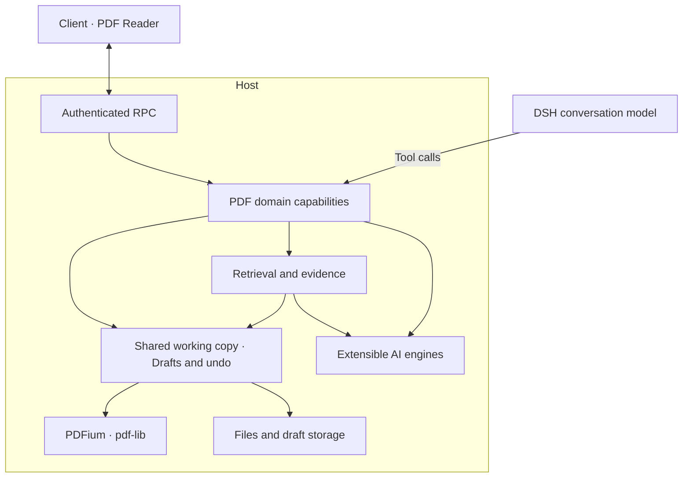

# DSH PDF Reader

English | [中文](README.zh.md)

Read PDFs alongside your [DeepSeek Harness](https://github.com/deepseek-ai/deepseek-harness) conversation. Let the model find relevant passages, annotate them, navigate to the source, and return to your previous reading position.

I read papers and books in PDF form. The readers I tried lacked multi-step back navigation, while AI explanation and translation often required another subscription. I built this plugin for my own DSH workspace.

## Features

- **Read and navigate**: continuous scrolling, zoom, thumbnails, text search, and multi-step back history with selectable destinations.
- **Annotate and bookmark**: highlights, underlines, strikeouts, comments, draggable and resizable notes, and editing of the PDF's built-in bookmark tree.
- **Translate and explain**: word meanings, pronunciation and examples; phrase and sentence translations; questions attached to multiple text passages or image regions, sent together to the current conversation.
- **Agent control**: read, search, annotate, edit bookmarks and fill existing AcroForm fields in the same draft as the user.
- **Save and recover**: undo/redo, draft recovery, save/save as, and source-file conflict detection.
- **OCR and retrieval**: region capture, text recognition and experimental semantic search with your own embedding service. Indexes can include scanned-page text and image descriptions.


## Install

Validated with DSH `0.2.1-rc.5`; other supported versions are declared in [package.json](package.json).

**GUI**: open **Plugins → Add plugin**, enter `@dylanl1/dsh-plugin-pdf`, install, then click **Enable now**.

**CLI**: replace `<profile>` with your profile:

```sh
dsh plugin --profile <profile> add @dylanl1/dsh-plugin-pdf
```

For Desktop, install its bundled CLI through **Manage dsh Command…** in the app menu. Launch Desktop once, fully quit it, install with `--profile desktop`, then reopen it. A separately npm-installed CLI cannot manage Desktop's plugins.

Native components install automatically; no local compilation is needed. Supported platforms: macOS (Apple Silicon/Intel), Windows x64, and glibc Linux (x64/arm64).

Open a local PDF from DSH's file sidebar. AI features use your configured models or extension engines. Semantic retrieval requires a separately configured embedding service and is off by default. Once enabled, it indexes documents in the background when opened; OCR and image descriptions can be enabled independently and may call remote services and incur charges. See [SPEC](SPEC.md) for limits.

## Agent tools

- Documents: `pdf_current`, `pdf_open`, `pdf_close`, `pdf_info`, `pdf_status`.
- Reading: `pdf_page_read`, `pdf_page_render`.
- Search and evidence: `pdf_keyword_search`, `pdf_semantic_search`, `pdf_evidence_read`.
- Annotations: `pdf_annotation_list`, `pdf_annotation_create`, `pdf_annotation_update`, `pdf_annotation_delete`.
- Bookmarks: `pdf_bookmark_list`, `pdf_bookmark_edit`.
- Forms: `pdf_form_inspect`, `pdf_form_fill`.
- Navigation and saving: `pdf_page_jump`, `pdf_save`.
- Images: `ocr_recognize`, `image_understand`.

`pdf_open` opens documents in the background; navigation requires a visible Reader. Agent edits go straight into the draft; overwriting the source still requires user approval. See the [tool documentation](docs/AI_READER_TOOLS.md) for parameters and examples.

## Extend engines

OCR, image understanding, translation and embedding support third-party implementations. Build an independent DSH Host plugin, declare this package as a peer dependency, register your backend with the corresponding service through the public SDK, and install it in the same Host profile. It then appears in PDF settings.

Start with [`http-engines`](examples/http-engines) in [`examples/`](examples/README.md), an independent plugin providing HTTP OCR and image-understanding backends. See [engine extensions](docs/ENGINE_EXTENSIONS.md) for API and lifecycle contracts.

## Architecture



The Reader and agent tools share Host business logic and a working copy within the same resource session; edits synchronize both ways. A native PDFium worker handles rendering and text extraction. See the [architecture](docs/ARCHITECTURE_V2.md).

## Development

```sh
npm ci
npm run native:build
npm run build
```

Checks and tests: `npm run check`, `npm run test:web`, `npm run test:coverage:project`. See also [retrieval configuration and benchmarks](docs/RETRIEVAL_EXPERIMENT.md) and [packaging and releases](docs/RELEASING.md).

## License

[MIT](LICENSE). Published packages include the third-party licenses for their native components and dependencies.
