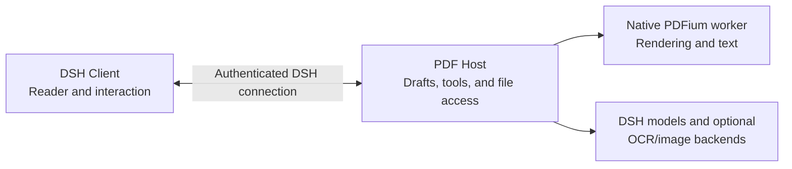

# DSH PDF Reader

English | [中文](README.zh.md)

Read a PDF alongside your [DeepSeek Harness](https://github.com/deepseek-ai/deepseek-harness) conversation. Ask a rough question, find the relevant passage, mark it in the document, and return to where you were reading.

I built this plugin because I often read papers and books in PDF form. The readers I tried were missing small but important conveniences—especially a way back after several jumps—while the ones with AI explanation and translation often required another subscription. This is the reader I wanted for my own DSH workspace.

## What it does

- **Go from a question to the source.** The agent can search unread pages, inspect nearby text, and mark a matching passage. It can move your visible reader when you ask it to; reading tools alone do not interrupt you.
- **Edit one shared draft.** Your highlights, comments, and page notes appear in the same undoable PDF draft as edits made by the agent. An agent-requested overwrite of the original PDF requires your approval.
- **Ask in context.** Select several text passages or a single-page image region, attach a question to each, and send them together to the current conversation.
- **Navigate without losing your place.** Use the PDF outline, personal bookmarks, search results, annotations, and a multi-step back history. Ordinary scrolling does not add history entries.

## Preview

The agent can mark a passage and add a comment directly to the PDF draft:


After several jumps, pick any earlier reading position from the back-history menu:


See also [bookmarks and outline](docs/screenshots/02-bookmarks-and-outline.png) and [notes and annotations](docs/screenshots/03-notes-and-annotations.png).

## Install

This plugin is not published to npm. Download the `dsh-pdf-npm-package-<target>` artifact for your OS and CPU from a successful [GitHub Actions run](https://github.com/dingyiliao/dsh-bundle-pdf/actions) on `main`. Unzip it and install the `.tgz` inside. Available targets are `darwin-arm64`, `darwin-x64`, `linux-arm64`, `linux-x64`, and `win32-x64`. Check [package.json](package.json) for compatible DSH versions.

For an existing Web profile:

```sh
dsh plugin --profile web add /absolute/path/to/package.tgz
dsh web
```

For Desktop, first launch the app to create its `desktop` profile, then quit it completely. Install the app's own CLI using **Manage dsh Command…** in the Desktop menu, and run:

```sh
dsh plugin --profile desktop add /absolute/path/to/package.tgz
```

Reopen Desktop afterward. A separately installed npm `dsh` command does not manage the Desktop profile.

Open an accessible local PDF from DSH's file sidebar to start reading. The plugin uses your configured DSH models and credentials; it does not provide a free model. Image understanding and OCR depend on the selected model or a separately configured backend.

## Architecture



The Client and agent tools use the same Host-side working copy. Reading does not open a new sidebar tab; agent edits update the Reader's unsaved draft, while an agent-requested overwrite is a separate approved action. The native worker handles rendering and text extraction behind the Host boundary.

See the [architecture](docs/ARCHITECTURE_V2.md), [AI reader tools](docs/AI_READER_TOOLS.md), and [specification](SPEC.md) for contracts and implementation status. Some advanced tool interactions still need real Desktop and model-based acceptance testing.

## Development

For a source checkout, run `npm ci`, `npm run native:build`, and `npm run build`, then install the directory with `dsh plugin --profile web add .`. A Git URL installation does not include a prebuilt native worker. Run `npm run check` for type and Node tests, `npm run test:web` for browser interactions, and `npm run test:coverage:project` for project coverage.

Encrypted PDFs are not supported. Text search does not automatically index scanned pages, and a background `pdf_open` tool call does not open a Reader tab. See [SPEC.md](SPEC.md) for the remaining limits.

## License

[MIT](LICENSE). Bundled third-party licenses are listed in `dist/THIRD_PARTY_NOTICES.md` and `dist/native/`.
