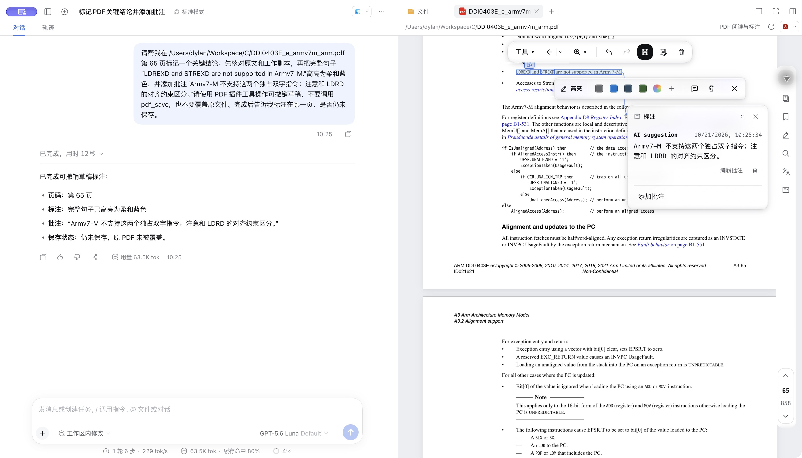
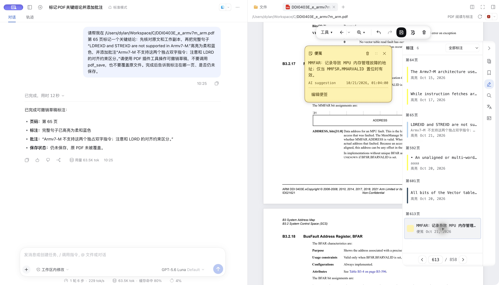
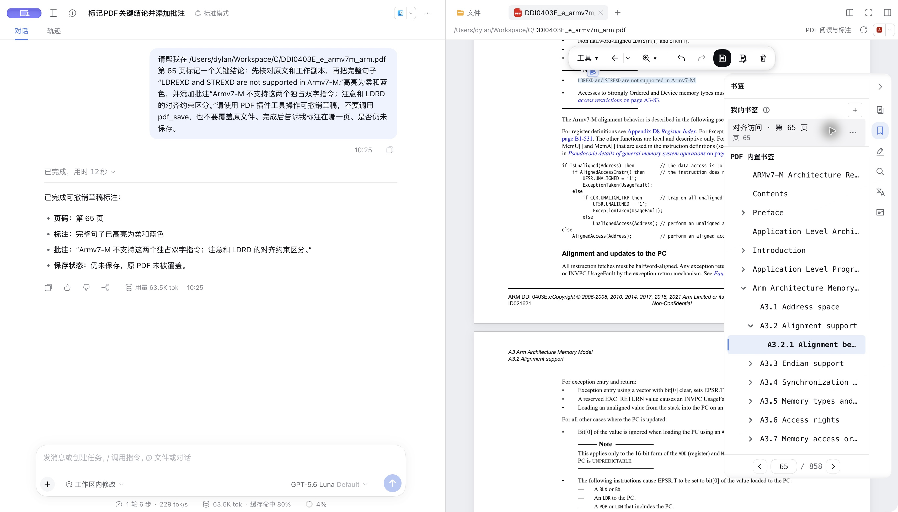
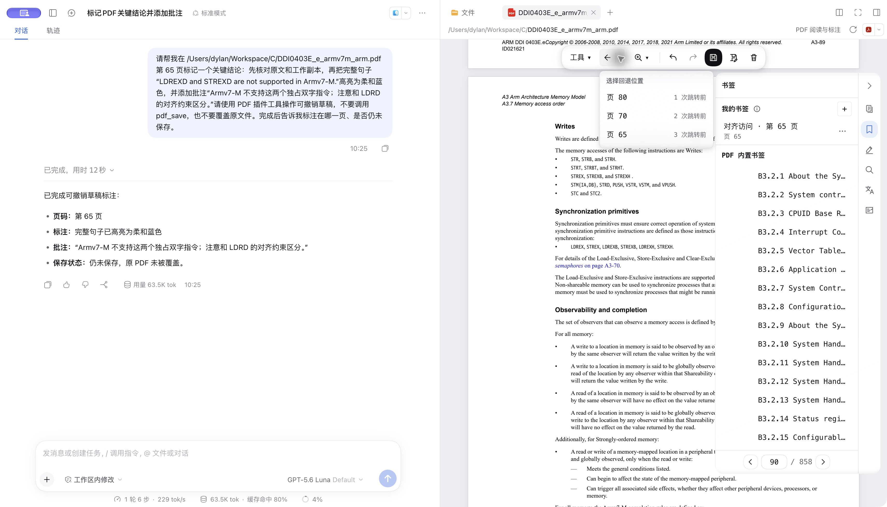
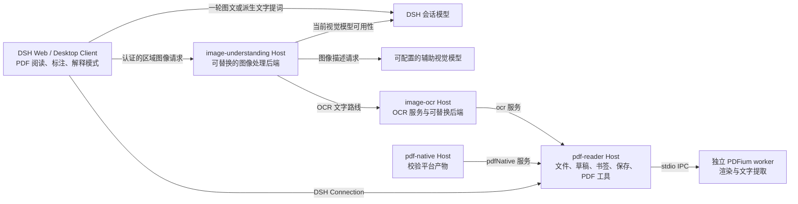

# DSH PDF 阅读器

> 把模糊的问题变成可核验的原文：边读边问，让模型查找相关段落、标记证据，必要时带你跳过去，再从阅读历史返回。

## 背景

我经常用 PDF 阅读论文和资料，但常见阅读器总会缺少一些顺手的功能，例如连续跳转多次后逐级返回原来的阅读位置；具备模型解读、翻译等功能的产品又往往需要额外付费。于是我借助 [DeepSeek Harness（DSH）](https://github.com/deepseek-ai/deepseek-harness) 写了这个自用插件，把 PDF 阅读、标注和 DSH 已有的模型能力放在同一个工作区，按自己的需求继续迭代。

## 为什么用它

- **从问题走到原文。** 例如问“刚才讨论的因果识别，这本书后面有说明吗？找到相关段落，标出来并带我看”。模型可以用同义词或译名分窗检索尚未阅读的页面，补读候选上下文，再按精确原文标注；用户明确要求跳转时，可让当前可见的阅读器跳页并记录回退历史。首版是词项扩展与候选排序，尚非有召回保证的语义索引；扫描页也不自动包含在文字检索中。
- **AI 和你改的是同一份 PDF 草稿。** 让模型按原文定位句子、加高亮与批注，结果会同步出现在阅读器中；你可以继续编辑或撤销。只有覆盖保存原 PDF 时，模型才需要另行取得批准。
- **问题可以直接附着在正在读的内容上。** 解释模式允许为多个文字选段或单页框选区域分别写问题，再一起发给当前会话；模型可以按需读页、搜索和补充上下文，而不是打开文件就把整本书塞进提词。
- **跳得远，也回得来。** 页码、PDF 内置目录、个人书签、搜索结果和标注都能用于定位。多次跳转后，可逐级返回，也可从历史列表直接选择更早的位置；普通滚动不污染回退记录。
- **保留完整的阅读手感。** 高亮可带多条批注；便签独立放在页面上。两者可以在阅读器内查看和编辑，未保存修改留在可恢复的工作草稿里。

## 功能演示

告诉模型要标记哪句话，它在工作草稿中高亮并写批注；右侧阅读器立即看到结果：



高亮批注附着原文，独立便签停在页面上；侧栏集中列出已有标注：



个人书签与 PDF 内置目录并列，随时回到阅读位置：



从第 65 页跳到 70、80、90 页后，不必反复点返回：直接选“第 65 页 · 3 次跳转前”，较新的历史随之移除。



## 使用方法

1. 在 [GitHub Actions](https://github.com/dingyiliao/dsh-bundle-pdf/actions) 选择 `main` 分支上与要安装的源码提交 SHA 一致、且构建成功的 native 工作流。从该运行的 **Artifacts** 下载与你的系统和 CPU 匹配的 `dsh-pdf-npm-package-<target>`：`linux-x64`、`linux-arm64`、`darwin-x64`、`darwin-arm64` 或 `win32-x64`。先解压下载的 ZIP，取出其中的 `.tgz`。目前这些包不在 Releases 中。
2. 将 `.tgz` 安装到要使用的 DSH profile，安装后重启 DSH。例如，已有 Web profile 可以运行：

   ```sh
   dsh plugin --profile web add /absolute/path/to/package.tgz
   dsh web
   ```

   Desktop 用户需先启动一次应用以初始化 `desktop` profile，然后完全退出应用；通过 Desktop 菜单“管理 dsh 命令…”安装其自带的 CLI，再运行 `dsh plugin --profile desktop add /absolute/path/to/package.tgz`，最后重新打开应用。普通 npm 版 `dsh` 命令不能管理 Desktop profile。
3. 在 DSH 的文件栏打开有权访问的本地 PDF。阅读器提供页码与目录跳转、逐级返回、个人书签、文字搜索、标注和选区翻译。解释模式可收集带问题的文字选段或单页框选区域，并作为一轮提词发送到所属会话。文字选段由 Host 重新提取并签发会话限定的证据引用；框选区域发送时通过已鉴权的 `pdf.image` `prepare-reference` 重新校验会话、文档、源文件、附件和摘要，直接图片使用 Host 返回的字节，而不是浏览器暂存的截图。模型还可以在后台打开 PDF 工作副本、读页、搜索、列书签、查询副本状态、定位原文、组装有界上下文，以及按需获取页图像或 OCR 文字；这些读取不会自动打开侧栏标签。`pdf_find_related` 根据问题与模型提供的相关词逐窗给出原文候选，模型需继续扫描、补读并判断含义。`pdf_render_page` 默认仍只向当前视觉模型返回页图；显式指定 `mode: configured-backend` 才使用 profile 选择的图像理解后端，其中 OCR 和辅助视觉路线只返回标注来源与局限的派生文字，不向当前会话返回图片。模型通过 `pdf_annotate` 直接编辑同一份可撤销、未保存草稿，已打开的 Reader 会同步显示；只有 `pdf_save` 覆盖原文件时才请求用户批准。用户要求“带我看”时，`pdf_navigate` 只对本会话已经可见的 Reader 跳页并记录回退历史，不在后台打开新标签。

翻译、解释以及首版 OCR 默认使用当前会话模型与 DSH 已配置的凭据，本插件不提供免费模型。框选解释默认要求当前会话模型明确支持图像输入；也可显式改用 `ocr-text`（只提取文字）或 `auxiliary-vision`（由另一视觉模型描述图像）。辅助路线会额外请求所配置的模型，可能产生费用；当前会话只接收派生描述，不接收原始截图，描述可能遗漏或误读细节。阅读器可按需识别整页或截图区域；内置 SessionLLM OCR 后端也需要视觉模型，仅返回可复制的转写文字，不生成可精确选中或标注的 PDF 文字层。加密 PDF 暂不支持。其他边界见 [SPEC.md](./SPEC.md)；[package.json](./package.json) 的 `peerDependencies` 列出声明兼容的 DSH 版本，当前 CI 使用 `0.2.0-rc.2` 依赖验证。

解释模式在 PDF 设置中提供“总体要求、文字选段、图片区域”三个独立输入框；只填写想调整的部分，留空即使用内置行为，不需要编写占位符。插件始终按顺序组织选段、问题、图片与来源引用，且不会跳过 Host 校验。旧版 `config.explanationPromptTemplate` 仍可在 profile patch 中使用；已有自定义模板会保留，直到用户明确切换到分项提示词。

从源码开发时，在本仓库目录执行 `npm ci && npm run native:build && npm run build`，再用 `dsh plugin --profile web add .` 链接本地目录。直接通过 Git URL 安装源码不会得到原生构建产物。

## 架构



同一个 bundle 通过 [cordis.patch.yml](./cordis.patch.yml) 装入四个 Host 插件。`pdf-reader` 使用 `pdf-native`，并可调用独立的 `ocr` 服务；`image-understanding` 为解释模式的框选图像及模型工具显式请求提供同一后端选择。默认 `session-vision` 路线检查当前会话模型后发送原图；`ocr-text` 只返回带来源与局限说明的识别文字；`auxiliary-vision` 把截图交给显式指定的第二个视觉模型，再将其描述作为派生文字送入当前会话。三条路线不自动互相降级。其他 Host 插件仍可注册自己的 OCR 或图像理解后端，对应的类型契约由 `@local/dsh-pdf/ocr-host` 和 `@local/dsh-pdf/image-host` 导出。图像理解后端通过 profile patch 中 `pdf-image-understanding` 的配置选择；目前没有设置卡片。Client 经 DSH 的认证连接访问 Host，而不是直接调用原生库。Host 负责会话范围内的文件访问、批注写回和 PDF 模型工具；原生 worker 负责 PDF 渲染与文字提取。每个平台的安装包都包含这套 JS 插件及对应平台的 helper 和 PDFium 动态库，安装时不需要 C++ 编译环境。

源码按 `src/entrypoints/`（Cordis 装配）、`src/modules/`（工作副本、证据、模型写入、阅读视图等）、`src/adapters/`（DSH、文件、存储、PDFium/pdf-lib）、`src/contracts/` 和 `src/shared/` 分层。原有 V1 草稿、书签、阅读位置格式保持不变；新增文字证据使用独立、限量且有保留期的存储域。模型与界面写入复用同一工作副本事务。`pdf_read_page`、`pdf_locate`、`pdf_context` 的工具结果有可回放的文字卡片；点击回到当前可见 PDF 时会重新校验来源和引文，这不等于模型已能主动导航。设计与落地状态见 [架构 V2](./docs/ARCHITECTURE_V2.md) 和 [AI 阅读工具](./docs/AI_READER_TOOLS.md)。开发检查使用 `npm run check`，浏览器交互使用 `npm run test:web`，Node＋浏览器＋原生的项目级行覆盖率使用 `npm run test:coverage:project`；是否通过以实际运行报告为准。

例如，仅对指定 profile 使用 OCR 文字路线时，在该 profile 的 `cordis.patch.yml` 中合并以下覆盖项（不要覆盖文件内已有的 patch）：

```yaml
- id: pdf-image-understanding
  config:
    backend: ocr-text
```

此配置只选择图像理解路线；OCR 引擎仍由 `image-ocr` 自己配置。

使用内置辅助视觉路线时，改为以下配置；`provider` 和 `model` 必须是 DSH 已配置且声明支持图像输入的精确标识，`reasoningEffort`、`maxOutputTokens` 可省略：

```yaml
- id: pdf-image-understanding
  config:
    backend: auxiliary-vision
    auxiliaryVision:
      provider: your-provider
      model: your-vision-model
      # reasoningEffort: low
      # maxOutputTokens: 4096
```

这一路线会把框选截图和对应问题发送给该辅助模型；它返回的描述可能遗漏细节或出错，当前会话不会看到原图。若还需要其他路线，Host 插件仍可向 `imageUnderstanding` 注册自定义后端并在 `config.backend` 中选择其 ID。

界面契约（含自定义 UI 组件的现状清单与收敛待办）见 [SPEC.md](./SPEC.md)；已完成与待测的性能口径见 [PERFORMANCE.md](./PERFORMANCE.md)。

## 许可证

本项目代码采用 [MIT License](./LICENSE)。PDFium、pdf-lib、Tesseract.js 等第三方组件遵循各自的许可证；构建包内附有 `dist/THIRD_PARTY_NOTICES.md` 与 `dist/native/` 下的许可文本。
