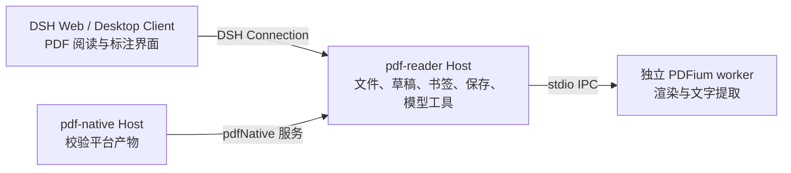

# DSH PDF 阅读器

## 背景

我经常用 PDF 阅读论文和资料，但常见阅读器总会缺少一些顺手的功能，例如连续跳转多次后逐级返回原来的阅读位置；具备模型解读、翻译等功能的产品又往往需要额外付费。于是我借助 [DeepSeek Harness（DSH）](https://github.com/deepseek-ai/deepseek-harness) 写了这个自用插件，把 PDF 阅读、标注和 DSH 已有的模型能力放在同一个工作区，按自己的需求继续迭代。

## 使用方法

1. 在 [GitHub Actions](https://github.com/dingyiliao/dsh-bundle-pdf/actions) 选择 `main` 分支上与要安装的源码提交 SHA 一致、且构建成功的 native 工作流。从该运行的 **Artifacts** 下载与你的系统和 CPU 匹配的 `dsh-pdf-npm-package-<target>`：`linux-x64`、`linux-arm64`、`darwin-x64`、`darwin-arm64` 或 `win32-x64`。先解压下载的 ZIP，取出其中的 `.tgz`。目前这些包不在 Releases 中。
2. 将 `.tgz` 安装到要使用的 DSH profile，安装后重启 DSH。例如，已有 Web profile 可以运行：

   ```sh
   dsh plugin --profile web add /absolute/path/to/package.tgz
   dsh web
   ```

   Desktop 用户需先启动一次应用以初始化 `desktop` profile，然后完全退出应用；通过 Desktop 菜单“管理 dsh 命令…”安装其自带的 CLI，再运行 `dsh plugin --profile desktop add /absolute/path/to/package.tgz`，最后重新打开应用。普通 npm 版 `dsh` 命令不能管理 Desktop profile。
3. 在 DSH 的文件栏打开有权访问的本地 PDF。阅读器提供页码与目录跳转、逐级返回、个人书签、文字搜索、标注和选区翻译。在同一会话中，也可以让模型解释当前页或搜索、读取 PDF 的可提取文字；模型使用 DSH 已配置的提供方和凭据，本插件不提供免费模型。

当前 OCR 尚未开放，加密 PDF 暂不支持；模型工具也不能读取扫描页中的图像文字。其他功能边界见 [SPEC.md](./SPEC.md)；[package.json](./package.json) 的 `peerDependencies` 列出声明兼容的 DSH 版本，当前 CI 仅以 `0.2.0-rc.1` 验证。

从源码开发时，在本仓库目录执行 `npm ci && npm run native:build && npm run build`，再用 `dsh plugin --profile web add .` 链接本地目录。直接通过 Git URL 安装源码不会得到原生构建产物。

## 架构



同一个 bundle 通过 [cordis.patch.yml](./cordis.patch.yml) 装入两个 Host 插件；`pdf-reader` 依赖 `pdf-native` 提供的服务。Client 经 DSH 的认证连接访问 Host，而不是直接调用原生库。Host 负责会话范围内的文件访问、批注写回和只读 PDF 模型工具；原生 worker 负责 PDF 渲染与文字提取。每个平台的安装包都包含这套 JS 插件及对应平台的 helper 和 PDFium 动态库，安装时不需要 C++ 编译环境。

## 许可证

本项目代码采用 [MIT License](./LICENSE)。PDFium、pdf-lib、Tesseract.js 等第三方组件遵循各自的许可证；构建包内附有 `dist/THIRD_PARTY_NOTICES.md` 与 `dist/native/` 下的许可文本。
