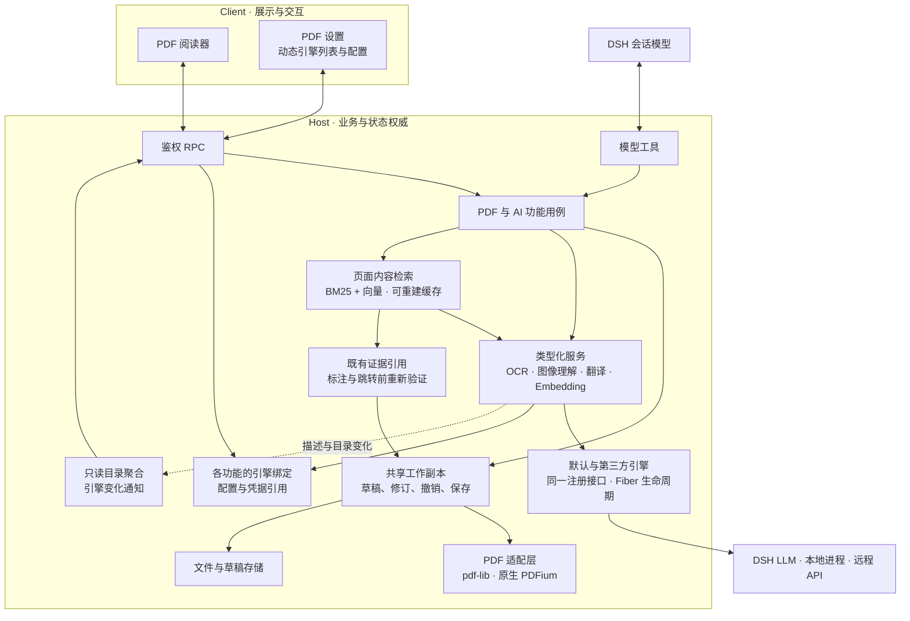
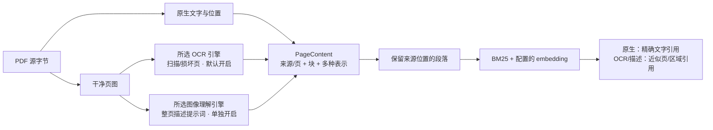

# DSH PDF 阅读器

[English](README.md) | 中文

在 [DeepSeek Harness](https://github.com/deepseek-ai/deepseek-harness) 的会话旁阅读 PDF：提出一个模糊的问题，找到相关原文、标记证据，需要时跳过去，再回到刚才的阅读位置。

我经常用 PDF 阅读论文和书籍。用过的阅读器总缺少一些顺手但重要的功能，尤其是连续跳转后的多级回退；带 AI 解读和翻译的产品又常常需要额外订阅。于是我借助 DSH 做了这个符合自己阅读习惯的插件。

## 能做什么

- **阅读与查找。** 连续滚动、缩放与适应页面、页面缩略图、文字选择和文本搜索。
- **跳转与回退。** 通过页码、链接、书签或标注定位，并从多级回退历史中选择之前的阅读位置。
- **标注与便签。** 高亮、下划线、删除线、批注和可拖动、调整尺寸的页面便签，支持颜色修改与多条评论。
- **编辑内置书签。** 新增、改名、删除、排序和调整父子层级，保存后写入 PDF。
- **填写表单。** 手动填写已有 AcroForm 控件，或让模型检查带编号的控件并逐页填写。
- **保存阅读成果。** 撤销／重做、草稿恢复、保存／另存为及源文件冲突检测。用户和模型共用一份草稿，模型请求保存时需要批准。
- **选区翻译。** 单词提供音标、词性、释义与例句，短语提供多义项和例句，句子及可读片段直接翻译。模型可纠正或补全残缺文字，保留原文、展示修复结果，并标明推测。
- **对着内容提问。** 收集多段文字或单页图像区域，分别附上问题，再一起发送给当前会话。
- **截图与识别。** 复制或下载区域截图，对整页或区域进行 OCR，并使用配置的图像理解后端。
- **让模型操作 PDF。** 补读未读页面、查找相关段落、标记证据、编辑表单与书签，并跳转已显示的阅读器。
- **扩展 AI 引擎。** 通过插件接口注册 OCR、图像理解、翻译和 embedding 实现，在 PDF 设置中选择可用引擎。
- **按含义寻找原文（实验功能）。** 使用配置的 embedding 模型检索同义表达和跨语言段落。后台索引组合原生文字、所选 OCR 引擎识别的扫描／损坏页文字，以及可选的整页图像描述，并保留来源位置。覆盖不足会明确报告；embedding 默认关闭，图像描述需单独开启。

## 提供给模型的工具

当前源码提供以下可组合工具。图像与 OCR 的可用性取决于当前模型及所选后端，导航要求已有可见的阅读器。参数与限制详见[工具契约](docs/AI_READER_TOOLS.md)。

- `pdf_current`：获取当前会话中可见的 PDF 及页码提示。
- `pdf_open`：在后台打开 PDF，取得共享文档引用。
- `pdf_close`：释放模型持有的文档引用，阅读器标签保留各自的引用。
- `pdf_info`：读取文件元信息，不创建持久工作副本引用。
- `pdf_status`：查询修订、未保存修改、冲突及可用能力。
- `pdf_page_read`：读取有界页面文字，并返回可复用证据引用。
- `pdf_keyword_search`：精确或显式归一化文字搜索，返回原文引用。
- `pdf_semantic_search`：查找与问题或概念相关的段落，返回原文引用。
- `pdf_evidence_read`：读取或缩小已有证据，或解析跨页连续文字范围。
- `pdf_page_render`：生成页图和可信图像句柄，不调用 OCR 或识图模型。
- `pdf_form_inspect`：返回填写框内带编号的页图，以及控件类型与选项。
- `pdf_form_fill`：依据检查结果，原子填写单页的共享草稿。
- `pdf_annotation_list`：读取指定页的标注、评论及精确 ID。
- `pdf_annotation_create`：新增高亮、下划线、删除线或便签，支持跨页原文范围。
- `pdf_annotation_update`：修改文字标记的颜色，或标注、便签和评论回复的文本。
- `pdf_annotation_delete`：按 ID 删除可编辑标注或评论回复。
- `pdf_bookmark_list`：读取 PDF 内置书签树及 ID。
- `pdf_bookmark_edit`：新增、改名、删除、排序或调整内置书签层级。
- `pdf_page_jump`：在可见阅读器中跳转到已验证的段落或页面，并保留回退历史。
- `pdf_save`：请求用户批准后，将当前草稿保存到原 PDF。
- `ocr_recognize`：通过配置的 OCR 引擎识别当前会话的图像句柄。
- `image_understand`：通过配置的图像理解后端处理图像句柄。

## 功能预览

模型可以直接在 PDF 草稿中高亮原文并添加批注：


连续跳转后，可以从回退历史中直接选择之前的阅读位置：


另见[书签与目录](docs/screenshots/02-bookmarks-and-outline.png)、[便签与标注](docs/screenshots/03-notes-and-annotations.png)。

## 安装

已验证 DSH `0.2.1-rc.5`。支持的运行时版本在 [package.json](package.json) 中声明，测试 SDK 与浏览器测试宿主固定到已验证版本。

在 DSH 插件管理器中添加 **`@dylanl1/dsh-plugin-pdf`**，安装并启用即可。主包会自动选择对应系统和 CPU 的预构建原生包，无需编译器或安装时构建脚本。支持 `darwin-arm64`、`darwin-x64`、`linux-arm64`、`linux-x64` 和 `win32-x64`；Linux 构建要求 glibc。

也可以使用 CLI，将 `<profile>` 替换为你实际使用的 profile：

```sh
dsh plugin --profile <profile> add @dylanl1/dsh-plugin-pdf
```

Desktop 用户应通过应用菜单中的**管理 dsh 命令…**使用桌面版自带的 CLI。单独通过 npm 安装的 `dsh` 命令不能管理 Desktop profile；安装后若未立即激活，可重新打开或重载 DSH。

如果此前安装过 `@local/dsh-pdf`，切换前先把未保存修改写入 PDF，并备份旧插件存储。启用新包前停用旧 bundle，不要同时启用两者。即使 `pdf-*` patch 行 ID 保持不变，旧包的设置、草稿和阅读位置仍需单独核对迁移情况。

在 DSH 文件栏打开有权访问的本地 PDF，即可开始阅读。插件使用你在 DSH 中配置的模型和凭据，不提供免费模型；图像理解与 OCR 是否可用取决于所选模型或另行配置的后端。

字符映射异常的页面会在本地恢复可选择、可读取的文字层，不上传或改写 PDF。恢复结果是近似 OCR，不等于自动识别所有扫描文档。

## 架构



Client 与模型工具按资源会话和规范路径，共用 Host 侧的一份工作副本。后台打开的 PDF 随后可由阅读器接管，沿用同一文档 ID、草稿与撤销历史，修改双向同步。关闭视图只释放引用，不丢弃草稿；空闲回收保留文档身份，使用时按需恢复资源。读取不会自动打开侧栏标签，模型覆盖原 PDF 仍需单独批准。原生 worker 在 Host 边界之后负责渲染与文字提取。

Host 插件可注册 OCR、图像理解、翻译和 embedding 引擎，设置列表会随注册与卸载自动更新，已卸载的选择仍会保留。任务固定使用启动时的实现与配置，卸载会取消该引擎的在途任务。各服务保留类型化接口，聚合目录不维护另一套执行注册表；语义搜索工具要求可用的 embedding 引擎，不可用时明确报告；关键词搜索独立可用。扩展契约见[引擎扩展](docs/ENGINE_EXTENSIONS.md)。阅读器可选择文字层的字符映射修复仍走本地专用通道；语义索引的扫描页选项则使用所选 OCR 引擎。

图片处理只有两类契约：OCR 返回文字及可选位置；图像理解接受图片和提示词，返回生成的文字。视觉描述索引复用所选图像理解引擎。内置 DSH 图像适配器默认**跟随当前会话**；在 PDF 设置中选择**指定模型**后，从 DSH 按提供商分组的列表中选择视觉模型，无须手填 ID，也不改变聊天模型。向视觉会话直接附图属于解释编排。可运行的[扩展示例](examples/http-engines)及其[契约测试](tests/examples/engine-extensions.test.ts)展示第三方插件的注册、调用与卸载。

`pdf_keyword_search` 和 `pdf_semantic_search` 首次接收文档、查询及选项，返回 `searchId` 和 `hasMore`；继续时只需向同一工具传回该 ID，查询和进度由 Host 保存。相关检索在处理完请求范围后排名，可选预处理失败时覆盖仍不完整。覆盖边界及搜索会话的有效期规则见[工具契约](docs/AI_READER_TOOLS.md)。

书签编辑复用同一套目录领域规则和现有 pdf-lib 保存事务。模型可通过 `pdf_bookmark_list` 获取精确的 `outlineId`，再用 `pdf_bookmark_edit` 提交一组原子的草稿修改。新增目录编辑的真实 Desktop 和外部阅读器验收仍待完成。

接口与实现状态详见[架构文档](docs/ARCHITECTURE_V2.md)、[AI 阅读工具设计](docs/AI_READER_TOOLS.md)和[功能规格](SPEC.md)。部分高级工具交互仍需真实 Desktop 与模型场景验收。

表单检查返回编号页图及本页可写控件的类型、选项和共享字段身份，透明底小编号放在每个控件内。调用模型根据页图理解印刷内容与控件的对应关系；检查工具不会另行调用模型或 OCR。

## 开发

从源码运行时，依次执行 `npm ci`、`npm run native:build`、`npm run build`，再通过 `dsh plugin --profile <profile> add .` 安装本地目录，使用你实际的 profile。源码开发将 worker 暂存到 `dist/native/`；安装发布包时则自动取得匹配的原生依赖。类型与 Node 测试使用 `npm run check`，浏览器交互测试使用 `npm run test:web`，项目级覆盖率使用 `npm run test:coverage:project`。

语义检索使用你自行配置的 **embedding 模型**，与当前会话模型独立。内置的 **Embedding service** 通过兼容 OpenAI 格式的 `/models` 与 `/embeddings` 接口连接本地或第三方服务。在 PDF 设置中配置服务地址、模型名称和向量维度；需要认证时使用 DSH 凭据引用。本机服务支持 HTTP 或 HTTPS，其他地址要求 HTTPS。Qwen3 仅作为默认配置示例，查询指令需按模型要求显式配置。协议要求及其他接入方式见[引擎扩展](docs/ENGINE_EXTENSIONS.md)。

启用语义检索后，通过阅读器或 `pdf_open` 打开 PDF，Host 都会在后台预建内容和向量索引。**文字识别索引**默认开启，在原生文字缺失或编码损坏时调用所选 OCR 引擎；**视觉描述索引**默认关闭，复用同一个所选图像理解引擎，以索引提示词生成文字，并非直接嵌入原始图片。两项可同时开启，不再提供独立的视觉描述引擎设置。缺失的引擎仍保留显示，不会自动切换提供方。描述会增加模型调用、等待时间及可能的费用。这两个选项本身不会启用语义检索。预建不生成查询向量，打开文档不会等待完成，提前搜索仍可能等待剩余进度。所选远程服务可能在首次搜索之前收到页面图像或抽取／派生文字。OCR 成功但未识别出文字是有效空白页结果，不算提取失败。已有可用文字时，可选 OCR 或描述失败不会丢弃这些内容，但覆盖仍标记不完整；须显式重建该文档以重试失败步骤。

`PageContent` 是可复用的页面内容模型：包含源字节与提取身份、精确的原生 UTF-16 偏移、PDF 矩形，以及各自带有生产者和输入摘要的原生文字、OCR 文字及图像描述表示。检索从这些表示生成有界段落，不改写原生文字。图像首版只保留整页 `visual-region`，不自动检测独立插图、表格或公式区域。



原生命中保留精确文字引用，精确标注前仍须重新验证字形；OCR 与描述保留近似的页／区域引用，不能证明原生文字标注的位置。同一 Host 内，已授权会话只有在源字节、范围、预处理身份和 embedding 配置匹配时才共享可复用索引及构建；权限、草稿、查询、续读句柄和证据引用仍按会话隔离，共享派生内容不授予文件访问权。

在**搜索**面板中可手动建立或重建当前 PDF 的语义索引。重建会重新读取该文档并计算向量，不清空其他文档的索引。任务面板展示文件名、页面读取和分段进度：运行中可**取消**，失败后可**重建索引**，完成后可点击**完成**关闭通知。关闭通知不删除已就绪索引，后续新任务仍会出现。取消只停止本会话的预建，不打断同一构建的其他订阅者；来源、配置变化或重新打开可恢复预建。索引和持久缓存均有预算，可能被淘汰。

缓存标识由内部管理。OCR／图像扩展可以提供稳定的 `cacheIdentity` 以跨重启复用结果；未提供时，派生缓存按会话和引擎注册期隔离。来源、实际干净页图、生产者／模型／配置和 embedding 身份共同区分可复用结果。服务在身份不变时更换同名模型后，可在 PDF 设置中点击**重建索引**：先停止后台预建，再清除当前 profile 的检索缓存并使旧搜索失效；启用状态下，仍打开的文档会重新后台预建，其他文档在下次打开或搜索时建立索引。PDF 和草稿保持不变。

MLX/Qwen3 的启动示例、所需依赖及基准测试命令见[实验配置及实测记录](docs/RETRIEVAL_EXPERIMENT.md)。语义检索属于实验功能，默认关闭；具体可用性以安装的构建或发布版本为准。OCR 与图像描述是派生解释，可能遗漏或误读图表／公式细节；来源坐标不代表已识别出结构化版面。

普通 AcroForm 字段可由用户或模型填写。检查工具将小编号放在填写框内，页图不绘制控件外观和批注；当前草稿值通过 `includeValues:true` 元数据读取，不能从空白图判断字段状态。填写只传单个检查 ID 和编号／值，Host 恢复页号，原子更新该页的共享可撤销草稿。可先批量检查多页，再分别填写独立页；共享字段或声明的依赖冲突时仍需重新检查。模型可显式提供条件和互斥选项检查；Host 校验这些传入规则及字段类型，不推断业务含义。检查页图要求视觉模型，模型覆盖保存仍需单独批准。不会执行 PDF 脚本或动作。签名 PDF 仍只读预览，且不验证签名真伪；XFA 与加密 PDF 不支持。关键词搜索保留原生文字策略，扫描页识别属于所配置的语义索引。Host 后台调用 `pdf_open` 不会打开阅读器标签。其他边界见 [SPEC.md](SPEC.md)。

草稿仍使用 `format: 1`，但旧二进制不理解新增的目录操作或按 ID 定位的表单操作。降级前须先保存或丢弃表单及目录草稿，并备份 PDF 与插件存储；不能把格式号未变理解为新操作可由旧二进制回读。

## 许可证

[MIT](LICENSE)。主包包含 `dist/THIRD_PARTY_NOTICES.md`，各平台原生包在二进制文件旁附带对应的第三方许可文本。
