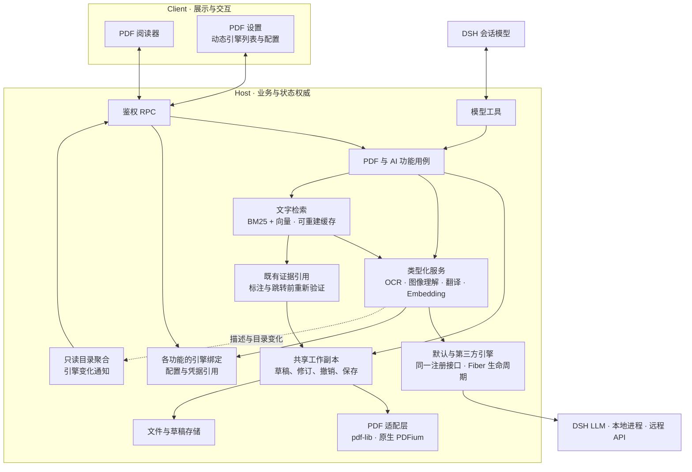

# DSH PDF 阅读器

[English](README.md) | 中文

在 [DeepSeek Harness](https://github.com/deepseek-ai/deepseek-harness) 的会话旁阅读 PDF：提出一个模糊的问题，找到相关原文、标记证据，需要时跳过去，再回到刚才的阅读位置。

我经常用 PDF 阅读论文和书籍。用过的阅读器总缺少一些顺手但重要的功能，尤其是连续跳转后的多级回退；带 AI 解读和翻译的产品又常常需要额外订阅。于是我借助 DSH 做了这个符合自己阅读习惯的插件。

## 能做什么

- **从问题回到原文。** 模型可以搜索尚未读到的页面、补读上下文并标记相关段落。只有你要求“带我看”时，它才会移动当前可见的阅读器；普通读取不会打断阅读。
- **共用一份草稿。** 你和模型添加的高亮、批注、页面便签都进入同一份可撤销的 PDF 草稿。模型请求覆盖原文件时，需要你单独批准。
- **对着内容提问。** 可以分别选中多段文字或单页图像区域，为每一项写问题，再一起发送给当前会话。
- **跳得远，也回得来。** PDF 目录、搜索结果和标注都能用来定位；多级回退可直接选择更早的位置，普通滚动不占用历史。
- **编辑 PDF 书签。** 可以新增、重命名、删除整棵子树、修改目标页、调整顺序或层级；修改进入同一份可撤销草稿，保存后写入 PDF。
- **按含义寻找原文（实验分支）。** 结合关键词与本地 embedding，检索同义表达和跨语言段落。结果保留原文引用，索引尚未完成及图片页未覆盖都会明确报告；embedding 默认关闭。

## 功能预览

模型可以直接在 PDF 草稿中高亮原文并添加批注：


连续跳转后，可以从回退历史中直接选择之前的阅读位置：


另见[书签与目录](docs/screenshots/02-bookmarks-and-outline.png)、[便签与标注](docs/screenshots/03-notes-and-annotations.png)。

## 安装

已验证 DSH `0.2.1-rc.3`。支持的运行时版本在 [package.json](package.json) 中声明，测试 SDK 与浏览器测试宿主固定到已验证版本。

插件暂未发布到 npm。请从 `main` 分支构建成功的 [GitHub Actions](https://github.com/dingyiliao/dsh-bundle-pdf/actions) 运行中，下载与你的系统及 CPU 对应的 `dsh-pdf-npm-package-<target>` 产物，解压 ZIP 后安装其中的 `.tgz`。支持 `darwin-arm64`、`darwin-x64`、`linux-arm64`、`linux-x64` 和 `win32-x64`。兼容的 DSH 版本见 [package.json](package.json)。

已有 Web profile 可运行：

```sh
dsh plugin --profile web add /absolute/path/to/package.tgz
dsh web
```

Desktop 用户先启动一次应用以创建 `desktop` profile，再完全退出。通过应用菜单中的**管理 dsh 命令…**安装桌面版自带的 CLI，然后运行：

```sh
dsh plugin --profile desktop add /absolute/path/to/package.tgz
```

之后重新打开 Desktop。单独通过 npm 安装的 `dsh` 命令不能管理 Desktop profile。

在 DSH 文件栏打开有权访问的本地 PDF，即可开始阅读。插件使用你在 DSH 中配置的模型和凭据，不提供免费模型；图像理解与 OCR 是否可用取决于所选模型或另行配置的后端。

字符映射异常的页面会在本地恢复可选择、可读取的文字层，不上传或改写 PDF。恢复结果是近似 OCR，不等于自动识别所有扫描文档。

## 架构



Client 与模型工具按资源会话和规范路径，共用 Host 侧的一份工作副本。后台打开的 PDF 随后可由阅读器接管，沿用同一文档 ID、草稿与撤销历史，修改双向同步。关闭视图只释放引用，不丢弃草稿；空闲回收保留文档身份，使用时按需恢复资源。读取不会自动打开侧栏标签，模型覆盖原 PDF 仍需单独批准。原生 worker 在 Host 边界之后负责渲染与文字提取。

Host 插件可注册 OCR、图像理解、翻译和 embedding 引擎，设置列表会随注册与卸载自动更新，已卸载的选择仍会保留。任务固定使用启动时的实现与配置，卸载会取消该引擎的在途任务。各服务保留类型化接口，聚合目录不维护另一套执行注册表；只有检索的显式 `auto` 模式会报告词法回退。扩展契约见[引擎扩展](docs/ENGINE_EXTENSIONS.md)。字符映射自动修复仍走本地专用通道，不会因选择远程 OCR 而上传页面。

`pdf_search` 和 `pdf_find_related` 首次接收文档、查询及选项，返回 `searchId` 和 `hasMore`；继续时只需向同一工具传回该 ID，查询和进度由 Host 保存。相关检索仅在所请求范围完成索引后返回排名。覆盖边界及搜索会话的有效期规则见[工具契约](docs/AI_READER_TOOLS.md)。

书签编辑复用同一套目录领域规则和现有 pdf-lib 保存事务。模型可通过 `pdf_bookmarks` 获取精确的 `outlineId`，再用 `pdf_outline_edit` 提交一组原子的草稿修改。新增目录编辑的真实 Desktop 和外部阅读器验收仍待完成。

接口与实现状态详见[架构文档](docs/ARCHITECTURE_V2.md)、[AI 阅读工具设计](docs/AI_READER_TOOLS.md)和[功能规格](SPEC.md)。部分高级工具交互仍需真实 Desktop 与模型场景验收。

表单检查返回编号页图及本页可写控件的类型、选项和位置，透明底小编号放在每个控件内。调用模型根据页图理解印刷内容与控件的对应关系；检查工具不会另行调用模型或 OCR。

## 开发

从源码运行时，依次执行 `npm ci`、`npm run native:build`、`npm run build`，再通过 `dsh plugin --profile web add .` 安装本地目录。直接用 Git URL 安装不会得到预构建的原生 worker。类型与 Node 测试使用 `npm run check`，浏览器交互测试使用 `npm run test:web`，项目级覆盖率使用 `npm run test:coverage:project`。

在 `feat/pdf-hybrid-retrieval` 分支，可复用已有的 Apple Silicon MLX 环境和已缓存的 Qwen3 embedding 模型：

```sh
/absolute/path/to/mlx-lm-local-demo/.venv/bin/python scripts/local-embedding-server.py --port 8001
```

随后在 PDF 设置中选择 **Local Qwen3 embedding**。启动器只启动 embedding 服务，不下载模型，作为独立进程手动管理；所需缓存模型与依赖见[实验配置及实测记录](docs/RETRIEVAL_EXPERIMENT.md)。`npm run bench:retrieval` 可运行无需模型的基线，文档也提供真实模型测试命令。此功能属于实验分支，不表示 `main` 已发布产物包含语义检索；图片、图表和公式版面不在文字索引的覆盖范围内。

普通 AcroForm 字段可由用户或模型填写。检查工具将小编号放在填写框内，页图不绘制控件外观和批注；当前草稿值通过 `includeValues:true` 元数据读取，不能从空白图判断字段状态。填写只传单个检查 ID 和编号／值，Host 恢复页号，原子更新该页的共享可撤销草稿。可先批量检查多页，再分别填写独立页；共享字段或声明的依赖冲突时仍需重新检查。模型可显式提供条件和互斥选项检查；Host 校验这些传入规则及字段类型，不推断业务含义。检查页图要求视觉模型，模型覆盖保存仍需单独批准。不会执行 PDF 脚本或动作。签名 PDF 仍只读预览，且不验证签名真伪；XFA 与加密 PDF 不支持。文字搜索不会自动索引扫描页，Host 后台调用 `pdf_open` 也不会打开阅读器标签。其他边界见 [SPEC.md](SPEC.md)。

草稿仍使用 `format: 1`，但旧二进制不理解新增的目录操作或按 ID 定位的表单操作。降级前须先保存或丢弃表单及目录草稿，并备份 PDF 与插件存储；不能把格式号未变理解为新操作可由旧二进制回读。

## 许可证

[MIT](LICENSE)。打包的第三方许可文本见 `dist/THIRD_PARTY_NOTICES.md` 和 `dist/native/`。
