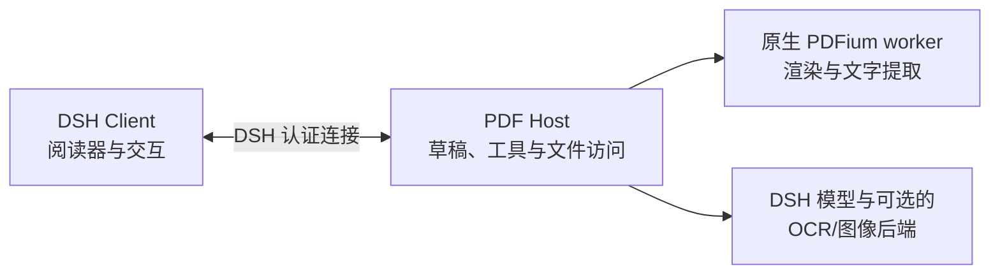

# DSH PDF 阅读器

[English](README.md) | 中文

在 [DeepSeek Harness](https://github.com/deepseek-ai/deepseek-harness) 的会话旁阅读 PDF：提出一个模糊的问题，找到相关原文、标记证据，需要时跳过去，再回到刚才的阅读位置。

我经常用 PDF 阅读论文和书籍。用过的阅读器总缺少一些顺手但重要的功能，尤其是连续跳转后的多级回退；带 AI 解读和翻译的产品又常常需要额外订阅。于是我借助 DSH 做了这个符合自己阅读习惯的插件。

## 能做什么

- **从问题回到原文。** 模型可以搜索尚未读到的页面、补读上下文并标记相关段落。只有你要求“带我看”时，它才会移动当前可见的阅读器；普通读取不会打断阅读。
- **共用一份草稿。** 你和模型添加的高亮、批注、页面便签都进入同一份可撤销的 PDF 草稿。模型请求覆盖原文件时，需要你单独批准。
- **对着内容提问。** 可以分别选中多段文字或单页图像区域，为每一项写问题，再一起发送给当前会话。
- **跳得远，也回得来。** PDF 内置目录、个人书签、搜索结果和标注都能用来定位；多级回退可直接选择更早的位置，普通滚动不占用历史。

## 功能预览

模型可以直接在 PDF 草稿中高亮原文并添加批注：


连续跳转后，可以从回退历史中直接选择之前的阅读位置：


另见[书签与目录](docs/screenshots/02-bookmarks-and-outline.png)、[便签与标注](docs/screenshots/03-notes-and-annotations.png)。

## 安装

插件暂未发布到 npm。请从 `main` 分支构建成功的 [GitHub Actions](https://github.com/dingyiliao/dsh-bundle-pdf/actions) 运行中，下载与你的系统及 CPU 对应的 `dsh-pdf-npm-package-<target>` 产物，解压 ZIP 后安装其中的 `.tgz`。支持 `darwin-arm64`、`darwin-x64`、`linux-arm64`、`linux-x64` 和 `win32-x64`。兼容的 DSH 版本见 [package.json](package.json)。

已有 Web profile 可运行：

```sh
dsh plugin --profile web add /absolute/path/to/package.tgz
dsh web
```

Desktop 用户先启动一次应用以创建 `desktop` profile，再完全退出。通过应用菜单中的**管理 dsh 命令…**安装桌面版自带的 CLI，然后运行：

```sh
dsh plugin --profile desktop add /absolute/path/to/package.tgz
```

之后重新打开 Desktop。单独通过 npm 安装的 `dsh` 命令不能管理 Desktop profile。

在 DSH 文件栏打开有权访问的本地 PDF，即可开始阅读。插件使用你在 DSH 中配置的模型和凭据，不提供免费模型；图像理解与 OCR 是否可用取决于所选模型或另行配置的后端。

## 架构



Client 与模型工具使用 Host 侧的同一份工作副本。读取不会自动打开新的侧栏标签；模型修改会更新阅读器中的未保存草稿，模型请求覆盖原 PDF 时则需要单独批准。原生 worker 在 Host 边界之后负责渲染与文字提取。

接口与实现状态详见[架构文档](docs/ARCHITECTURE_V2.md)、[AI 阅读工具设计](docs/AI_READER_TOOLS.md)和[功能规格](SPEC.md)。部分高级工具交互仍需真实 Desktop 与模型场景验收。

## 开发

从源码运行时，依次执行 `npm ci`、`npm run native:build`、`npm run build`，再通过 `dsh plugin --profile web add .` 安装本地目录。直接用 Git URL 安装不会得到预构建的原生 worker。类型与 Node 测试使用 `npm run check`，浏览器交互测试使用 `npm run test:web`，项目级覆盖率使用 `npm run test:coverage:project`。

暂不支持加密 PDF。文字搜索不会自动索引扫描页，Host 后台调用 `pdf_open` 也不会打开阅读器标签。其他边界见 [SPEC.md](SPEC.md)。

## 许可证

[MIT](LICENSE)。打包的第三方许可文本见 `dist/THIRD_PARTY_NOTICES.md` 和 `dist/native/`。
