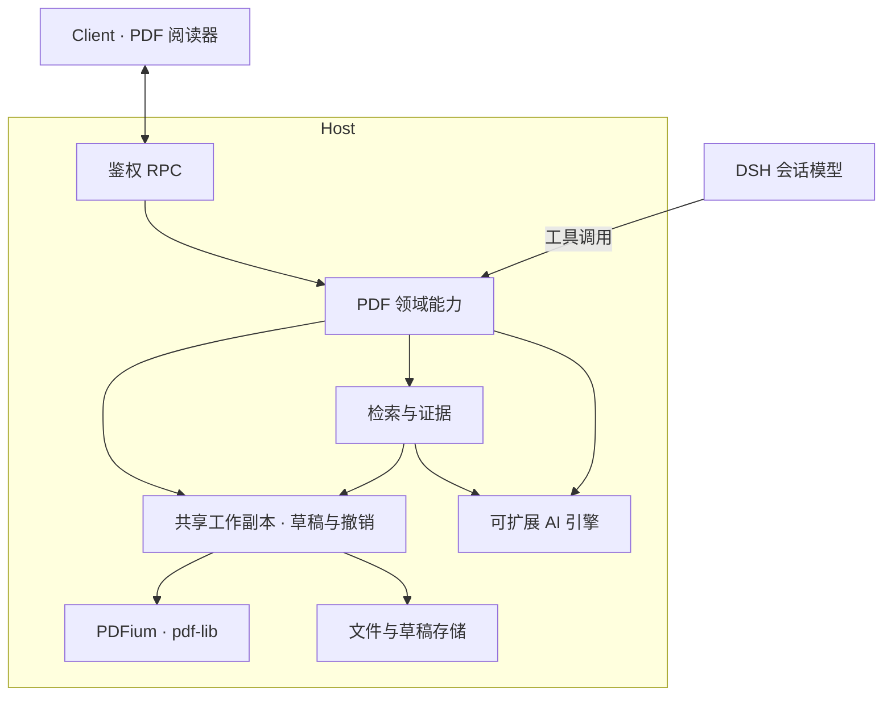

# DSH PDF 阅读器

[English](README.md) | 中文

在 [DeepSeek Harness](https://github.com/deepseek-ai/deepseek-harness) 中一边对话，一边阅读 PDF。让模型查找相关原文、添加标注、跳转定位，再回到之前的阅读位置。

我常用 PDF 读论文和书。常用阅读器缺少多级回退，带 AI 解读和翻译的产品又常需额外订阅，于是借助 DSH 写了这个插件。

## 功能

- **阅读与导航**：连续滚动、缩放、缩略图、文字搜索，以及可选择历史位置的多级回退。
- **标注与书签**：高亮、下划线、删除线、批注、可拖动和调整尺寸的便签；编辑 PDF 内置书签及其层级。
- **翻译与解释**：单词释义、音标和例句；短语与句子翻译；收集多段文字或图像区域，分别提问后发送给当前会话。
- **模型操作**：读页、检索、标注、编辑书签和填写已有 AcroForm 表单，与用户共用草稿。
- **保存与恢复**：撤销／重做、草稿恢复、保存／另存为和源文件冲突检测。
- **OCR 与检索**：区域截图、文字识别，以及基于自配 embedding 模型的语义搜索（实验功能）。索引可加入扫描页文字和图像描述。


## 安装

已验证 DSH `0.2.1-rc.5`，其他支持版本见 [package.json](package.json)。

**GUI**：打开 **插件 → 添加插件**，输入 `@dylanl1/dsh-plugin-pdf`，安装后点击 **立即启用**。

**CLI**：将 `<profile>` 替换为所用 profile：

```sh
dsh plugin --profile <profile> add @dylanl1/dsh-plugin-pdf
```

Desktop 用户需通过应用菜单的 **管理 dsh 命令…** 安装自带 CLI。先启动一次 Desktop，再完全退出，以 `--profile desktop` 安装后重新打开；单独通过 npm 安装的 CLI 不能管理桌面版插件。

安装包自动匹配原生组件，无需本地编译。支持 macOS（Apple Silicon／Intel）、Windows x64 和 Linux glibc（x64／arm64）。

安装后从 DSH 文件栏打开本地 PDF。AI 功能使用已配置的模型或扩展引擎；语义检索需单独配置 embedding 服务，默认关闭。文档的生效策略启用后，打开时会后台建立索引；OCR 与图像描述可分别开启，可能调用远程服务并产生费用。更多限制见 [SPEC](SPEC.md)。

设置自动保存。每份 PDF 可在**搜索 → 当前 PDF 索引**中选择引擎与索引方式；由你决定何时更新，已有结果会尽量复用，关闭语义检索则立即生效。全局设置管理引擎连接和新文档的默认值。

## 模型工具

- 文档：`pdf_current`、`pdf_open`、`pdf_close`、`pdf_info`、`pdf_status`。
- 阅读：`pdf_page_read`、`pdf_page_render`。
- 检索与证据：`pdf_keyword_search`、`pdf_semantic_search`、`pdf_evidence_read`。
- 标注：`pdf_annotation_list`、`pdf_annotation_create`、`pdf_annotation_update`、`pdf_annotation_delete`。
- 书签：`pdf_bookmark_list`、`pdf_bookmark_edit`。
- 表单：`pdf_form_inspect`、`pdf_form_fill`。
- 导航与保存：`pdf_page_jump`、`pdf_save`。
- 图像：`ocr_recognize`、`image_understand`。

`pdf_open` 只在后台打开文档；跳转需要阅读器已显示。模型编辑直接写入草稿，覆盖保存原文件仍需用户确认。参数和示例见[工具文档](docs/AI_READER_TOOLS.md)。

## 扩展引擎

OCR、图像理解、翻译和 embedding 均支持第三方实现。将扩展写成独立的 DSH Host 插件，在 `peerDependencies` 中声明本包，通过公开 SDK 向对应服务注册后端，并安装到相同 Host profile，即可在 PDF 设置中选择。

参考 [`examples/`](examples/README.md) 中的 [`http-engines`](examples/http-engines)：一个提供 HTTP OCR 和图像理解后端的独立插件。接口与生命周期约定见[引擎扩展](docs/ENGINE_EXTENSIONS.md)。

## 架构



阅读器与模型工具共用 Host 业务能力和同一资源会话内的工作副本，修改双向同步。原生 PDFium worker 负责渲染和文字提取。详见[架构文档](docs/ARCHITECTURE_V2.md)。

## 开发

```sh
npm ci
npm run native:build
npm run build
```

检查与测试：`npm run check`、`npm run test:web`、`npm run test:coverage:project`。另见[语义检索配置与基准测试](docs/RETRIEVAL_EXPERIMENT.md)、[打包与发布](docs/RELEASING.md)。

## 许可证

[MIT](LICENSE)。发布包附带所用原生组件及依赖的第三方许可证。
