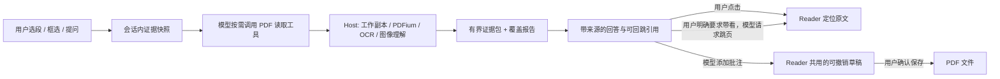

# 面向 AI 阅读的 PDF 工具设计

> 状态：第一阶段只读工具 `pdf_status`、`pdf_locate`、`pdf_context`、会话范围的文字/图像来源引用、有界结果元数据与三个文字工具卡已接入；`pdf_image_context` 可重验页图、OCR 或辅助视觉引用。第二阶段的标注新增/修改/删除直接写入可撤销草稿，个人书签支持新增/重命名/删除，`pdf_save` 经交互批准后才覆盖原 PDF。解释模式的区域图像与文字选区均由 Host 重验并签发引用，区域发送前再经 `pdf.image` `prepare-reference` 重验。新增 `pdf_find_related` 以有界词项扩展提供候选，`pdf_navigate` 可请求当前可见 Reader 的历史感知跳页；两者仍待真实 Desktop 交互验收，也不等于完整语义索引或答案内联引用。本文既记录已落地契约，也保留尚未实现的目标；示例中的目标结构不等于当前 TypeScript API。

## 产品判断

这个插件的目标不是让 Agent 执行尽可能多的 PDF 操作，而是让人和模型**读同一份材料**：选中一段或一块图像提问，模型按需补读，回答能回到实际原文；模型标注直接进入与用户共用、可撤销的未保存草稿，最后显式保存。

“正确”首先意味着可检查。模型应能说清它读了哪些页、哪些页没有文字层、图像究竟是它直接看见、OCR 转写，还是另一模型描述；找不到证据时不得把推断包装成 PDF 原文。阅读工具不移动用户视图，也不把整份 PDF 因为打开了就塞进会话。

值得打磨的独特体验是：同一次解释模式中把多段文字、图表区域和各自的问题一起提交；模型围绕这些证据补读，并在答案旁给出“点一下回到这句/这块图”的入口。模型可以像用户一样添加页内批注；模型创建的批注保留作者标记，编辑后立即在 Reader 可见、可撤销，但覆盖保存原 PDF 仍需用户确认。翻译、总结、对比、解释仍由会话模型完成，不另外注册 `pdf_translate`、`pdf_summarize` 或 `pdf_chat`；工具只提供来源明确的材料和确定性的动作。



## 与现有实现的关系

Host 的基础读取工具包括 `pdf_open`、`pdf_close`、`pdf_current`、`pdf_read_page`、`pdf_search`、`pdf_page_annotations`、`pdf_bookmarks`、`pdf_render_page`、`pdf_ocr_page`；下表列出其余已接入工具。这些是 DSH 的模型工具，不是已经对外发布的 MCP server。独立 OCR 插件另有 `ocr_recognize`。本文**保留名称及已有语义**，通过新增可选字段/结果与少量新工具演进，不把 `pdf_bookmarks` 换名为另一个 `pdf_outline`。

| 阶段 | 接口 | 作用与边界 |
| --- | --- | --- |
| 现有 | `pdf_current`、`pdf_open`、`pdf_close` | 前者只列**本会话 UI 正在显示**的 PDF；后两者管理 Host 后台工作副本，不打开/关闭侧栏标签。模型必须使用明确的 `documentId`。 |
| 现有 | `pdf_read_page`、`pdf_search`、`pdf_bookmarks`、`pdf_page_annotations` | 精确读页和检索、列目录/个人书签、列包含草稿的页标注。当前搜索只查大小写敏感的原生文字，不搜 OCR；标注覆盖文字是几何推断，不能当精确原文。 |
| 现有 | `pdf_render_page`、`pdf_ocr_page` | 有界整页图像或文字；图片能否直达当前模型由视觉能力决定。OCR 和辅助视觉结果是派生文字，不能宣称当前模型看过原图。现有页图不合成未保存的草稿覆盖层。 |
| 第一阶段已实现 | `pdf_status`、`pdf_locate`、`pdf_context` | 查询**已打开**工作副本状态、在有界页窗内定位引文、打包有界文字上下文；版本化游标和会话限定的持久文字引用。`pdf_status` 只是观察时快照，非实时文件重验。 |
| 首版已接入，待真实模型验收 | `pdf_find_related` | 模型可提供同义词/译名等扩展词，逐次扫描最多 50 个物理页，在已提取文字中排序并返回精确摘录、来源引用和已扫描范围。分数只供当前页窗排序，不是语义相关概率；必须续扫、补读、由模型判断相关性。无文字层的扫描页需另走 OCR/视觉工具。 |
| 第一阶段已接入 | `pdf_image_context`、读工具来源元数据与工具卡 | `pdf_render_page`、`pdf_ocr_page` 返回 `refId`；新工具在同一 Agent 会话和已授权工作副本中重验源字节、版本及附件，直送图像仍要求当前模型支持图像。`pdf_read_page`、`pdf_render_page`、`pdf_ocr_page` 写入有界 `tool/result.meta`；Client 为 `pdf_read_page`、`pdf_locate`、`pdf_context` 注册可回放卡。尚无图像工具卡或答案正文引用。 |
| 第一阶段已接入，待真实 Desktop 验收 | `pdf.region`、`pdf.selection`、`pdf.image` `prepare-reference`（Client↔Host RPC） | 解释模式的单页框选区域由 Host 根据已授权工作副本绘制 PNG、核对附件字节并生成 `pdf-region` 引用；文字选段由 Host 按 PDFium 字形位置重新提取、核对整页文字并签发引用。发送区域图像时，Client 用 `prepare-reference` 让 Host 再核对会话、文档、源文件、附件和摘要，直送图片只使用 Host 返回的字节，不使用 Client 暂存 Blob。它们都不是模型导航工具。 |
| 第二阶段已实现 | `pdf_annotate`、`pdf_annotation_update`、`pdf_annotation_delete`、`pdf_save` | 新增、修改颜色/评论、删除可编辑标注均直接进入 Reader 共用的可撤销草稿；修改/删除须使用 `pdf_page_annotations` 的精确 ID 与当前修订。只有覆盖保存原 PDF 时才要求交互批准。 |
| 第二阶段已实现 | `pdf_bookmark_add`、`pdf_bookmark_rename`、`pdf_bookmark_remove` | 操作 Reader 独立保存的个人书签，不改动 PDF 字节；可按页或现有标注定位。嵌入式 PDF 目录只读；删除个人书签不可由草稿撤销，因此需要交互确认。 |
| 首版已接入，待真实 Desktop 验收 | `pdf_navigate`、`pdf.navigation` | 仅在用户要求“带我看”时，请求本会话已可见的 Reader 跳到已确认的物理页。Host 通过活动阅读 lease 向 Client 递送请求；Client 使用已有的 `jump()` 记录回退历史并回报成功/失败。不打开侧栏标签；同一 PDF 多个 Reader 须指定 `tabId`。首版只跳页，不精确滚动到字形或批注。 |

先不暴露 `pdf_read_section`、`pdf_structure`、`pdf_tables`、`pdf_fill_form`、`pdf_sign`、`pdf_redact` 等名字。当前没有可靠的结构/表格元素模型；原生层甚至拒绝表单、签名和加密 PDF。为这些名字返回排版猜测或伪造 `element_id`，会破坏阅读器最有价值的可信度。未来确有可靠提取器与评测数据时再引入，不把创建、脱敏、签名、格式转换视为 AI 阅读器上线门槛。

## 共同契约：证据与能力边界

以下是覆盖文字和图像的**目标统一结构**，不是当前单一、完整导出的 TypeScript 类型。现有 `src/modules/evidence/reference-store.ts` 分别持久化 `pdf-text`、`direct-image`、`ocr-text`、`auxiliary-vision` 引用：图像记录只存附件句柄、来源和尺寸/摘要等元数据，不在证据域复制 PNG；OCR/辅助视觉记录只存有界派生文字及其来源。解释模式区域图像可产生 `pdf-region` 定位的 `direct-image` 引用，文字选区经 `pdf.selection` 生成 `text-window` 引用；两者都绑定会话、工作副本、源文件/内容版本与修订。缺失几何时降级说明，绝不编造：

```ts
type PdfEvidence = {
  refId: string                  // 本会话内引用句柄；有快照，不能仅指向易变缓存
  documentId: string             // 当前工作副本句柄，不作为跨重启的永久 ID
  sourcePath: string             // 重新获得访问权限后用于重开；文件可能已移动
  sourceDigest: string           // 源 PDF 字节 SHA-256；现有内部 sourceHash 可复用
  sourceVersion: string          // 文件系统版本，不是内容摘要
  contentVersion: string         // 当前工作副本的页面内容身份，不是永久哈希
  revision: number               // 工作副本修订；写入并发检查另行使用
  page: number                   // 物理页，从 1 开始，不是 PDF 显示页标签
  source: 'pdf-text' | 'ocr-text' | 'auxiliary-vision' | 'direct-image' | 'annotation'
  snapshot: { text?: string; imageRef?: string; sha256: string }
  locator:
    | { kind: 'text-window'; startUtf16: number; endUtf16: number; rectsPdf?: number[][] }
    | { kind: 'pdf-region'; rectPdf: [number, number, number, number] }
    | { kind: 'page-only' }
  precision: 'exact-text' | 'approximate-geometry' | 'page-only'
  limitations?: string[]
}
```

`sha256` 只校验已发送快照，不代表 PDF 中有永久元素 ID。字符偏移对应插件拼接后的页文本，按 UTF-16 计；它目前**不能直接**映射回 PDFium 字符索引，因为拼接过程可能插入空格。多行选区以后应用多个 PDF 四边形/矩形，而不是强塞进一个 bbox。PDF 坐标为未旋转页面的 user space，必须同时核对页面 crop/rotation；OCR 现有坐标是渲染图像像素，未完成换算前只能给页级定位或 `null`。

`refId` 只在所属会话有效。文字与图像来源记录共用独立的 `pdf_evidence_${suffix}` Storage Domain，写入时按最多 256 条、最长 30 天清理；这不是永久归档，也没有依据 `session/disposed` 删除记录，因为该事件也会在运行时 detach/HMR 时发生，并不代表会话日志已删除。重新打开同一路径 PDF 后，Host 的 `pdf_context` 文字引用路线会重新取得该会话的已授权工作副本，核对路径、整页文字摘要与引文；`documentId` 和 `contentVersion` 不能当跨重启身份。`pdf_image_context` 另以当前会话和工作副本重验图像来源字节、页码、附件或派生文字摘要；只有字节仍相同且附件仍可取得时才允许重新绑定引用，源文件改变或附件遗失则失败。Client 的三个文字工具卡保存有界历史摘录，点击导航先用已鉴权的 `pdf.evidence` RPC 核对会话、完整路径摘要、整页文字与引文，再由 Client 核对当前可见 Reader；失败只保留快照、不盲跳。解释模式文字选段的引用来自 `pdf.selection` 的 Host 重提取结果，区域引用来自 `pdf.region`；发送图像前 `prepare-reference` 会在异步后端处理前后各重验一次，失效即失败。PDF 字节因仅保存批注改变而文字未变时仍可重验并跳转；内容或归属变化则拒绝。目标中的更精确视觉定位、图像工具卡与答案正文内联引用仍待进一步实现。

有文字层不等于读懂整页视觉内容；`no_text` 也不等于空白页。直接图像、OCR、辅助视觉的 `source` 和局限必须在工具结果及 UI 上一致。使用第二个视觉模型可能另计费用，且其描述不等于当前会话模型亲眼看过原图。

### 结果与错误

新工具输出使用判别式 `status`（如 `ok`、`partial`、`no_text`、`ambiguous`、`not_found`），同时给 `coverage`、`truncated`、`nextCursor`。预期的“找不到/多个候选”是数据结果；越权、无效参数、版本冲突和后端故障用稳定的 `error.code`，并给出可否重试。游标必须绑定 `documentId + contentVersion + revision + 查询参数`；文档变化后拒绝续读，不能混合两版内容。旧工具目前使用较宽泛的输出 schema，迁移应先添加字段与测试，再收紧 schema，不能直接破坏现有调用者。

所有工具继续由 `exec.agent.session.id` 限定资源访问。不要因为 UI 当前聚焦某个标签就对它隐式写入；读工具也不自动改变阅读位置。大型输出先设页数、字符数、图片像素和候选数量的硬上限，并报告实际覆盖范围；`tokenBudget` 至多是估算，不能代替字节/字符硬上限。长任务支持取消；未做异步作业底座前不要承诺 `pdf_job_status`。

## 第一阶段：可信读取与引用（已实现的文字范围）

### `pdf_status`

已实现：输入仅 `documentId`，从已打开工作副本返回路径、物理页数、源摘要、`sourceVersion/contentVersion/revision`、`dirty/conflict`、可见性提示、能力布尔值、局限说明及 `observedAt`。能力布尔值主要表示服务是否存在，**不保证所选 OCR/图像后端当下可用**；详细的逐后端不可用原因仍是目标。这些值是观察时快照，`conflict: false` 不保证外部文件此刻未变化。`pdf_current` 仍只代表正在显示的 PDF；Host 后台 `pdf_open` 不创建侧栏标签。

### `pdf_locate`

输入 `documentId`、**单页**原文 `quote`，可选物理页/页范围。既有 `refId` 应传给 `pdf_context`，不属于 `pdf_locate` 的输入。每次最多扫描十页，返回实际扫描范围、无文字页和版本绑定的 `nextCursor`；不给页范围时也从第一页分窗扫描，而不是暗中通读整本书。先精确匹配插件读到的页文本；将大小写、空白归一化作为明确的第二种匹配模式，而不是暗中改写引文。输出最多五个候选，每个带版本、原文快照、页/UTF-16 范围，以及可用时的 PDF 坐标与 `precision`。扫描未完成时返回 `partial`，不能把当前窗口的唯一命中说成全文唯一，也不能提前报 `not_found`；完整覆盖指定范围后才返回 `ok`、`ambiguous` 或 `not_found`。不伪造 0.98 之类未校准概率；多处同文不得擅自选一个。跨页选区由各页的独立片段组成，首版不拿跨页整句做单次匹配。

已实现精确的**拼接文字**偏移与至多五个候选、十页扫描窗口、版本化续读游标；可以从字形起点估算 PDF 矩形，但精度标成 `approximate-geometry`，不是逐字精确 painted outline。精确可视区域仍需校准“拼接文本偏移 ↔ PDFium 字符/字形”的映射与旋转、跨行、缺字、双栏样本；工具卡当前以验证后的物理页跳转，不宣称框出了精确句子。

### `pdf_context`

确定性地为模型组装一次**有限阅读**，不负责回答问题。输入显式 `documentId` 与**单个** `focus`：已有 `refId`、指定的页及偏移，或模型提出的检索词；可指定最大页数/字符数与续读游标。首版每调用最多处理十页、输出最多 12,000 个 UTF-16 字符并受字节上限约束。多选段解释若需补读，须分别传入各段的会话限定引用；没有引用时不悄悄读取整本书。`pdf_context` 只能续接自身产生的游标；检索尚未扫完时应另用 `pdf_locate` 继续定位，再以选定的引用聚焦。

输出按来源分块，每块含 `PdfEvidence`、正文、近邻上下文、实际字符数；`coverage` 报已扫描页、无文字页、未扫页范围、被截断的块与继续读取位置。首版检索只基于确定性的原文匹配及邻近页，不宣称已有语义向量检索、可靠章节抽取或表格还原；搜不到时返回未覆盖原因，让模型决定是否调 `pdf_render_page` / `pdf_ocr_page`。未来若有索引，可新增明确的 `retrievalMode: 'semantic'`，并标注索引版本及召回局限。

例如，一次围绕指定页的请求及返回形态可以是（仅示意关键字段；实际 `focus`、`chunks` 和 `coverage` 结构以工具 schema 为准）：

```json
{"documentId":"doc_…","focus":{"kind":"page-window","page":42,"offsetUtf16":1200},"maxPages":3,"maxChars":8000}
```

```json
{"status":"partial","chunks":[{"refId":"pdfref_…","page":42,"source":"pdf-text","text":"…","precision":"page-only"}],"coverage":{"pagesScanned":[41,42,43],"noTextPages":[],"remaining":"pages 44–end","nextCursor":"opaque-version-bound-cursor"}}
```

旧工具增强的实际范围：`pdf_read_page` 有来源版本及有界回放快照；`pdf_render_page` 与 `pdf_ocr_page` 返回会话限定 `refId`，元数据只存受保护附件标识或派生文字摘要，不内联 PNG；后者还标明后端及坐标空间。`pdf_search` 保持原有精确/有界搜索契约，没有完整的持久 `refId`。带草稿覆盖层的区域页图、OCR 像素坐标到 PDF 坐标的精确换算仍是后续目标；现有 `pdf_bookmarks` 已提供目录入口。

### `pdf_image_context` 与解释区域证据

`pdf_image_context(documentId, refId)` 不绘制新图，也不打开 Reader；它重新解析 `pdf_render_page` 或 `pdf_ocr_page` 返回的会话范围引用（以及调用者已知的 `pdf.region` 引用）。Host 先检查当前 Agent 会话对工作副本的访问，再核对来源路径/字节、页码与附件或派生文字。`direct-image` 仅在当前模型明确支持图像输入时附上受保护的原图附件；`ocr-text` / `auxiliary-vision` 只返回注明后端及局限的有限文字。重新绑定同字节、不同临时工作副本或修订的引用时返回新 `refId`；原引用不是访问凭据。附件可能过期或遗失，引用存在不等于图片一定能再次送达。

解释模式在用户保存单页框选问题时调用已鉴权的 `pdf.region`：Host 从工作副本按 PDF 坐标绘制裁剪 PNG，检查存入附件后的字节未被规范化，然后记下来源版本、修订、`pdf-region` 几何与引用。Client 验证响应仍属于当前选段，才暂存其 PNG 和引用。发送时改经 `pdf.image` 的 `prepare-reference`：Host 重新授权会话与文档、读取源文件摘要、重验附件句柄/尺寸/哈希，并检查异步图像处理后引用未变化；返回的 `direct-image` 携带实际校验过的 PNG 字节，解释提词使用这些字节，不再编码 Client Blob。所选**文字**则由 `pdf.selection` 从同一工作副本重新提取并签发引用。整轮提词仍不持久保存为完整 `PdfEvidence`；真实模型、跨重启与 Desktop 仍需验收。

### 阅读闭环中的 Client 改动

解释模式把路径、页码与所选文字/图片送进一轮提词；当前草稿已经绑定会话、工作副本、源版本/字节摘要、内容版本与修订，并在发送前重验。区域图像已由 Host 绘制且带可重验引用，文字选段由 `pdf.selection` 重提取并签发引用；发送区域图像时 `prepare-reference` 再验证并以 Host 字节直送。给**整轮**提词统一生成可持久重放的完整 `PdfEvidence`（包含各段引用、PDF 坐标与发送快照）仍待后续实现。

DSH 的 `presentationMeta(args, value)` 已用于有界 `tool/result.meta`；PDF Client 已在 `tool.call.toolview` 槽位注册 `pdf_read_page`、`pdf_locate`、`pdf_context` 卡片。卡片回放的是结果当时的有限摘录；若所属会话仍有匹配的可见 Reader，点击时先验证来源和页文字再跳页，不能把历史 `refId` 当授权。它**不是**助手 Markdown 正文中逐句可点的 PDF 引用；目前没有这样的回答级协议，本地 `pdf://` 也不能直接当可靠链接。解释模式的单段文字/区域已有 Host 引用，但整轮提词尚未统一持久化为上述完整证据结构，不应写未经 DSH 认可的自定义 Session 事件。

卡片只持久化有限摘录、版本、位置及必要的附件引用，不能把整页大图或整篇文字复制进 `meta`。图像工具目前没有对应的回放卡，不能把 `pdf_image_context` 能重新读取附件误说成用户可在历史消息中点图跳页。工具返回给模型的文字仍须标记为不可信文档内容；PDF 内写着的“忽略前面的指令”不是 Agent 的指令。

## 第二阶段：可控标注与保存

`pdf_annotate` 仅支持 `Highlight`、`Underline`、`StrikeOut`、`Text`。模型先用 `pdf_read_page` 获取原文；文字标记以 `{ kind: 'pdf-text', page, quote }` 指定当前物理页上的**完整且唯一**的精确引文，Host 从同版本 PDFium 字形求出四边形，不接受模型估算的矩形。独立 `Text` 便签仍以 `{ kind: 'pdf-region', page, rectPdf }` 指定位置，且必须有非空评论。工具还需明确的 `documentId`、预期 `revision` 和可选 RGB 颜色/评论；Host 校验会话、页界、源文件摘要与修订后，直接作为一个可撤销批次写入持久草稿，返回新修订与 `dirty: true`，**不修改原 PDF 文件**。Reader 和模型共用这个工作副本；Reader 通过 `pdf.watch` 的轻量修订监听在模型写入后刷新。现有 `refId` 只有近似几何，不能安全写入；若作为目标传入会被拒绝。没有原文文字层、字形坐标或引文不唯一时拒绝写入，而不是猜测位置。

`pdf_annotate` 不再有 `preview` / `commit` 双阶段，也不接受 `confirmed: true`。编辑草稿与用户手动标注同属可撤销的工作副本操作；若与 UI 并发编辑，修订或源文件校验失败时拒绝写入，模型应先调用 `pdf_status` 获取新修订再决定是否重试。用户可以在 Reader 查看、撤销或继续修改草稿。

`pdf_annotation_update` / `pdf_annotation_delete` 使用 `pdf_page_annotations` 返回的完整 `id`；标为 `idTruncated` 的条目不能作为精确目标。工具拒绝不可编辑批注、跨会话文档及过期修订。更新仅允许根高亮/下划线/删除线的 RGB 颜色，以及标注、便签或回复的评论文本；根标注可以清空评论，独立便签和回复不能置空。删除带回复的父标注前须先删除回复。两者和新增标注一样写入未保存、可撤销的工作副本，不会直接改写源文件。`pdf_page_annotations` 同时返回回复的 `replyToId`，方便模型区分父标注和评论回复。

`pdf_bookmark_add` 接受一页或现有标注 ID 作为定位目标，按已打开工作副本的当前修订校验后写入 Reader 的个人书签存储。`pdf_bookmarks` 返回个人书签的 UUID `key` 和 `updatedAt`；重命名、删除须带上二者，若书签已被别人修改则拒绝旧版本请求。原生 PDF 目录条目不属于个人书签，不能修改。书签写入与 PDF 草稿分离，不增加 `dirty`，也不会被 `pdf_save` 写入文件；删除不可撤销，所以先通过受信交互服务征得用户同意。

DSH 的 `userQuestions` 是可由插件注册回答者的交互服务，接口本身不能以密码学方式证明回答者一定是屏幕前的用户。`pdf_save` 依赖 profile 中受信的交互提供者；审批详情中的文档路径与批注差异仍是不可信输入，必须作为纯文本显示，不能让 PDF 内容变成审批界面的指令或外链媒体。

`pdf_save` 与标注分离：仅保存明确指定的工作副本及预期修订，重新核对源文件版本、冲突与写权限；有未保存改动时，按原生批注基线与当前草稿计算最终增/删/改差异（包括用户手工改动），通过 DSH 提问界面展示后请求单独批准原路径覆盖。差异超过 8 项或审批文字超过 6,000 字符时拒绝模型保存，要求用户在 Reader UI 中审阅并手工保存；批准后再次核对差异与修订。成功返回新源版本和 `dirty: false`。无改动时返回 `no_changes`，不触碰文件。不允许模型凭任意路径静默“另存为”或越过 DSH 沙箱；模型未调用保存时，文件保持不变。

`pdf_navigate` 不与读工具混用：它接受明确的物理页及最新 `contentVersion`，仅在用户明确发出“带我看/跳到那里”的请求时向本会话的可见 Reader 发送导航意图。Client 重新检查 lease 和文档版本，以已有 `jump()` 执行并回报 `opened` / `stale` / `unavailable`；失败时模型不得谎称已带用户跳转。Host 后台 `pdf_open` 不会让导航自动打开侧栏。按引文、书签或标注精确定位到页内位置，以及答案正文的可点击引用，仍是后续能力。

## 分阶段验收

1. **证据基础**：原生文字、OCR、辅助视觉、图像区域和标注各有真实来源；读页和搜索不会越过输出边界；旧工具调用仍通过。合成空格、跨行、双栏、旋转页、扫描页均测试引文的精度降级，不测试“伪 bbox”。
2. **引用闭环**：首步在可回放工具卡里点击回到正确页/区域；重复引文给候选；源文件外部改变后只显示旧快照或重新定位；会话重开后卡片仍可解释。答案正文中的内联引用单独验收。测页码准确率、精确文本匹配率、可视定位误差及错误跳转率。
3. **可控写入**：模型批注立即进入未保存草稿，已打开的 Reader 自动同步；并发修订与源版本冲突都拒绝；批注可整批撤销，只有用户单独确认保存才改变文件。覆盖 UI 未保存草稿、Host 后台工作副本和文件外部变更。
4. **使用时性能**：用长论文、千页书、扫描版、双栏和含图表 PDF，记录 `pdf_context`、定位、区域渲染的 p50/p95、CPU/内存峰值及返回字符/图片量。未测量前不写固定时延承诺。

第一阶段的共享文字/图像来源证据模块、五项新读取工具、有界 `presentationMeta`、文字工具卡、页级 Reader 导航、模型导航请求与 Host 区域绘制入口已接入；第二阶段的模型直接写草稿、Reader 修订同步与保存前 DSH 交互批准也已接入。仍需真实模型、长文档、跨重启及 Desktop 人机审批交互验收，不能以聚焦测试代替生产环境验收。

## 未来扩展的判据

有稳定的结构树、跨页表格提取和标注来源评测后，再考虑 `pdf_read_section` / `pdf_tables`；有可解释的召回评测与版本化索引后，再加语义检索。若要提供 MCP，只在相同的 Host 服务上做独立 adapter，重新审视会话身份、文件权限与写入确认；不能把 DSH 内部工具注册等同于已经安全地对外暴露。表单、签名、真脱敏、校验和转换应作为独立的文档处理能力评估，不驱动当前阅读器的工具列表膨胀。
