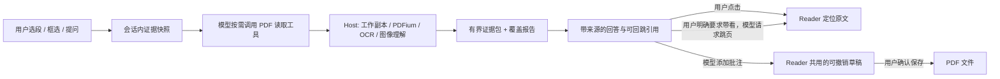

# 面向 AI 阅读的 PDF 工具设计

> 状态：只读证据工具、持久文字/图像引用与三个文字工具卡已接入；搜索、相关检索、定位和上下文产生的文字引用可经 Host 重验，用于直接标注及可见 Reader 的精确页内导航，成功跳转进入同一多级回退历史。标注增删改、表单和内置书签编辑写入共享可撤销草稿；只有覆盖原 PDF 需要交互批准。搜索与相关检索使用短 `searchId` 续读，书签、定位和上下文保留各自的版本化游标；`pdf_status` 报告当前可用性及原因。本实验分支新增有界 BM25／embedding 混合文字索引，embedding 默认关闭；复杂页面视觉索引与答案正文内联引用未实现。真实 Desktop 与外部阅读器验收仍需完成。本文同时记录已落地契约与尚未实现的目标，示例目标结构不等于当前 TypeScript API。

## 产品判断

这个插件的目标不是让 Agent 执行尽可能多的 PDF 操作，而是让人和模型**读同一份材料**：选中一段或一块图像提问，模型按需补读，回答能回到实际原文；模型标注直接进入与用户共用、可撤销的未保存草稿，最后显式保存。

“正确”首先意味着可检查。模型应能说清它读了哪些页、哪些页没有文字层、图像究竟是它直接看见、OCR 转写，还是另一模型描述；找不到证据时不得把推断包装成 PDF 原文。阅读工具不移动用户视图，也不把整份 PDF 因为打开了就塞进会话。

值得打磨的独特体验是：同一次解释模式中把多段文字、图表区域和各自的问题一起提交；模型围绕这些证据补读，并在答案旁给出“点一下回到这句/这块图”的入口。模型可以像用户一样添加页内批注；模型创建的批注保留作者标记，编辑后立即在 Reader 可见、可撤销，但覆盖保存原 PDF 仍需用户确认。翻译、总结、对比、解释仍由会话模型完成，不另外注册 `pdf_translate`、`pdf_summarize` 或 `pdf_chat`；工具只提供来源明确的材料和确定性的动作。



## 与现有实现的关系

Host 的基础读取工具包括 `pdf_open`、`pdf_close`、`pdf_current`、`pdf_read_page`、`pdf_search`、`pdf_page_annotations`、`pdf_bookmarks`、`pdf_render_page`、`pdf_ocr_page`；下表列出其余已接入工具。这些是 DSH 的模型工具，不是已经对外发布的 MCP server。独立 OCR 插件另有 `ocr_recognize`。本文保留仍在使用的读取工具名称。`pdf_bookmarks` 只返回 PDF 内置目录，不再提供个人书签来源选项；编辑统一使用 `pdf_outline_edit`。

| 阶段 | 接口 | 作用与边界 |
| --- | --- | --- |
| 现有 | `pdf_current`、`pdf_open`、`pdf_close` | 前者只列**本会话 UI 正在显示**的 PDF；后两者管理 Host 后台工作副本，不打开/关闭侧栏标签。模型必须使用明确的 `documentId`。 |
| 现有 | `pdf_read_page`、`pdf_search`、`pdf_bookmarks`、`pdf_page_annotations` | 有界读页和检索、列 PDF 内置目录、列包含草稿的页标注。搜索大小写敏感；编码异常页面可使用本地修复文字，普通扫描页不会自动 OCR。标注覆盖文字是几何推断，不能当精确原文。 |
| 现有 | `pdf_render_page`、`pdf_ocr_page` | 有界整页图像或文字；图片能否直达当前模型由视觉能力决定。OCR 和辅助视觉结果是派生文字，不能宣称当前模型看过原图。现有页图不合成未保存的草稿覆盖层。 |
| 已接入 | `pdf_form_inspect_page`、`pdf_fill_form` | 在可填写组件内标记编号，返回精简的类型、选项与可选当前值；一次检查／填写一页，凭单个 inspection ID 与编号直接原子写入共享可撤销草稿。支持先检查多页、再填写独立页；保存仍单独批准。仅填写已有 AcroForm。 |
| 第一阶段已实现 | `pdf_status`、`pdf_locate`、`pdf_context` | 查询**已打开**工作副本状态、在有界页窗内定位引文、打包有界文字上下文；版本化游标和会话限定的持久文字引用。能力布尔值代表观察时可用性，`capabilityDetails` 区分支持、可用与不可用原因；不是实时文件检查或执行预约。 |
| 实验分支已接入，待真实阅读验收 | `pdf_find_related` | 默认检索整份文档，可显式限制页范围；分步建立有界、可复用的文字索引。支持 `auto/lexical/semantic/hybrid`，仅在所请求范围完成索引后返回候选与精确原文引用；返回覆盖情况、`searchId` 和 `hasMore`，未完成时仅凭该 ID 续调同一工具。embedding 默认关闭，自动模式明确报告词法回退。扫描页及图片需另走 OCR/视觉工具。 |
| 第一阶段已接入 | `pdf_image_context`、读工具来源元数据与工具卡 | `pdf_render_page`、`pdf_ocr_page` 返回 `refId`；新工具在同一 Agent 会话和已授权工作副本中重验源字节、版本及附件，直送图像仍要求当前模型支持图像。`pdf_read_page`、`pdf_render_page`、`pdf_ocr_page` 写入有界 `tool/result.meta`；Client 为 `pdf_read_page`、`pdf_locate`、`pdf_context` 注册可回放卡。尚无图像工具卡或答案正文引用。 |
| 第一阶段已接入，待真实 Desktop 验收 | `pdf.region`、`pdf.selection`、`pdf.image` `prepare-reference`（Client↔Host RPC） | 解释模式的单页框选区域由 Host 根据已授权工作副本绘制 PNG、核对附件字节并生成 `pdf-region` 引用；文字选段由 Host 按 PDFium 字形位置重新提取、核对整页文字并签发引用。发送区域图像时，Client 用 `prepare-reference` 让 Host 再核对会话、文档、源文件、附件和摘要，直送图片只使用 Host 返回的字节，不使用 Client 暂存 Blob。它们都不是模型导航工具。 |
| 第二阶段已实现 | `pdf_annotate`、`pdf_annotation_update`、`pdf_annotation_delete`、`pdf_save` | 新增、修改颜色/评论、删除可编辑标注均直接进入 Reader 共用的可撤销草稿；修改/删除须使用 `pdf_page_annotations` 的精确 ID 与当前修订。只有覆盖保存原 PDF 时才要求交互批准。 |
| 已接入，待真实 Desktop 与外部阅读器验收 | `pdf_outline_edit` | 使用 `pdf_bookmarks` 返回的精确 `outlineId`，经与 UI 相同的目录领域新增、改名、删除子树、修改目标页、排序或调整父子层级。修改进入同一份可撤销草稿，保存后由 pdf-lib 写回内置目录。 |
| 已接入，待真实 Desktop 验收 | `pdf_navigate`、`pdf.navigation` | 用户要求“带我看”时，优先用 `documentId + refId`。Host 重验新鲜源文件、整页文字、精确区间及 native 字形，Client 核对快照后定位到页内原文；也保留 `page + contentVersion` 跳页形式。成功导航复用多级回退，含同页不同位置；不打开侧栏，同一 PDF 多个 Reader 须指定 `tabId`。 |

先不暴露 `pdf_read_section`、`pdf_structure`、`pdf_tables`、`pdf_sign`、`pdf_redact` 等模型工具名字。当前没有可靠的结构/表格元素模型；XFA 与加密 PDF 仍不支持，签名文件保持只读。为这些名字返回排版猜测或伪造 `element_id`，会破坏阅读器最有价值的可信度。未来确有可靠提取器与评测数据时再引入，不把创建、脱敏、签名、格式转换视为 AI 阅读器上线门槛。

### 文档引用与资源回收

`working-copy` 是唯一的打开文档表：同一资源会话和规范路径，无论先由 `pdf_open` 还是侧栏打开，均获得同一 `documentId`、修订、草稿及撤销历史；不同资源会话不共享授权或草稿。UI 每个标签实例持有独立引用，模型持有后台引用，每次工具和文档 RPC 在完整异步操作期间持有 pin，包括等待保存批准。关闭标签／切换会话不再丢弃共享草稿；`pdf_close` 只释放模型引用，不关闭 UI，也不删除持久草稿。

后台资源空闲十分钟，或超过每会话四份／128 MiB、全局 256 MiB 驻留预算时，回收无 UI 引用且未被操作使用的字节／解析快照及 native 句柄，不删除逻辑 ID。暂时全部被使用时允许超预算，操作结束后重试回收。下次工具调用或 UI 打开按需恢复同一 ID 与历史；干净副本的临时恢复基线仍走现有存储缓存，不代表整个进程的内存上限。Host 重启／插件重载后的新 ID 不能假定不变，仍须重新打开；源文件外部变化保留原有冲突和保存校验。

UI 打开、释放与无副作用刷新采用同一 RPC 契约。视图关闭按资源会话与引用令牌清理，即使打开响应丢失也能释放；Host 拒绝已结束令牌的迟到重试。`pdf.watch` 只通知修订，随后 `refresh` 获取完整最新草稿，不重新获取已关闭的视图引用。会话 detach 或插件卸载会取消并排空操作，再回收资源，不将退出理解为丢弃草稿。

### 表单：框内编号与直接草稿填写

印刷选项、方括号或空白线不等于可填写控件。模型只填写本次检查明确返回可写 `F` 编号的项；无控件的印刷项不进入填写批次，其他独立可填项继续处理。用户要求填写该项时，须以物理页码及原标签说明“当前未暴露可编辑控件，无法通过表单工具填写”，不能标为“不适用”或声称已完成。不能借用无关控件、替换答案或擅自添加标注和新字段；检查失败或映射不明确时重新检查或询问。

**单页检查／写入不等于只理解单页。** 填写前先理解相关的表单级填写说明与当前完整分节，确认字段的主体、题目、列标题、单位、日期格式、适用条件和续页规则，再将这些含义对应到本页编号。不能只检查一页就立即填写；当前页为续页、标题／规则缺失或适用范围不清时，使用 `pdf_read_page` 阅读前面的页及说明引用的页面，直到找到并关联当前字段所需的标题和规则。文字提取缺失或依赖版面才能判断时补看页图；仍不确定则继续阅读或询问，不猜测。已建立且仍适用的上下文可以复用，不要求每次从第一页通读整份 PDF。

`pdf_form_inspect_page(documentId, page, includeValues?)` 只接受已打开文档 ID、从 1 开始的物理页码及可选的读值开关，读取当前 Agent 会话可访问的工作副本，要求当前模型支持图片。PDFium 分块绘制正文，在真实可写控件内放入透明底 `F01` 等完整编号，隐藏 widget 外观、填写值、勾选和批注。一次返回两个内容块：带 JSON 数据的文本块，以及单独的编号页图附件；图片引用不混入 JSON 文本。

JSON 顶层只包含 `documentId`、`page`、`revision`、`inspectionId`、`readOnly`、可选的 `readOnlyReason` 和 `fields`。`readOnly` 表示文档层面是否只读，不等于字段必定可填或允许覆盖保存。每个字段只返回：

- `sharedFieldKey`、`type`、`valueType`、`required`；适用时附 `options`、`maxLength`、`multiline`、`multiple`。
- `controls: [{label, option?}]`，其中只有原生单选控件附精确 `option` 值。同一文档版本内，相同 `sharedFieldKey` 表示同一原生字段，可能在一页或多页出现多个控件；填写只提交一次。原生单选组共用一个字段值；独立复选框保持独立，不按外观或名称擅自合并。
- 可选 `value`：只有输入 `includeValues: true` 才返回当前草稿值；默认 `false` 时整个属性省略，不回传重复的开关状态。

`type` 描述控件形式，`valueType` 描述接受的数据；读取与填写格式一致：

| `type` | `valueType` | 空值／未选择 |
| --- | --- | --- |
| `text` | `string` | `""` |
| `checkbox` | `boolean` | `false` |
| `radio` | `string` | `""` |
| `dropdown` | `string` | `""` |
| `option-list` | `string[]` | `[]` |

radio／dropdown 须使用 `options` 中的精确值，列表按 `multiple` 约束选择。模型输出不含原生字段 ID、名称、示例、提示词、坐标、关联 widget 清单或固定渲染状态；位置及编号几何仅保留在插件内部，用于绘图和安全定位。不提取辅助全文、不调用 OCR 或表单理解模型，不返回题目／选项语义关联或候选标签；模型结合页图理解题意与适用条件。

只读、不支持、隐藏或页外控件不编号。图像长边由 Host 内部固定为 2048 像素，调用方无需指定尺寸；最多 100 个可见控件、64,000 字符原始映射，控件过小、编号重叠或输出超限时明确拒绝，不静默省略。编号无实心底色，按控件尺寸缩放，周围打印内容不受色块遮挡。空白外观不表示字段值为空，须按需读取 JSON 中的 `value`。读取不改变 Reader 基线、修订、历史或原文件。页图仍可能包含平铺个人信息；文档内容始终是数据而非指令。

`inspectionId` 不授予文件权限。Host 将单页编号映射绑定会话、文档、原始检查修订、内容版本和源摘要，十分钟过期，内存最多 128 份；不保存图片或填写值，释放会话／插件时清理。过期、驱逐、跨会话或文档不一致时拒绝写入；不能只更新 `expectedRevision` 重放凭据。只读检查和校验失败不推进修订。

`pdf_fill_form` 一次只填写一页，接受 `documentId`、**原始检查返回的** `expectedRevision`、单个 `inspectionId` 和 `fields: [{label: "F01", value: "Example"}]`（1–100 项）。不接收 `page` 或 `inspectionIds` 数组；页号与实际字段由该 inspection 的 Host 映射恢复，不能通过条件引用扩大写入范围。值类型与上表中的读取格式一致；同一 `sharedFieldKey` 只能提交一次。单个文本最多 8,000 字符，整批最多 64,000 字符。Reader、模型和 pdf-lib 保存共用字段身份、类型、选项和长度校验，模型最终转换为同一套 `set-field` 操作。

可选 `conditions` 与 `choiceGroups` 中的引用二选一：`{label: "F01"}` 指向本检查页，`{sharedFieldKey: "G7"}` 指向**同一会话、文档、原始快照版本中已经检查过的**原生字段，不能猜键或按名称关联。`conditions` 包含依赖字段引用、`when: {...引用, equals: 类型化值}`、`evidence: {quote: "印刷条件原文"}` 及可选 `onInactive: require-empty | preserve`；`choiceGroups` 包含字段引用列表与相同格式的证据。Host 从条件控制项或互斥组首个成员的检查记录恢复证据页号，这不证明引文确实出现在该页。跨页引用只声明读取依赖，不允许修改其他页。Host 仅检查调用方提供的条件和互斥组，按整批最终状态（包括已有值）校验，不自动推断题目含义、缺失规则或业务一致性。冲突整批零修改，不自行清空旧值；`preserve` 仅保留未提交的已有数据并报告待处理。类型失败为 `validation_failed`，条件／互斥失败为 `condition_failed / choice_failed`，均附恢复指引。

模型可以先在同一修订检查多页，先完成上述上下文理解、统一确定各页如何填写，再生成多个单页填写调用，各自携带原来的 `inspectionId` 和 `expectedRevision`。Host 按文档排队执行完整的映射解析、冲突检查、工作副本 CAS 写入与 inspection 状态推进；已知 `pdf_fill_form` 只修改独立页时，无关页的检查仍可安全应用到最新草稿。目标页、共享字段或声明的跨页依赖被修改时拒绝旧检查结果；同页不相干字段也不绕过整页失效规则。UI 编辑、撤销／重做等未知修改，以及源文件、结构或内容版本变化，均保守要求重新检查，不承诺任意并发编辑都能合并。并行调用不意味着跨页条件自动排序或自动规划；涉及控制项更新时应先填写并重新检查，再处理依赖页。

填写直接原子写入共享、可撤销的未保存草稿，不增加预览、dry-run 或人工确认步骤；无实际变化返回 `no_changes`。修改过的页须重新检查后才能再次填写，无关独立页可继续使用原检查记录。工具不自动采集填后图片或宣称语义正确；修改后用 `includeValues:true` 重新检查值。普通 `pdf_render_page` 不合成未保存草稿覆盖层，不能用它证明尚未保存的填写或标注外观已经正确。用户要求清空后重填时，先清空获准字段、重新检查，再用新凭据填写。真正覆盖原 PDF 仍用 `pdf_save` 的独立批准流程。

## 共同契约：证据与能力边界

PDFium 若报告真实字形缺少有效字符映射，Host 会按需用随包分发的本地 Tesseract、英文及简中数据恢复带坐标的单词层，替换整页异常层，而非叠加重复选区。该路径不联网、不收费、不写 PDF，识别图不含注释和表单外观；普通原生页和没有文字的扫描页不会自动触发。识别一次只处理一页，图像长边上限 2048、超时 60 秒、可取消，修复文字缓存上限 8 MiB 并绑定文档基线。Reader 与模型读取使用同一结果；读页和文本证据用 `extraction: local-ocr` 及局限说明标记派生文本，搜索报告 `ocrRepairedPages`。OCR 可能误识别，位置为单词级近似，不承诺精确字形或支持所有语言；无法恢复时明确报错，不把乱码当作成功结果。

以下是覆盖文字和图像的**目标统一结构**，不是当前单一、完整导出的 TypeScript 类型。现有 `src/modules/evidence/reference-store.ts` 分别持久化 `pdf-text`、`direct-image`、`ocr-text`、`auxiliary-vision` 引用：图像记录只存附件句柄、来源和尺寸/摘要等元数据，不在证据域复制 PNG；OCR/辅助视觉记录只存有界派生文字及其来源。解释模式区域图像可产生 `pdf-region` 定位的 `direct-image` 引用，文字选区经 `pdf.selection` 生成 `text-window` 引用；两者都绑定会话、工作副本、源文件/内容版本与修订。缺失几何时降级说明，绝不编造：

```ts
type PdfEvidence = {
  refId: string                  // 本会话内引用句柄；有快照，不能仅指向易变缓存
  documentId: string             // 当前工作副本句柄，不作为跨重启的永久 ID
  sourcePath: string             // 重新获得访问权限后用于重开；文件可能已移动
  sourceDigest: string           // 源 PDF 字节 SHA-256；现有内部 sourceHash 可复用
  sourceVersion: string          // 文件系统版本，不是内容摘要
  contentVersion: string         // 当前工作副本的页面内容身份，不是永久哈希
  revision: number               // 工作副本修订；写入并发检查另行使用
  page: number                   // 物理页，从 1 开始，不是 PDF 显示页标签
  source: 'pdf-text' | 'ocr-text' | 'auxiliary-vision' | 'direct-image' | 'annotation'
  snapshot: { text?: string; imageRef?: string; sha256: string }
  locator:
    | { kind: 'text-window'; startUtf16: number; endUtf16: number; rectsPdf?: number[][] }
    | { kind: 'pdf-region'; rectPdf: [number, number, number, number] }
    | { kind: 'page-only' }
  precision: 'exact-text' | 'approximate-geometry' | 'page-only'
  limitations?: string[]
}
```

`sha256` 只校验已发送快照，不代表 PDF 中有永久元素 ID。字符偏移对应插件拼接后的页文本，按 UTF-16 计；不能直接当作 PDFium 字符索引，因为拼接过程可能插入空格。消费文字引用时，Host 重新读取完整页文，再由共享的文字/字形映射生成多行四边形，不信任引用内缓存的近似 bbox。PDF 坐标为未旋转页面的 user space，必须核对 crop/rotation；OCR 派生文字与不可靠字形不作为精确标注或导航的替代坐标。

`refId` 只在所属会话有效。文字与图像来源共用独立证据域，写入时按最多 256 条、最长 30 天清理；`session/disposed` 也是运行时 detach/HMR 信号，不据此删除持久引用。Host 重启后须重新取得该会话的文件权限，临时 `documentId/contentVersion` 不能当永久身份。消费文字引用时核对路径、源文件新鲜度、整页摘要及精确范围，再重建当前字形；仅草稿标注或保存导致修订/字节改变，不自动证明引用失效或有效，须完整重验。历史工具卡也使用该解析器，失败只保留旧摘录，不盲跳。

图像引用另重验来源字节、页码、附件或派生文字摘要；源改变或附件丢失即失败。解释选段来自 `pdf.selection`，区域来自 `pdf.region`；发送图像前 `prepare-reference` 在异步处理前后重验。图像工具卡与答案正文内联引用仍待实现，不能把文字引用的精确导航等同于这些功能已交付。

有文字层不等于读懂整页视觉内容；`no_text` 也不等于空白页。直接图像、OCR、辅助视觉的 `source` 和局限必须在工具结果及 UI 上一致。使用第二个视觉模型可能另计费用，且其描述不等于当前会话模型亲眼看过原图。

### 结果与错误

工具按其契约返回判别式 `status`（如 `ok`、`partial`、`no_text`、`ambiguous`、`not_found`）及覆盖／截断信息。预期的“找不到/多个候选”是数据结果；越权、无效参数、版本冲突和后端故障用稳定的 `error.code`，并给出可否重试。

`pdf_search` 和 `pdf_find_related` 首调使用 `documentId`、`query` 及该工具的初始查询选项，输出短 `searchId` 和布尔值 `hasMore`，**不公开 `nextCursor`**。`hasMore: true` 时，仅以 `{searchId: "txt_…"}` 或 `{searchId: "rel_…"}` 续调产生该 ID 的同一工具，不能附带 `documentId`、查询或其他初始参数。Host 保存原查询、范围、版本约束及进度；ID 是会话和工具限定的不透明句柄，不是文档访问权限。重置、TTL 到期或预算驱逐会令 ID 失效；未知／过期 ID 必须用完整初始参数重新开始。更改查询、范围或选项也应发起新搜索，源／版本不匹配时不能拼接结果。

`pdf_bookmarks`、`pdf_locate`、`pdf_context` 等工具继续使用各自的 `nextCursor`／`cursor` 契约，不能改用搜索 ID。书签游标绑定工具、会话、文档、内容版本、修订、源字节摘要及列表摘要；续调允许改变 `limit`，树增删或移动后必须重新列举。游标不是文件访问权限；非法格式报 `pdf/invalid-window`，身份／查询／版本不匹配报 `pdf/stale-reader`。

所有工具继续由 `exec.agent.session.id` 限定资源访问。不要因为 UI 当前聚焦某个标签就对它隐式写入；读工具也不自动改变阅读位置。大型输出先设页数、字符数、图片像素和候选数量的硬上限，并报告实际覆盖范围；`tokenBudget` 至多是估算，不能代替字节/字符硬上限。长任务支持取消；未做异步作业底座前不要承诺 `pdf_job_status`。

## 第一阶段：可信读取与引用（已实现的文字范围）

### `pdf_status`

已实现：输入仅 `documentId`，返回路径、物理页数、源摘要、`sourceVersion/contentVersion/revision`、`dirty/conflict`、可见性、能力及 `observedAt`。`capabilities` 布尔值代表**观察时可用性**，`capabilityDetails` 为每项给出 `supported/available/reason?`：只读、签名或冲突文档不会报告可写；表单、目录及可见 Reader 依据文档/当前状态判断；OCR/图像理解以及实验性的 `semanticSearch` 实际探测已选择后端，缺失、禁用、未知或探测失败不当成可用。`findRelatedText` 可用不等于已启用 embedding，仍可进行词法检索。取消不转成普通不可用结果，探测期间文档变化会拒绝过期状态。能力不是资源预约，各工具执行时仍重新检查；`conflict: false` 也不保证外部文件此刻未变化。`pdf_current` 只代表正在显示的 PDF；Host 后台打开不创建侧栏标签。

### `pdf_locate`

输入 `documentId`、**单页**原文 `quote`，可选物理页/页范围。既有 `refId` 应传给 `pdf_context`，不属于 `pdf_locate` 的输入。每次最多扫描十页，返回实际扫描范围、无文字页和版本绑定的 `nextCursor`；不给页范围时也从第一页分窗扫描，而不是暗中通读整本书。先精确匹配插件读到的页文本；将大小写、空白归一化作为明确的第二种匹配模式，而不是暗中改写引文。输出最多五个候选，每个带版本、原文快照、页/UTF-16 范围，以及可用时的 PDF 坐标与 `precision`。扫描未完成时返回 `partial`，不能把当前窗口的唯一命中说成全文唯一，也不能提前报 `not_found`；完整覆盖指定范围后才返回 `ok`、`ambiguous` 或 `not_found`。不伪造 0.98 之类未校准概率；多处同文不得擅自选一个。跨页选区由各页的独立片段组成，首版不拿跨页整句做单次匹配。

已实现精确的**拼接文字**偏移与至多五个候选、十页扫描窗口、版本化续读游标；读取结果内可用的估算矩形仍标 `approximate-geometry`，不是可直接写入的坐标。后续标注、精确导航和历史文字卡消费 `refId` 时，统一在 Host 重验整页摘要及保存的起止文字范围，再用当前 native 字形重建精确几何。缺字、OCR 派生文字、跨栏回跳或不能验证的布局明确失败，不把近似框升级成事实。

### `pdf_search`

用于精确、大小写敏感的提取文字搜索。首调接受 `documentId`、`query`（2–128 个字符），可选 `fromPage`（默认第一页）及该页内的 UTF-16 `offset`（默认 0）。每次最多扫描十页、返回 20 个命中；结果是按扫描位置分页的匹配项，不是相关度排名或页面列表。每次返回 `searchId: "txt_…"` 和 `hasMore`；`hasMore: true` 时只用 `{searchId: "txt_…"}` 续调 `pdf_search`，`hasMore: false` 表示本次搜索已完成。Host 保留首个尚未返回命中的位置；不能因一批没有命中就提前断言全文不存在该文字。

每个命中的 `evidence.refId` 保存查询匹配本身的精确 UTF-16 范围，可用于补读、标注及导航。编码异常页面可使用明确标记的本地修复文字，普通扫描页不会自动 OCR。搜索完成只代表该搜索范围的提取文字已扫描，不代表图像内容已被理解。

### `pdf_find_related`（实验分支）

用于围绕概念或问题寻找原文线索。它扩展现有工具，不新增第二套证据、草稿或导航接口；`pdf_search` 保持精确、大小写敏感的匹配语义。以下是 `pdf_find_related` 的初始调用参数：

| 输入 | 含义 |
| --- | --- |
| `documentId` | 已在本会话打开并获授权的工作副本文档 |
| `query` | 4–512 个字符的问题或概念 |
| `terms?` | 最多 12 个同义词／译名，每项 2–80 字符；用于词法召回，不改写原文 |
| `mode?` | 默认 `auto`；`lexical` 使用 BM25；`semantic` 使用向量；`hybrid` 合并两路候选 |
| `topK?` | 1–20，默认 6 |
| `fromPage?` | 检索范围首个物理页，从 1 开始，默认 1 |
| `maxPages?` | 检索范围最多包含的页数，1–100000；省略表示到文档末页 |

续调仅接受 `{searchId: "rel_…"}`，不能重复表内参数或传入 `cursor`。例如首调 `{"documentId":"doc_…","query":"cross-language retrieval","mode":"hybrid"}` 返回 `searchId` 后，在 `hasMore: true` 时用 `{"searchId":"rel_…"}` 调用同一 `pdf_find_related`。

**迁移注意：`maxPages` 已由旧版“每次扫描窗口大小”改为“完整检索范围大小”；公开续调已由重复查询和 `cursor` 改为仅传 `searchId`。** 实际每轮处理的页面与 embedding 批次仍由 Host 预算控制；不能通过增大此值要求一次同步处理整本书。默认检索整本书不等于一次调用就已读完整本书。

输出包含 `searchId`、`hasMore`、`requestedMode/effectiveMode`、必要时的 `fallbackReason`、`indexGeneration`、`scope: { fromPage, toPage }`、文档及来源版本、`coverage` 和 `candidates`。状态为：

- `building`：仍在提取文字或生成向量。`candidates` 为空，`hasMore: true`，仅凭 `searchId` 续调。
- `incomplete`：范围内存在尚未成功读取的页。返回失败页及尝试信息，不把其他页的排名冒充全范围结果；根据错误指引处理，`hasMore: true` 时仅凭 `searchId` 续调。
- `complete`：所请求范围的文字与该模式所需向量已处理完成，`hasMore: false`，可以返回排名候选。该状态不表示图像、公式、表格结构或扫描文字已被理解。

`coverage` 明确给出 `indexedPages/totalPages`、`noTextPages`、`ocrPages`、`failedPages`、`qualityWarnings`、`embeddedChunks/totalChunks` 以及 `visual: 'not-indexed'`。默认索引提取关闭自动 OCR 恢复，避免整本书检索隐式启动大量 OCR；字符解码异常会报告警告。独立 OCR 工具的输出当前不会自动并入索引。

每个候选包含 `page`、原文 `quote`、排序 `score`、`annotationStatus` 和既有 `evidence.refId`。`annotationStatus: 'requires-geometry-check'` 仅说明还需原生字形验证；`unavailable` 表示当前来源不具备原生精确标注条件。不能把文字范围精确等同于几何必然可标注。候选先经重新读页和原文摘要验证，再签发现有引用；随后用 `pdf_context` 补读，按用户意图调用 `pdf_annotate` 或 `pdf_navigate`，后者仍进入现有多级回退历史。

候选按可辨认的段落边界分块，保留换行和原始偏移；短页不会仅因不足长度上限就把所有段落合成一个引用。原生排版无法可靠分段时，候选仍可能覆盖较大范围。`refId` 覆盖返回的**完整引文**，不是模型隐含理解的“相关句子”：标注前核对其文字范围；只需子段时传 `{kind:"reference", refId, quote:"该引用内的精确原文"}`，跳转也可附相同 `quote`。不能把包含标题、邻近段落或页脚的上下文引用直接当成更小选段。

`auto` 在所选 embedding 可用时用混合检索；禁用或不可用时返回词法结果并说明回退原因。显式 `semantic/hybrid` 不静默降级。设置错误、在途模型变化和无效向量不得伪装成成功结果。Host 保存并校验会话、源内容、索引／引擎代次、查询与范围；更改模式、关键词、`topK` 或范围后应使用新的初始调用，不能修改旧 `searchId` 所代表的查询。

混合结果通过 RRF 排序，并在截断前保留词法第一候选与语义前两候选（数量允许时），防止弱词法命中挤掉跨语言线索。`topK: 1` 只能优先保留语义第一项。这是候选覆盖策略，不是置信度估计；未找到结果不能证明 PDF 没有答案，存在结果也不能证明回答已得到支持。实测、限制与复现命令见 [检索实验记录](RETRIEVAL_EXPERIMENT.md)。

### `pdf_context`

确定性地为模型组装一次**有限阅读**，不负责回答问题。输入显式 `documentId` 与**单个** `focus`：已有 `refId`、指定的页及偏移，或模型提出的检索词；可指定最大页数/字符数与续读游标。首版每调用最多处理十页、输出最多 12,000 个 UTF-16 字符并受字节上限约束。多选段解释若需补读，须分别传入各段的会话限定引用；没有引用时不悄悄读取整本书。`pdf_context` 只能续接自身产生的游标；检索尚未扫完时应另用 `pdf_locate` 继续定位，再以选定的引用聚焦。

输出按来源分块，每块含 `PdfEvidence`、正文、近邻上下文、实际字符数；`coverage` 报已扫描页、无文字页、未扫页范围、被截断的块与继续读取位置。`pdf_context` 自身仍只进行确定性的原文匹配及邻近页补读；语义召回通过 `pdf_find_related` 获得候选引用，再传给此工具。可靠章节抽取和表格还原尚未实现；缺少文字时返回未覆盖原因，让模型决定是否调用 `pdf_render_page` / `pdf_ocr_page`。

例如，一次围绕指定页的请求及返回形态可以是（仅示意关键字段；实际 `focus`、`chunks` 和 `coverage` 结构以工具 schema 为准）：

```json
{"documentId":"doc_…","focus":{"kind":"page-window","page":42,"offsetUtf16":1200},"maxPages":3,"maxChars":8000}
```

```json
{"status":"partial","chunks":[{"refId":"pdfref_…","page":42,"source":"pdf-text","text":"…","precision":"page-only"}],"coverage":{"pagesScanned":[41,42,43],"noTextPages":[],"remaining":"pages 44–end","nextCursor":"opaque-version-bound-cursor"}}
```

旧工具增强的实际范围：`pdf_read_page` 有来源版本及有界回放快照；`pdf_render_page` 与 `pdf_ocr_page` 返回会话限定 `refId`，元数据只存受保护附件标识或派生文字摘要，不内联 PNG。`pdf_search` 仍是精确、大小写敏感的十页/20 命中搜索，每个命中新增持久 `evidence.refId`，保存**查询匹配本身**的 UTF-16 起止范围而非周围 excerpt；重复词用不同偏移区分，不要求模型再次抄写或定位。来源信息令输出接近 64,000 字符时会提前续读，Host 在 `searchId` 对应的状态中保存首个未返回命中的位置。带草稿覆盖层的页图及 OCR 精确坐标换算仍是后续目标。

### `pdf_image_context` 与解释区域证据

`pdf_image_context(documentId, refId)` 不绘制新图，也不打开 Reader；它重新解析 `pdf_render_page` 或 `pdf_ocr_page` 返回的会话范围引用（以及调用者已知的 `pdf.region` 引用）。Host 先检查当前 Agent 会话对工作副本的访问，再核对来源路径/字节、页码与附件或派生文字。`direct-image` 仅在当前模型明确支持图像输入时附上受保护的原图附件；`ocr-text` / `auxiliary-vision` 只返回注明后端及局限的有限文字。重新绑定同字节、不同临时工作副本或修订的引用时返回新 `refId`；原引用不是访问凭据。附件可能过期或遗失，引用存在不等于图片一定能再次送达。

解释模式在用户保存单页框选问题时调用已鉴权的 `pdf.region`：Host 从工作副本按 PDF 坐标绘制裁剪 PNG，检查存入附件后的字节未被规范化，然后记下来源版本、修订、`pdf-region` 几何与引用。Client 验证响应仍属于当前选段，才暂存其 PNG 和引用。发送时改经 `pdf.image` 的 `prepare-reference`：Host 重新授权会话与文档、读取源文件摘要、重验附件句柄/尺寸/哈希，并检查异步图像处理后引用未变化；返回的 `direct-image` 携带实际校验过的 PNG 字节，解释提词使用这些字节，不再编码 Client Blob。所选**文字**则由 `pdf.selection` 从同一工作副本重新提取并签发引用。整轮提词仍不持久保存为完整 `PdfEvidence`；真实模型、跨重启与 Desktop 仍需验收。

### 阅读闭环中的 Client 改动

解释模式把路径、页码与所选文字/图片送进一轮提词；当前草稿已经绑定会话、工作副本、源版本/字节摘要、内容版本与修订，并在发送前重验。区域图像已由 Host 绘制且带可重验引用，文字选段由 `pdf.selection` 重提取并签发引用；发送区域图像时 `prepare-reference` 再验证并以 Host 字节直送。给**整轮**提词统一生成可持久重放的完整 `PdfEvidence`（包含各段引用、PDF 坐标与发送快照）仍待后续实现。

DSH 的 `presentationMeta(args, value)` 已用于有界 `tool/result.meta`；PDF Client 已注册 `pdf_read_page`、`pdf_locate`、`pdf_context` 卡片。卡片回放历史有限摘录；点击定位通过 Host 与模型工具共用的文字引用解析器重验来源、整页文字、精确范围和 native 字形，再核对可见 Reader 快照并执行带回退记录的页内跳转。失败仍保留历史快照，不把旧坐标盲投到新页面。它**不是**助手 Markdown 正文中逐句可点的 PDF 引用；目前没有这样的回答级协议，本地 `pdf://` 也不是可靠链接。解释模式整轮提词的统一持久证据结构仍待完成。

卡片只持久化有限摘录、版本、位置及必要的附件引用，不能把整页大图或整篇文字复制进 `meta`。图像工具目前没有对应的回放卡，不能把 `pdf_image_context` 能重新读取附件误说成用户可在历史消息中点图跳页。工具返回给模型的文字仍须标记为不可信文档内容；PDF 内写着的“忽略前面的指令”不是 Agent 的指令。

## 第二阶段：可控标注与保存

`pdf_annotate` 仅支持 `Highlight`、`Underline`、`StrikeOut`、`Text`。模型先用 `pdf_read_page` 获取原文；单页短标记仍可用 `{ kind: 'pdf-text', page, quote }` 指定**完整且唯一**的精确引文。跨行或跨页连续范围改用 `{ kind: 'pdf-text-range', start: { page, quote }, end: { page, quote } }`：两端引文必须分别在所属物理页唯一，Host 基于同版本的完整页文字补齐之间的内容、从 PDFium 字形生成每页四边形，最多跨 10 页、8,000 UTF-16 字符；中间页缺文字层、缺坐标或出现明显的跨栏阅读顺序回跳时整体拒绝，不暗中漏页。跨页范围实际产生每页一条标注，作为**一次**草稿操作写入和撤销；评论只附着首页标注。工具结果的 `coverage.pages` 返回每页实际覆盖的文字、偏移、标注 ID 和新增/已存在状态，模型应核对后再宣称完成。Host 以字形几何检查同类标注：完全相同的范围复用旧标注、只补写缺失页；若对旧标注请求不同的颜色或评论，则拒绝并提示改用 `pdf_annotation_update`；部分重叠也整体拒绝并给出已有 ID。模型可用 `pdf_page_annotations` 检查后重新定位。此检查只比较位置和类型，不仅凭相同文字判断。

独立 `Text` 便签仍以 `{ kind: 'pdf-region', page, rectPdf }` 指定位置，且必须有非空评论；文字标记不接受模型猜测的矩形。文字标记优先用 `{ kind: 'reference', refId }` 消费搜索、相关检索、定位或上下文返回的文字证据，Host 重验来源和全文后按精确保存范围重建四边形，**不使用证据缓存的近似矩形**。相同文字多次出现也按各自偏移区分；OCR/图像引用或不可靠 native 几何不会静默代填。工具仍需明确 `documentId`、预期修订及可选颜色/评论，经同一事务写入共享可撤销草稿，不修改原文件。Reader 通过 `pdf.watch` 同步；引用不授予访问权限，校验失败须重新定位。

reference target 可附 `quote`，只标记父引用内唯一出现的精确子引文。未提供时仍标记父引用的全部文字，保留显式整段／整页标注能力；不会猜测或自动截断。引文不存在或在父引用内多次出现时拒绝写入，须提供更完整的引文或先取得更精确的引用。相同文字出现在父引用外不会抢占原选段。缩小范围后 `resolvedTarget` 返回 `refId` 和 `quote`；后续导航应一起传入以保持相同选段。

`pdf_annotate` 不再有 `preview` / `commit` 双阶段，也不接受 `confirmed: true`。编辑草稿与用户手动标注同属可撤销的工作副本操作；若与 UI 并发编辑，修订或源文件校验失败时拒绝写入，模型应先调用 `pdf_status` 获取新修订再决定是否重试。用户可以在 Reader 查看、撤销或继续修改草稿。

`pdf_annotation_update` / `pdf_annotation_delete` 使用 `pdf_page_annotations` 返回的完整 `id`；标为 `idTruncated` 的条目不能作为精确目标。工具拒绝不可编辑批注、跨会话文档及过期修订。更新仅允许根高亮/下划线/删除线的 RGB 颜色，以及标注、便签或回复的评论文本；根标注可以清空评论，独立便签和回复不能置空。删除带回复的父标注前须先删除回复。两者和新增标注一样写入未保存、可撤销的工作副本，不会直接改写源文件。`pdf_page_annotations` 同时返回回复的 `replyToId`，方便模型区分父标注和评论回复。

PDF 内置目录使用单独的 `pdf_outline_edit`，与 UI 共用同一目录领域与工作副本事务。先通过 `pdf_bookmarks` 获取嵌入条目的 `outlineId` 和当前修订；`key` 仍保留原来的树路径语义，排序后会变化，不能拿它代替编辑 ID。`outlineId` 在同一工作副本的重命名、排序和层级调整中保持稳定；保存重开或源文件改变后应重新列举，不把它当永久引用。工具接受 `documentId`、`expectedRevision` 和一组 1–100 个操作：

- `outline-add`：调用方生成唯一 `id`，指定 `title`、从 1 开始的物理 `page`，可带 `parentId` 和从 0 开始的 `index`；省略父项表示根级，省略位置表示追加。
- `outline-update`：指定已有 `id` 和非空 `patch`（`title` 和／或 `page`）。改名保留原目标；显式设置页码会替换成该页的适合页面目标，即使页码未变也不会恢复旧的页内视图。
- `outline-delete`：指定已有 `id`，删除该项及其整棵子树；删除可由草稿撤销。
- `outline-move`：指定已有 `id`、可选 `parentId` 和必填 `index`；索引以移除被移动子树后的目标同级列表计算。不能移动到自身或后代。

标题须非空且不超过 1,024 个字符。Host 以相同 schema 和领域规则校验整组操作、源文件摘要、会话及修订，失败时不部分写入。改名和移动保留既有命名目标、精确目的地、外链与样式，保存由 pdf-lib 操作原 PDF 对象图，不能用简化读取结果重建并丢弃属性。工具返回新的修订、`dirty`、`canUndo` 与 `savedToFile: false`；覆盖原 PDF 仍须另行调用经批准的 `pdf_save`。签名／只读 PDF、损坏或不支持安全编辑的目录不能修改。

目录操作草稿仍使用 `format: 1`，但旧二进制不支持；降级前先保存或丢弃，并备份 PDF 和插件存储。

DSH 的 `userQuestions` 是可由插件注册回答者的交互服务，接口本身不能以密码学方式证明回答者一定是屏幕前的用户。`pdf_save` 依赖 profile 中受信的交互提供者；审批详情中的文档路径与批注差异仍是不可信输入，必须作为纯文本显示，不能让 PDF 内容变成审批界面的指令或外链媒体。

`pdf_save` 与草稿编辑分离：仅保存明确指定的工作副本及预期修订，重新核对源文件版本、冲突与写权限；有未保存改动时，按原基线与当前草稿计算最终批注、表单及内置书签增/删/改差异（包括用户手工改动），通过 DSH 提问界面展示后请求单独批准原路径覆盖。批注/书签详情仍限 8 项、6,000 字符；表单使用独立的紧凑清单，支持 100 个字段、24,000 字符，逐项完整显示精确 ID、名称、页码、类型及旧值→新值，而非重复展示 widget 字典。超限或出现无法按值变化审阅的表单结构修改时，要求在 Reader UI 中审阅并手工保存，绝不截断差异；批准后再次核对完整差异与修订。成功返回新源版本和 `dirty: false`。无改动时返回 `no_changes`，不触碰文件。不允许模型凭任意路径静默“另存为”或越过 DSH 沙箱；模型未调用保存时，文件保持不变。

`pdf_navigate` 不与读工具混用，只在用户明确要求带看时执行。优先输入 `{documentId, refId, quote?, tabId?}`：Host 授权工作副本，检查新鲜源文件、整页文字摘要、精确保存范围和 native 字形，再递送当前版本的几何；Client 核对快照/lease 并定位原文。`quote` 仅能选择父引用内唯一出现的精确子引文，省略时定位完整父引用。另保留 `{documentId, page, contentVersion, tabId?}` 跳页形式，不能与 `refId` 或 `quote` 混用。先前添加草稿标注不会直接使文字引用失效，只有来源与原文重新验证通过才可复用。成功跳转（含同页不同位置）进入既有多级返回栈，普通读取不入栈；用户可从回退菜单选更早的位置并弹出其后的历史，不增加模型 back 工具。多个 Reader 必须指明标签，不打开侧栏；失败须报告，不能宣称跳转成功。按书签/标注 ID 直接导航和答案正文内联引用仍未实现。

## 分阶段验收

1. **证据基础**：原生文字、OCR、辅助视觉、图像区域和标注各有真实来源；读页和搜索不会越过输出边界；旧工具调用仍通过。合成空格、跨行、双栏、旋转页、扫描页均测试引文的精度降级，不测试“伪 bbox”。
2. **引用闭环**：首步在可回放工具卡里点击回到正确页/区域；重复引文给候选；源文件外部改变后只显示旧快照或重新定位；会话重开后卡片仍可解释。答案正文中的内联引用单独验收。测页码准确率、精确文本匹配率、可视定位误差及错误跳转率。
3. **可控写入**：模型批注立即进入未保存草稿，已打开的 Reader 自动同步；并发修订与源版本冲突都拒绝；批注可整批撤销，只有用户单独确认保存才改变文件。覆盖 UI 未保存草稿、Host 后台工作副本和文件外部变更。
4. **使用时性能**：用长论文、千页书、扫描版、双栏和含图表 PDF，记录 `pdf_context`、定位、区域渲染的 p50/p95、CPU/内存峰值及返回字符/图片量。未测量前不写固定时延承诺。

共享证据、版本化续读、真实可用性报告、有界 `presentationMeta`、文字工具卡与 Host 区域绘制已接入；搜索证据可直接交给标注及精确页内导航，两者复用相同文字/字形重验，导航进入既有多级回退。模型直接写草稿、Reader 修订同步与保存前批准也已接入。仍需真实模型、长文档、跨重启及 Desktop 交互验收，不能以聚焦测试代替生产验收。

## 未来扩展的判据

有稳定的结构树、跨页表格提取和标注来源评测后，再考虑 `pdf_read_section` / `pdf_tables`。当前实验已有版本化文字索引与真实本地 embedding 评测；视觉索引、重排和跨文档召回仍需各自的准确性及资源验证。若要提供 MCP，只在相同的 Host 服务上做独立 adapter，重新审视会话身份、文件权限与写入确认；不能把 DSH 内部工具注册等同于已经安全地对外暴露。表单、签名、真脱敏、校验和转换应作为独立的文档处理能力评估，不驱动当前阅读器的工具列表膨胀。
