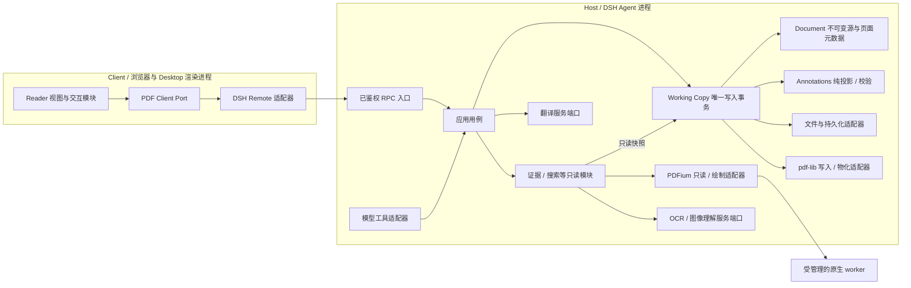

# PDF 插件架构 V2（实施记录与后续设计）

> 状态：源码分层、Client Reader 拆分、旧 V1 草稿读取、普通 PDF 评论回复解析/编辑、AcroForm 用户填写、浏览器保存重开、文字与图像来源引用、解释模式 Host 证据链、模型草稿编辑及经人类审批的保存工具已接入；真实 Desktop、外部阅读器互操作、旧版二进制回退、跨平台 CI 与端到端性能仍需验收。本文保留 2026-10-18 的设计目标与迁移基线；标为“目标”“后续”的条款不代表已实现。工具的逐项状态见 [AI_READER_TOOLS.md](./AI_READER_TOOLS.md)。

当前入口位于 `src/entrypoints/`，DSH、文件、PDFium、pdf-lib 和存储接入位于 `src/adapters/`，业务能力位于 `src/modules/`，跨端契约和纯几何/缓存分别位于 `src/contracts/` 与 `src/shared/`。`src/client/` 负责页面组合与样式，`src/core/pdf-types.ts` 定义共享 PDF 数据，`src/navigation/` 提供纯视口历史，`src/engine/framing.ts` 实现原生协议；这些文件仍有实际职责。`src/host/` 仅保留已发布 OCR/Image SDK 的类型入口。`npm run arch:report` 可重复生成当前行数、复杂度代理值和模块依赖图；测试目录已按 `tests/modules/`、`tests/adapters/`、`tests/contracts/`、`tests/entrypoints/` 组织，浏览器 E2E 与原生集成另测。

2026-10-28 清理：删除无生产消费者的 Client 入口和 viewport 转发、Host 工作副本/阅读位置装配包装；测试与 benchmark 的便捷装配归到 `tests/fixtures/`，浏览器启动归到 `tests/browser/`。批注线程只保留生产使用的索引实现，文字定位与图片编码测试也直接覆盖当前范围定位和 Host 验证字节路径。同步清除失效 CSS、重复菜单监听和旧表单 `valueContract`；TypeScript 检查禁止不可达语句和无用标签。

Web 回归发现自动适宽的 DOM 锚点会随虚拟页面卸载而失效，现由 `WindowedPages` 统一持有数值布局锚点，尺寸 Hook 仅上报宽高；导航按实时视口和最新数值布局定位，避免侧栏动画期间使用过期尺寸。

公开扩展 API、V1 草稿兼容、原生回调测试及检索 benchmark 的历史对照保留。生产 TS/TSX 由 302 个文件、31,411 物理行减至 298 个文件、31,222 行；静态决策复杂度超过 20 的函数仍有 68 个，主要集中在文档写入、批注布局、工作副本与检索生命周期。它们不是死代码，后续应按具体状态与操作边界继续审查，不以拆文件或缩行代替简化。

本轮本地复验：`npm run check` 的源码、测试及 benchmark 类型检查、构建均通过，Node 测试 1,504 项通过、1 项浏览器 Worker 因默认安装路径缺失而条件跳过；指定本机 Chrome 补跑 Worker 1 项通过，完整 Web 交互 38 项通过。模块 DAG 与跨进程运行时依赖检查通过。原生取消测试使用真实子进程入站确认和回复放行门闩，另保留跨平台的同步流单测，避免依赖父进程 tick 推断子进程进度。本轮未重新采集项目行覆盖率。

当前源码的模型工具按单一职责重新命名并删除重复入口，不注册旧名称别名；完整契约见 [AI_READER_TOOLS.md](./AI_READER_TOOLS.md)。原子动作由模型组合，UI 专属区域 OCR 仍走同一识别服务。此次工具入口调整不改动草稿、文件或会话数据格式。

## 设计决定

1. **保留一个可安装的 DSH bundle**：继续发布四个 Host Cordis 入口（原生提供者、OCR、图像理解、PDF Reader）和一个 Client 入口；内部按能力拆成独立模块。模块有公开入口、依赖边界和独立测试，但暂不为每个目录发布 npm 包。OCR、图像理解、翻译继续提供可复用的服务/SDK；出现第二个独立消费者或不同发布周期时，再抽为单独包。
2. **Host 拥有事实，Client 拥有交互**：文件权限、工作副本、草稿、版本校验、保存、PDFium 和模型工具只在 Host；Client 负责渲染、选区、临时视口/跳转状态和操作反馈，持久阅读位置由 Host 保存。Client 通过有类型的 RPC 调用 Host，不读取 Host 私有存储；Host 不导入 Client 文件。
3. **共享事实和底层算法，不强迫 UI 与工具同一种策略**：两者读取同一工作副本，复用页文字拼接、坐标映射和版本校验；UI 搜索可继续提供全书、忽略大小写及 OCR 页级结果，模型搜索继续保持有界、大小写敏感的契约。批注与保存则必须走同一个 Host 写入事务。
4. **允许内部 API 和目录破坏性调整，不允许无声丢失数据**：可以重写源码组织和私有接口；第一轮重构**不改变现有 V1 持久化格式**，保留既有批注草稿、书签和阅读位置的兼容边界。后续新增表单、目录操作不等于旧二进制可读，降级要求见下文。若后续确需改格式，须作为单独的数据迁移发布。外部 bundle 入口、插件 ID、模型工具名和现有数据语义先保持稳定，确需改变时单独升级契约版本。

设计时的聚合点是旧 `src/client/Reader.tsx`、`src/host/agent-tools.ts`、`src/host/workspaces.ts` 和 `src/host/pdf-service.ts`；重构后分别拆向 `modules/viewer`、`adapters/host/dsh`、`modules/working-copy` 与 `adapters/host/pdfium`。原 Host→Client viewport 运行时导入已改为共享几何模块。不能仅凭目录移动判断完成度：当前仍有高复杂函数，需以 `arch:report` 的报告与测试持续约束。

## 运行时边界



Cordis `Context`、DSH Remote/Slots/Tools、文件沙箱和原生 worker 的具体 API 停在入口与适配器层。用例只依赖显式端口，纯领域逻辑不接触 `ctx`、React、Node 文件系统或 Electron。Host 对文档/文件相关的 RPC 与工具调用按会话身份及 DSH 文件访问能力授权；不含文件数据的 `pdf.info` 等启动接口仍需连接鉴权，但不能凭空要求资源会话 ID。Client 的当前标签或路径只是请求上下文，不能当授权凭据。当前 UI 会话、文件资源会话与模型工具执行会话不是同一个标识，适配器须明确转换，不能混用。

读页、搜索、OCR、图像理解不会暗中移动用户视图；导航是单独的 Client 动作。Host 的“后台打开文档”与 Client 的“在侧栏显示文档”仍是两个操作。

### 混合页面内容检索（实验功能）

`modules/document` 拥有不可变、可验证的 `PageContent`：源字节摘要、页号、提取身份、页矩形、精确拼接的原生文字／摘要／段落偏移，以及内容块和各块的多种表示。表示区分 `native-text`、`ocr-text` 与 `image-description`，保留文字摘要、生产者／版本／模型／配置身份、实际干净渲染输入摘要、可选 UTF-16 几何 span、完成状态及警告。块 ID 由源摘要、页和提取身份限定，独立于会话证据 `refId`。运行时 Zod 校验拒绝损坏摘要、无效偏移和超限内容；每页文字及表示总文字各限 500,000 UTF-16、总 span 限 10,000，缓存不复制 PNG。

`modules/retrieval` 只拥有从内容表示投影出的可重建索引，不拥有第二份文档或草稿。Host 从共享工作副本取得已授权快照，组合 PDFium 原生文字与所选 OCR／图像服务，保留原始 UTF-16 范围和 PDF 来源位置；分块、BM25、向量排名与候选合并均在独立模块中。首版固定提供整页 `visual-region` 后备块，不推断独立插图、表格或公式版面；空原生文字层仍是有效页面。`pdf_semantic_search` 的默认范围是全文，内部有界分步处理；`building` 报告覆盖和进度，处理完请求范围后对可用内容统一排名，局部失败仍以 `incomplete` 返回。公开续调仅使用短 `searchId: "rel_…"`；Host 保存初始查询、范围、进度及源／引擎代次约束。旧版逐窗口关键词排序路径已删除。

可选 OCR／图像描述失败但已有有效原生或 OCR 文字时，`PageContent`／`RetrievalPage.failure` 保留失败原因和可用表示，索引继续收录这些内容；失败内容模型不写入持久缓存。结果同时列入 `coverage.failedPages` 并保持 `status: incomplete`，可以返回现有内容的排名候选，但 `hasMore: false` 表示没有可继续的构建步骤，不生成虚假续调游标。此状态不能宣称索引整体就绪或覆盖完整，须显式重建该文档以重试失败的预处理。没有任何有效文字的失败页仍遵循原有自动重试流程；成功的空 OCR 输出不属于失败。

图片处理只保留 OCR 与图像理解两个执行契约。OCR 接受图像并返回转写文字及可选位置／置信度；图像理解接受图像与提示词，始终返回实际生成的文字及来源。内置 `dsh-vision` 统一当前会话与指定 provider/model 的视觉调用，不再注册 OCR 图像桥接或直接传图后端。直接附图由解释／会话编排负责；文本会话使用配置的图像理解引擎生成派生文字，不静默降级到 OCR。

`indexScanPages`（文字识别索引）默认 `true`，仅在原生文字缺失或编码损坏时调用 `ocrEngine`；成功空转写是有效结果。`indexImageDescriptions`（视觉描述索引）默认 `false`，复用 `imageEngine` 与其配置，通过索引提示词生成整页描述再索引，并非嵌入原图。两个开关独立，可同时开启；没有独立的索引引擎选择或注册表。描述增加模型调用、耗时及费用，两项均不会开启默认关闭的 embedding。语义检索启用且可用时，打开文档的后台预建与手动／搜索入口共用处理链路。Reader 的本地字符映射修复是另一个固定用途。可运行的第三方扩展及生命周期测试见 [`examples/http-engines`](../examples/http-engines) 与 [`tests/examples/engine-extensions.test.ts`](../tests/examples/engine-extensions.test.ts)。

检索分块保留空行和原生排版中可辨认的段落边界，短段落不因整页不足长度上限而合并；长段落才继续按长度与重叠窗口拆分。边界使用原始拼接文字的 UTF-16 偏移，不改写文字或重排多栏。派生缓存包含边界信息，分块版本变化时重建索引；批量向量化、文本去重和原有资源预算继续生效。无法可靠区分段落的版面仍返回原始范围，不能据此声称已经识别用户想标注的子句。

检索上下文和标注选段是不同粒度：裸 `refId` 始终代表完整快照。模型需要其中一段时先用 `pdf_evidence_read` 在父引用内唯一匹配精确子引文，取得新引用；连续跨页范围也在该入口解析。标注与导航仅消费最终引用，Host 在执行时仍重验来源、整页摘要、连续范围和 native 几何。不得退回全页搜索同文、静默缩短范围或漏掉中间页，所有页标注进入唯一工作副本事务。

`pdf_semantic_search` 与 `pdf_keyword_search` 共用初调／续调的对外形态：首调传 `documentId`、`query` 和各自的查询选项，响应包含 `searchId` 与 `hasMore`；`hasMore: true` 时仅以 `{searchId}` 续调同一工具，不再公开或接收搜索游标，也不重复初始参数。Host 按会话和工具隔离句柄，保留授权与源版本重验，重置、TTL 或预算驱逐后失效；未知／过期 ID 要求完整初调重新开始。普通文字搜索的 `txt_…` ID 保存匹配分页位置，相关检索的 `rel_…` ID 保存索引构建进度；两者不互通，也不改变列表工具的游标契约。语义入口要求可用 embedding，关键词入口负责 exact/normalized 匹配。

Host 的 `pdfEmbedding` 使用与其他引擎相同的注册／注销和动态设置目录，默认关闭；本地 Qwen 实现通过独立的回环 HTTP 服务运行，不加载聊天模型或修改其数据库。向量缓存按表示文字及 embedding 模型指纹复用；页面内容另按源字节、提取管线、干净图像输入与 OCR／图像生产者身份复用。OCR／图像后端可提供可选 `cacheIdentity`：稳定字符串允许跨重启复用，未提供或明确声明不可持久复用时加入会话及注册期隔离，不能把可变会话模型按同一引擎名永久复用。配置变化、卸载或源变化使旧请求失效，注册代次仍校验异步返回。索引有内存／数量／并发预算，页面、向量的持久派生缓存使用独立的 `pdf_retrieval_<namespace hash>` Storage Domain，不能作为授权或草稿事实；初始化读取同样清理过期与超限数据。

索引构建步骤拥有自己的工作副本租约，查询和插件卸载使用取消与排空边界。返回原生候选前重新核对原文，再交给现有 evidence 引用存储；原生引用的精确标注和跳转继续由当前原生字形定位器校验。OCR／描述候选保存派生摘要、生产者和页／区域来源，精度为近似区域或整页，不能用于原生精确文字标注，也不能拿其本地偏移去切原生页文字。写入共享草稿、保存审批和阅读回退均复用既有能力。描述可以让图像内容进入检索，但不保证识别图表／公式结构；历史实验与性能测量见 [RETRIEVAL_EXPERIMENT.md](./RETRIEVAL_EXPERIMENT.md)，不能用原生文字基准代替新预处理的实测。

当前 PDF 的手动建立／重建入口由搜索面板承载，细轨仅保留共用任务入口。Host 拥有索引状态、构建次数和取消；Client 的会话共享订阅记录已关闭的完成通知，不改变 Host 的 ready 状态。重复轮询或切换同会话的 PDF 视图不会使同次完成通知重新出现，新一轮构建仍显示。重建只重置相同来源版本与选中引擎的派生索引，排空旧构建后重新读取页面和计算向量，不清空无关文档的缓存。

## 能力探测与提供者

Host 的 `pdfCapabilities` 是进程内能力目录：稳定的操作 ID 描述需求，Cordis 插件按 Fiber 生命周期注册/注销提供者，目录在请求时结合会话和取消信号判断是否可用。其他 Host 插件可从 `@dylanl1/dsh-plugin-pdf/capabilities` 引入能力 ID 与提供者类型，再注入 `pdfCapabilities` 注册自己的实现。提供者保留自己的有类型实现接口；目录不以一个无类型 `execute()` 替代 PDF、OCR、识图各自的输入输出契约。OCR 与识图可以在 Reader 之前或之后加载，它们的后端选择和可用性仍由各自服务决定。

AI 引擎扩展由 `modules/engines` 提供描述、配置校验、类型化目录的共用记账、可取消探测和只读聚合目录。`ocr`、`imageUnderstanding`、`pdfTranslation` 各自拥有唯一实现目录；默认与第三方引擎同样注册并随 Fiber 注销。Reader 配置中的 OCR/图像/翻译选择及各引擎配置通过 Host 绑定到单次请求，人和模型工具复用同一绑定适配器；翻译用请求级实例，不通过修改全局选择路由并发请求。`pdf.engines` 通过认证连接传递有修订的目录快照与长轮询通知，Client 不再只在启动时缓存翻译列表。卸载取消任务，未知选择保留且不自动回退；断线保留上次目录，重新连接后刷新。真实会话模型/凭据可用性仍由 Host 在使用时检查。声明式设置仅接受普通标量及凭据引用，不接收第三方实现函数。详见 [ENGINE_EXTENSIONS.md](./ENGINE_EXTENSIONS.md)。

`dsh-vision` 的模型来源由 PDF 设置编辑器拥有：默认跟随会话，指定时写入同一引擎配置的 provider/model/effort，切回跟随清除覆盖。`pdf.model-options` 是无资源会话的只读候选桥接：复用 DSH 的 `sessionController.modelCatalog()`，由 Host 通过 `resolveModelInfo()` 只保留明确支持 image 的模型；Client 按需读取、分组显示和重试，不创建第二套模型注册表，也不调用 `session.selectModel()`。官方会话选择器没有公开独立回调组件，直接使用其会话入口会切换聊天模型，因此这里复用官方目录与现有设置控件样式；目录不是执行授权，真正调用仍由图像引擎重新检查。

引擎目录、索引状态、文档修订和导航状态的被动订阅共用 `shared/passive-poll.ts` 的 5 秒等待上限；事件发生时仍立即返回。官方 Desktop 的更新准备阶段会停止接收新请求，并在 10 秒内等待已接收请求结束，所以这些订阅不能等待插件卸载后才取消。此预算仅限制一次状态观察，不限制草稿写入、索引或导航工具的实际工作；更新锁仍须等待已接纳的写入。Client 在正常连接下继续订阅，在断线、取消和卸载时释放订阅。

打开 PDF 时先经 `pdf-lib` 检查源文档和只读条件，再由 PDFium 探测页数、表单类型及签名数。`modules/capabilities/pdf-open.ts` 合并两个解析器发现的需求，不能因其中一个漏报而静默忽略表单：普通页面、AcroForm/XFA 外观以及签名读取。当前页面实际由 `pdfium.native` 执行，因此打开检查**只接受这个执行者自身声明的能力**；不能因为另一个插件声称支持 XFA，就让仍由 PDFium 绘制的页面被错误放行。缺失能力时报告 `pdf/native-unsupported` 及所需操作 ID。未来接入另一 PDF 引擎时，须先实现对应的有类型 reader/renderer 端口并让打开、读页和绘制真正路由到该实现，再允许它参与打开规划。

当前 PDFium 绘制普通页和 AcroForm 原有外观；Client 按 Host 解析的字段与 widget 坐标覆盖可编辑控件。修改作为 `set-field` 操作进入现有工作副本，支持草稿、撤销／重做，保存时由 `pdf-lib` 更新字段值与外观并走相同的版本检查和原子发布。中文外观使用随包提供的 OFL 字体。阅读器不执行 PDF 脚本、网络动作；带数字签名的 PDF 可只读预览，但不会验证签名真伪，也不能保存；XFA 和加密文档仍不支持。加密文件在探测前需要独立的解锁／授权步骤，不能仅注册一个“支持加密”的布尔能力就绕过密码与源字节转换。能力目录是可扩展的发现与规划层，不代表这些实现已经存在。

模型表单入口只有 `pdf_form_inspect` 与 `pdf_form_fill`。检查输入仅 `documentId`、物理 `page` 和可选 `includeValues`；输出分成 JSON 文本块与编号页图。JSON 顶层仅含 `documentId/page/revision/inspectionId/readOnly/readOnlyReason?/fields`；字段仅含 `sharedFieldKey/type/valueType/required`、适用的选项及长度等约束、可选当前值和 `controls: [{label, option?}]`，只有原生单选控件附 `option`。不把原生名称、ID、坐标、widget 清单、示例或固定渲染状态暴露给模型。原生字段关联用同版本内的 `sharedFieldKey` 表达，独立复选框不推断分组。`inspection-references` 保存有界的单页定位映射，绑定会话／文档／原始检查修订／内容版本／源摘要，十分钟过期、最多 128 份，不存图片或填写值，随会话及插件清理。

`pdf_form_fill` 输入为 `documentId`、原始检查的 `expectedRevision`、单个 `inspectionId` 和 `fields: [{label, value}]`，只允许写该检查页，页号和真实字段由 Host 恢复；不再接受页号或 ID 数组。可选条件／互斥规则引用 `{label}`（本页）或 `{sharedFieldKey}`（同会话、文档及原始快照中已检查的字段），后者可建立跨页读取依赖，不能扩大写入范围；证据只传 `quote`，页号由 Host 补齐。规则仍由模型提供，Host 不自动推断语义。

Host 在文档级队列中串行执行检查记录解析、冲突检查、工作副本 CAS 写入和记录推进，领域操作仍复用 Reader 的类型、选项、长度和身份校验，原子写入同一草稿及撤销历史，不另存模型表单。同版本批量检查后，已知 `pdf_form_fill` 仅修改独立页时，无关页可持原始凭据安全应用到最新草稿；目标页、共享字段或声明的跨页依赖被修改则拒绝。同页修改整页失效；UI 编辑、撤销／重做等未知修订，以及源文件／结构／内容版本变化保守要求重新检查。该有界追踪不是通用并发编辑合并；填写依赖仍须按控制项先行、重新检查后再处理依赖项的顺序执行。`no_changes` 与校验失败不推进修订；草稿填写不要求人工确认，覆盖保存仍需批准。

`modules/forms` 与 `forms/inspection-layout` 内部保留控件和编号几何，复用 `NativeViewport` 处理 crop／旋转／UserUnit，将透明底小编号放进真实控件。PDFium 复用 Reader 基线 handle，关闭 widget 和批注外观，以不超过 1024 像素的块组成最长 2048 像素的整页。检查页图的长边由 Host 内部固定，模型工具不暴露尺寸参数。空白外观不表示值为空；`includeValues` 仅通过结构化字段数据返回当前草稿值，关闭时省略 `value`。模型侧读写格式一致：text／radio／dropdown 为字符串（空 `""`），checkbox 为布尔值（未选 `false`），option-list 为字符串数组（空 `[]`）；适配器将 dropdown 的内部数组表示规范为单个字符串，不改变 Reader 原有值模型。适配器核对会话、视觉能力、源／修订和附件尺寸。模型根据页图理解印刷标签及条件，使用填写返回状态和显式读回检查结果；普通 `pdf_page_render` 仍绘制源基线，不验证未保存草稿外观。Host 不生成语义题目、自动推断规则或自动采集填后图。

表单字段以 PDF 对象引用形成 `pdf-field:<object>:<generation>` 身份，`name` 仅用于显示；导入表单可存在同名但独立的字段，不得用名称全局去重或任取第一个字段。`modules/forms/identity` 统一解析 UI、模型、工作副本与 pdf-lib 写入目标。新 `set-field` 写 `fieldId`；旧草稿的 `name` 目标仅在唯一匹配时接受，歧义时明确拒绝，不影响同文档其他目标。多 widget 的同一规范字段只枚举一次，跨页仍共享 ID；对象引用由 pdf-lib 在保存时保留，基线恢复重算同一身份，不重命名用户原字段或重新挂接不明归属的 widget。

PDF 内置书签现通过 `outlines` 领域支持新增、重命名、删除子树、修改目标页、排序与父子层级调整。UI 和模型工具 `pdf_bookmark_edit` 使用同一套校验与投影，经工作副本的修订检查写入可撤销、可恢复的草稿，保存仍由既有 pdf-lib 事务处理。写入侧使用 PDF 对象身份保留未修改的目的地、命名目标、外链、颜色、字重及其他属性；显式改目标页才替换为页面适合目的地。原生读取结果只用于精确导航，不能作为丢弃未知属性后重建整树的依据。损坏或不支持安全编辑的目录仍可经原生读取展示，但不允许编辑。新增功能的真实 Desktop 交互和外部阅读器互操作仍待验收。

导入目录以 `First/Next` 正向链接确定层级；只有正向树有界、无循环、节点唯一且身份稳定时，才允许恢复错误的 `Parent/Prev/Last` 派生链接。反向链接若指向正向树之外的实际书签，必须与对应节点除反向链接外的全部字段完全一致（包括目标、样式、私有数据及正向子节点），否则保持只读，避免把缺失的分支当作冗余数据丢弃。打开与普通批注保存不修改目录；实际目录编辑物化时才重连链接，即使只是改名也要生成有效结构。用户和模型入口共用此规则。

书签 UI 使用原位名称输入、行级菜单和有插入反馈的拖拽，不设全局编辑模式。`viewer/controllers/use-outline-editing` 管理单项操作、文档身份、修订检查和重复提交防护；`viewer/model/outline-editing` 将拖拽与键盘移动映射到相同的领域操作。新增行在名称提交前仅为 Client 临时状态，取消不修改 PDF。改名、改目标、排序各自形成一次可撤销编辑，不互相提交尚未完成的输入。折叠状态按稳定书签 ID 保存，弹层挂载在 Reader 内，避免被侧栏裁切，同时保留主题和阅读区边界。

## 目录职责（当前结构与目标边界）

```text
src/
  entrypoints/                    # Cordis apply/注册与生命周期组合；不写业务规则
    reader-host.ts
    native-host.ts
    ocr-host.ts
    image-understanding-host.ts
    reader-client.tsx
  contracts/                      # 跨进程 schema、标识、错误码、协议版本
    rpc/
    evidence.ts
    identifiers.ts
    errors.ts
  modules/                        # 功能模块；跨模块只从 index.ts 导入
    capabilities/                 # Host 能力 ID、提供者目录与 PDF 打开需求规划
    document/                     # 不可变源快照、页面元数据与读取端口
      domain/
      ports.ts
      index.ts
    annotations/                  # 不依赖工作副本的批注模型、投影与校验
    forms/                        # 表单身份、值契约、整批校验、编号与几何约束
    outlines/                     # 内置书签树操作、校验与原生导航投影
    working-copy/                 # 会话内副本、草稿、撤销/重做、CAS 与保存
      application/
      ports.ts
      index.ts
    navigation/                   # 页码、书签、阅读位置、回退栈
    search/                       # 共用文本内核；UI/工具各自的查询策略
    evidence/                     # 快照、定位、来源、上下文打包与引用校验
    model-write/                  # 模型直接编辑可撤销草稿；原文件保存需审批
    explanation/                  # 多段/区域问题与会话提交
    ocr/                          # 图像→文字的通用服务，不知道 PDF 是什么
    image-understanding/          # 图像→描述或原生视觉的策略/能力端口
    translation/                  # 文本→译文的通用服务
    viewer/                       # Client 视图、交互状态与按需渲染
      components/
      controllers/
      rendering/
      styles/
      index.ts
  adapters/
    host/
      dsh/                        # Remote、Tools、Session、Storage、权限
      filesystem/                 # 沙箱文件访问、原子替换、版本检查
      pdfium/                     # 原生 worker 协议、读取和绘制
      pdf-lib/                    # PDF 写入与外观物化
    client/
      dsh/                        # Slots、会话提词、资源标签与设置
      remote/                     # RPC 客户端、快照缓存与取消
  shared/
    geometry/                     # 纯 PDF/viewport/image 坐标换算
    cache/                        # 不含 Host/Client 依赖的有限缓存
native/                           # 原生源码与按平台构建脚本（现有布局保留）
tests/                            # 按模块和边界组织测试
```

上图是职责地图，不是逐文件清单：已经存在 `entrypoints`、`contracts/rpc`、`modules/{document,annotations,outlines,working-copy,navigation,search,evidence,model-write,explanation,ocr,image-understanding,viewer}`、Host/Client adapters 与 `shared/{geometry,cache}`；通用翻译逻辑目前仍由公开的 `src/translation/` SDK 和 Host 适配器承载，尚未机械迁入 `modules/translation`。不为不存在的功能建立空目录。`shared/` 只放跨模块且无业务所有权的纯工具。

| 模块 | 唯一责任与对外能力 | 不负责 |
| --- | --- | --- |
| `document` | 不可变源字节/页面元数据与读取端口，描述来源身份 | 草稿、撤销栈、保存、UI |
| `annotations` | 纯批注模型、普通 PDF 回复关系、操作验证、投影与物化计划；可脱离 DSH 和存储测试 | 直接读写工作副本或磁盘 |
| `outlines` | 内置书签树的操作校验与投影，按稳定 ID 保留原生目的地并呈现草稿；可脱离 DSH 和存储测试 | 直接写盘或第二套保存事务 |
| `working-copy` | 唯一会话副本与写事务所有者；组合 `document`、纯批注与目录算法、文件/存储适配器，管理修订、草稿、撤销、冲突、保存及恢复 | React、工具协议、独立的一套 PDF 写入路径 |
| `navigation` | 物理页跳转、内置目录读取、阅读位置与回退记录；Host 持久阅读位置，Client 管当前视图 | 把 Host 后台打开伪装为侧栏打开 |
| `search` | 共用文本拼接/位置内核；保留 UI 全书、忽略大小写、已缓存 OCR 页级结果与模型工具精确有界搜索两套策略 | 虚构结构树或无依据的语义命中 |
| `evidence` | 从 `working-copy` 的只读快照截取原文/图片、验证锚点、提供来源与精度、打包有界上下文 | 回答用户问题、自动写标注 |
| `model-write` | 对显式 PDF 区域直接通过 `working-copy` 写入可撤销草稿；仅覆盖保存原文件时经 DSH 用户交互服务明确批准 | 自己另建写入路径、以模型自报的确认字段代替保存批准 |
| `explanation` | 将多个选段或图像区域、各自问题和证据快照组成一轮提词 | 复制整个 PDF 到会话、维护另一份工作副本 |
| `ocr`、`image-understanding`、`translation` | 与 PDF 解耦的识别、视觉策略和翻译服务，可被其他插件通过端口/公开导出复用 | 文件访问、PDF 页码、侧栏状态 |
| `viewer` | 页面窗口化绘制、交互模式、选区、各功能面板与状态反馈；调用 Client Port | 草稿最终持久化、文件授权、业务版本裁决 |

目标依赖图无环：`working-copy` **单向**组合 `document`、`annotations` 与 `outlines`，独占文件写入、每会话操作队列和草稿存储；`navigation/search/evidence` 使用只读快照，`viewer` 经 Client Port 请求 Host。当前 `annotations/projection.ts` 已无 `pdf-lib` 运行时导入，PDF 物化在 `adapters/host/pdf-lib`；解析器将普通 `/IRT`、`/RT /R` 回复关联到标注，`/Popup` 不作为评论，`/RT /Group` 不作为普通回复，写入经同一工作副本事务保留关系。页面内评论线程是 `viewer` 的展示状态，非第二份持久评论存储。部分模块仍使用 Node 内置库或 `src/core/pdf-types.ts` 类型；解释模式的文字选段现已消费 `pdf.selection` 的 Host 证据结果，区域图像在发送时消费 `pdf.image` `prepare-reference` 的 Host 字节。因此“所有模块完全纯净、只经 `index.ts` 互相导入”仍是后续收敛目标。模块边界检查已加入测试，不能仅凭目录分离宣称彻底达成。

同一功能模块若同时有 Host 与 Client 实现，就分别放在该模块的 `host/` 和 `client/`，共享的只限纯类型、schema 与算法；`host/` 永不导入 `client/`，反之亦然。模块的独立性以“脱离 DSH 入口仍能运行领域/用例测试”为准，不以目录数量衡量。

主要旧文件的去向如下；这是已执行的职责拆分说明，而不是逐路径的现存清单：

| 现有位置 | 新归属 |
| --- | --- |
| `src/host/index.ts`、三个 Host 插件入口、`src/client/index.tsx` | `entrypoints/`，只做 Cordis 装配和释放 |
| `src/host/workspaces.ts`、`background-documents.ts`、`local-files.ts` | `working-copy` 事务/后台所有权 + `adapters/host/filesystem`、V1 持久化适配器 |
| `src/host/pdf-service.ts`、`src/engine/native-worker.ts`、`src/core/pdf-document.ts` | 文档/页面读取端口 + `adapters/host/pdfium`、`adapters/host/pdf-lib` |
| `src/host/agent-tools.ts`、`transport.ts` | `adapters/host/dsh` 中的薄工具/RPC 注册 + 各模块用例 |
| `src/client/api.ts`、`contracts.ts` | `adapters/client/remote` 与 `contracts/rpc`；保留缓存与增量同步语义 |
| `src/client/Reader.tsx`、`src/client/native/*`、侧栏/工具栏组件 | `viewer` 的 controller、rendering、组件与 feature 样式 |
| `src/client/native/viewport.ts`、`src/engine/byte-cache.ts` | 跨端纯 `shared/geometry`、`shared/cache` |

搜索不能被“统一用例”误合并：Reader 按需遍历全书、忽略大小写、最多展示 500 个结果，包含已缓存 OCR 的页级命中；`pdf_keyword_search` 区分大小写、单次最多十页/20 个命中，扫描当前提取文字（编码修复文字明确标记，不自动 OCR 普通扫描页）。每个工具命中借 `text-evidence` 保存精确匹配偏移和会话限定引用；不把周围 excerpt 作为命中范围。搜索返回分页匹配项及 `searchId/hasMore`，`hasMore: false` 表示该搜索完成，不是页面列表或相关度排名。搜索的内部 `tool-cursor` 由 Host 保留，书签仍公开使用自己的游标；这些版本约束绑定工具、会话、文档、内容版本、修订、源摘要及查询／列表摘要，异步读取后复核，不能把不同版本结果拼起来。两端共享文本/位置内核，保留各自获取、限额、取消与精度契约。

## 前后端接口与数据边界

字符映射故障在 native 提取时以 `quality.unmappedCharacters` 报告，不能将“有字形但无有效 Unicode”误当空白页。Host PDF 服务统一为 Reader 和模型读页修复异常页：随包本地 Tesseract 在一个可终止的 Worker thread 中运行，不联网，不嵌套启动子 worker；正常页不触发，修复结果按文档基线缓存，取消/卸载释放线程。`modules/document/text-recovery` 只负责 OCR 单词到 PDF 坐标的纯转换，识别适配器位于 `adapters/host/ocr`；恢复文字携带 `extraction: local-ocr` 和近似性说明，不覆盖原 PDF，也不创建第二套可选择的重叠文字层。

表单填写支持调用方显式提供有印刷依据的 `conditions` 和 `choiceGroups`。`forms/conditions` 与 `forms/choice-groups` 按整批最终字段状态校验依赖及独立复选框的互斥，包括未提交的旧值；Host 不推断未上报规则或业务语义。冲突整批拒绝，不自行清空旧值或取消选择。填写直接进入共享未保存草稿，无额外确认；保存继续独立确认。模型负责页图理解、歧义询问及填后读回，用户手工编辑不受模型传入规则限制。

`contracts/rpc/` 定义请求、响应和错误的运行时 schema；Host 与 Client 由同一契约生成/推导 TypeScript 类型。RPC 适配器负责鉴权、校验、超时/取消、错误归一化与序列化，不在其中实现查找、标注或保存。当前 `pdf.dispatch.v2` 可以作为迁移外壳；若更改语义或破坏旧调用者，需显式协商新协议版本，不能只改字段类型。

统一使用 `documentId` 指会话内工作副本，`pageNumber` 指从 **1** 开始的物理页；仅原生边界使用从 **0** 开始的 `pageIndex`。坐标名称写明空间和单位，例如 `rectPdf`、`rectViewportPx`、`rectImagePx`，换算函数放 `shared/geometry`，不再从 Client 路径给 Host 借用。版本字段有不同的不变量：

| 字段 | 当前含义与变化条件 | 允许用于什么校验 |
| --- | --- | --- |
| `documentId` | 当前 Host 生命周期中按资源会话＋规范路径登记的工作副本身份；关闭视图、后台资源回收及重新接管保留 ID；Host 重启后须重新获取 | 查找该会话已授权的副本，不能单独证明权限 |
| `sourceDigest`（当前草稿的 `sourceHash`） | 源 PDF **字节** SHA-256；保存批注也会改变它 | 基线完整性、外部源文件比较、引用重新定位的第一步 |
| `sourceVersion` | DSH 文件/预览所有者观察到的文件系统版本；不是字节摘要 | 判断是否需要重新读取/刷新；不能替代保存的目标字节摘要检查 |
| `contentVersion` | **页面逻辑内容身份**；当前实现给新副本分配 UUID，批注编辑和仅保存批注时保持不变；外部来源变化/重新加载可更新；不是跨重启稳定的内容哈希 | 页文字和逻辑锚点的失效边界；**不能单独判断批注或页图是否更新** |
| `revision` | 工作副本的可变修订；批注编辑、撤销/重做及保存/重载等成功状态转移推进 | 写入 CAS、含批注结果和游标的并发检查 |
| `renderedHash` | 物化后待发布 PDF 的字节摘要，保存前写进草稿；只用于崩溃恢复 | 重启时比对磁盘字节，判定保存是否实际发布；不是通用源版本 |
| `reader.bytesHash` | 原生阅读器当前基线字节的身份 | 与 `reader.generation`、页/缩放/区域等参数一起校验 PDFium 句柄、位图与 tile；不等于未保存标注投影 |

`working-copy` 是唯一写入仲裁者：UI 与模型使用同一个会话副本、每会话串行队列、批注投影和文件适配器。`pdf_annotation_create` 直接以预期修订与源摘要进入一个可撤销操作组；`pdf.watch` 只传轻量修订通知，Reader 随后从已鉴权的工作副本刷新。现有 `pdf.dispatch.v2` 修改/保存请求仍传 `id + revision`，**不在旧 RPC 中强加新必填字段**；未来新写入工具的版本化契约可显式传预期 `contentVersion`。覆盖保存仍须用户批准，再核对沙箱权限、源/目标的已观察字节摘要及覆盖意图，由文件适配器按规范路径串行执行。页文字和不含外观的逻辑锚点缓存可按 `contentVersion` 失效；PDFium bitmap/tile 至少还要按 `reader.bytesHash + reader.generation` 及页/缩放/区域等渲染参数区分，由截图产生的 OCR 也须绑定实际图像输入与引擎配置。带批注的快照、引用和游标还须核对 `revision`；`sourceDigest` 变化后，旧引用即使原文看似相同也必须重新验证，不能按旧坐标盲跳。普通文件系统不能保证与无关外部写入者之间的真正跨进程事务；保留现有最终摘要复核与“不确定”错误语义。

打开文档表也由该服务拥有，不另建 UI／模型副本表。具名 UI 引用、模型所有权与操作 pin 独立计数；`background-documents` 只根据登记表的驻留状态执行空闲／容量策略，不再拥有第二份文档生命周期。挂起释放完整快照和 native 资源，保留 ID、路径、修订及恢复记录；恢复用原基线重建草稿，再检查磁盘变化，不用新源文件静默覆盖旧修改。UI 的 `open(referenceId)`、`release` 与不增加引用的 `refresh` 由同一服务处理；引用令牌结束后，迟到的打开请求不得复活它。基线持久缓存仍沿用 V1 存储，未承诺全进程内存受驻留预算约束。

续读位置仍持久化源字节哈希。保存批注或目录会改变源字节而保持 `contentVersion`，旧位置可能被标记过期；这是保留的 V1 行为，未来应通过稳定页面内容指纹改进，不能直接改为跨进程不稳定的 `contentVersion`。个人书签能力已移除，旧域不再打开或修改；旧数据留在磁盘，不迁移进 PDF。

### 会话身份与授权矩阵

| 操作 | 身份来源 | 必须满足 | 不能做的事 |
| --- | --- | --- | --- |
| `pdf.info` 设置启动 | DSH Connection 的连接身份 | 连接鉴权、请求限额；不读取文档内容 | 虚构 `sessionId` 或返回文件数据 |
| Client 打开/读页/搜索/OCR | 文件资源地址携带的 `resourceSessionId`，Host 解析对应 Agent | 文件沙箱授权；已有 `documentId` 必须属于该会话；长任务可取消 | 用当前聊天的 `containerSessionId` 替代资源所属会话 |
| Client 修改/撤销/保存 | 同一 `resourceSessionId` | 上述条件加预期 `revision`；保存/覆盖另需已观察的目标摘要和用户覆盖选择 | 仅凭当前可见标签或路径写文件 |
| 解释提词、发布当前阅读状态 | UI 的 `containerSessionId` 与资源地址中的 `resourceSessionId` | 两者相等；解释还须使用所属聊天的正式发送接口 | 跨会话把 PDF 内容发入另一个聊天；将带 TTL 的阅读状态当授权 |
| 模型后台打开/读工具 | `exec.agent.session.id` | 显式地址/文档句柄属于执行会话，并通过文件访问检查 | 根据 UI 当前页猜出可读文件或跨会话复用句柄 |
| 引用重放、首版 `pdf_page_jump` | 引用记录的会话 + 当前获授权的会话/附件与可见标签 | 重验来源版本和目标；导航须有匹配的活标签及显式意图，失败要回报 | 用历史 `refId` 或阅读状态直接取得新权限或宣称已经跳转 |

这些规则由 Host 授权适配器及相应 Client 会话入口共同执行；失败返回稳定错误/状态，不静默降级到另一会话。`readerContexts` 仅是有过期时间的“当前看到什么”提示。读工具不自动导航，Host 后台 `pdf_open` 不自动创建侧栏标签。

### V1 持久化与保存恢复协议

表单外观的字体选择以最终字段状态及 `needsAppearancesUpdate()` 为准，不读取中途填过什么。单选项的导出值不是待绘制文字，列表即使取消选择仍需绘制全部选项；无 widget 或不更新外观的字段不为本次保存引入字体。空外观使用标准字体，避免未使用的 CJK 字体触发底层空子集编码异常。完整历史的填写／清空／单选修改须在隔离子进程中覆盖崩溃回归，最终值与原生绘制还需分别验证。

第一轮仅改变源码组织：保留 `pdf_drafts_${suffix}`、`pdf_positions_${suffix}` 两个 Storage Domain 的名称、`version: 1`、表名、profile namespace 派生后缀及键算法；草稿继续写 `format: 1`。旧主分支源码生成的冻结 fixture 与旧 schema 读取**批注类**新记录的测试已加入，但**尚未用实际发布旧二进制完成回滚演练**。后续 AcroForm 填写和内置书签编辑扩展了同一操作联合类型：新版可读取旧草稿；旧二进制不支持新增的 `outline-add`、`outline-update`、`outline-delete`、`outline-move` 操作，含 `set-field` 的新草稿也不能保证旧版可回读。降级前须先保存或丢弃表单及目录草稿，并备份源文件及插件存储；格式号仍为 1 不代表旧版兼容，未来正式发布前应为这类操作设计独立版本迁移。冻结样本覆盖内联 `original` 与独立 `baseKey` 草稿、阅读位置；源文件改名/删除、外部改动和损坏基线仍需按场景持续验证。

保存顺序不得因拆模块而改变：先确保操作草稿及其基线持久化；若物化后的字节不同于源 PDF，在发布前持久化 `renderedHash`；然后通过文件适配器做权限检查、规范路径队列、观察版本检查、原子替换及最终摘要复核。重启时，只有磁盘字节摘要等于 `renderedHash`，才能认定此前的保存已提交并把副本恢复为 clean；若不匹配，保留草稿与冲突信息，不能把操作盲目应用到另一份源文件。清理时先删草稿操作记录，成功后才删其独立基线；清理失败只给可重试警告，不能把已经提交的文件重新标成未保存。另存覆盖同一文件、保存结果不确定及退出时已接纳操作的 drain 都要有测试。

如果将来确需 V2 格式，必须作为**独立迁移发布**：停写并排空队列 → 备份现有 V1 域（包括历史遗留域）和**仍可取得**的源文件，逐条验证草稿基线原始字节与 `sourceHash` → 在新域/命名空间幂等复制 → 比对记录数、所属会话、键、摘要和恢复结果 → 切换读取。源 PDF 已删除时保留原有草稿/冲突语义，不用另一份文件替代，也不把它当作迁移失败的唯一理由。失败时 V1 仍是权威数据。V2 一旦接纳新写入，旧二进制不再天然可回滚；必须先完成并验证兼容双写或备份恢复/降级工具，才允许清除 V1。迁移测试覆盖旧版写入→新版打开/编辑→重启恢复→旧版回退，以及崩溃于每个关键阶段的重试。不得假定 Storage Domain 的 `version` 字段会自动迁移数据。

证据的 `refId` 是会话范围内的快照句柄，不等于永久 PDF 元素 ID。已实现的**文字与图像来源**记录存于独立 `pdf_evidence_${suffix}` Storage Domain；每次写入淘汰超过 30 天或总数 256 条以外的记录，查询同时检查所属会话。图像证据只在此域保存受保护的附件句柄、来源/版本、页或 PDF 区域及摘要，或保存有界 OCR/辅助视觉派生文字，**不复制 PNG 字节**。`session/disposed` 只是运行时 detach/HMR/退出信号：它取消并排空该代任务，释放模型引用及不再使用的驻留资源，**不删除逻辑文档身份、草稿、会话日志或持久引用**。Host 重启或同一路径 PDF 重开后，使用文字引用还须先在原会话重新获得文件访问，并核对源路径、整页文字摘要与引文；图像引用另重验源字节、页、附件或派生文字，附件不存在时失败。同字节但临时工作副本/修订变化时可重签发新 `refId`；引用本身不授予文件或附件访问权。解释模式的区域图像经 `pdf.region`、文字选段经 `pdf.selection` 生成会话限定引用；发送区域图像时再经 `pdf.image` `prepare-reference` 核对会话、文档、源文件、附件与摘要，直接图片使用 Host 返回的字节。

`tool/result.meta` 为基础读取、检索与证据读取保存有界文字快照，Client 的证据卡可重放。`text-evidence` 统一签发读页/搜索/检索的文字证据；`text-target` 是模型标注、精确导航及历史卡片共用的引用解析入口：先授权当前工作副本并重验新鲜源，再核对整页摘要与已存 UTF-16 范围，最后从当前 native 字形重建四边形，不消费缓存的近似 bbox。相同引文按精确偏移区分；OCR 派生文字、缺失/异常几何或并发变化不能降级为猜测坐标。`pdf_annotation_create` 的 reference 目标经该解析器进入同一草稿事务；`pdf_page_jump(documentId, refId, tabId?)` 和历史卡片将验证后的目标交给可见 Reader，Client 再核对版本与 lease，通过既有导航记录同页/跨页多级返回历史。仅页导航仍支持 `page + contentVersion`。读工具不自动跳转，不新增模型 back 工具；真实 Desktop 验收仍待完成。

页图、OCR 与 `pdf_evidence_read` 的来源元数据只保存受保护附件句柄或有界派生文字，不复制 PNG。解释模式的 `pdf.region`、`pdf.selection` 及发送前 `prepare-reference` 继续重验源文件、附件和摘要，直送图片仅使用 Host 字节；image-understanding-host 动态取得 reader-host 的证据服务，加载顺序不影响调用。普通模型页图仍不合成未保存草稿覆盖层；图像工具卡与答案正文内联引用未实现。`pdf_status` 的布尔能力代表观察时可用性，详细 `supported/available/reason` 由文档只读/冲突状态、表单/目录信息、可见 Reader 及所选引擎实际探测合成，取消和文档变化不能被吞成成功结果。模型适配器保留 schema、权限、限额及 metadata，领域用例不依赖工具协议。覆盖保存仍由 `pdf_save` 单独请求批准。逐项契约见 [AI_READER_TOOLS.md](./AI_READER_TOOLS.md)。 页图生产与图像处理分离：`pdf_page_render` 只生成图像和句柄，`ocr_recognize`／`image_understand` 消费可信句柄；区域 OCR 只保留 UI 入口，共用服务而不注册区域模型工具。

`pdf.selection` 只用 Host 重提取的原生逐字位置验证选段；单字符与多字符文字项遵循同一坐标契约。缺少逐字数据的文字项只有在原生边界可可靠排除于全部选区之外时才可跳过，选区内坐标不足、引文不匹配、文字不连续及源文件／草稿版本变化仍拒绝。OCR 恢复层不冒充原生逐字证据，解释模式保留已输入问题并提示改用区域框选；Client 按错误码提供本地化提示。

## Client 拆分方式

`Reader` 最终只负责组合页面布局和连接 feature controller。按独立的状态所有者拆分：文档会话与加载、视口/页面窗口、导航/书签、选区与批注、搜索、OCR/翻译、解释模式、保存与通知。每个 controller 对外暴露明确输入/状态/动作，组件不直接拼 RPC payload，也不复制 Host 的脏状态裁决。不要把两千行组件改成一个同样庞大的 `useReader()`，或用单个全局 store 重新耦合全部 feature。

先保持现有窗口化页面、tile 绘制与文字层算法整体可运行，再移动到 `viewer/rendering`；其时序/取消与高亮定位有回归风险，不应与目录迁移同时重写。通用按钮、分段操作和浮层进入 `viewer/components/primitives`（若有其他 Client 消费者再外移）；颜色、圆角、透明度、间距先收束为少量主题 token，各 feature CSS 只写自己的布局与状态。继续使用 `dsh-pdf-` CSS 命名空间，不覆盖 DSH 全局样式。

Reader 左侧工具栏与右侧折叠栏均为 56px 一体细轨，各自只有一层 `.dsh-pdf-rail-shell` 玻璃外壳，导航、交互、文档或栏目分组使用透明容器及细分隔线。左右两栏始终占据实际布局宽度，PDF 的 scrollport 排除这两列；右侧展开默认总宽 296px，保留约 230px 内容卡片。按钮宽度保持 36px，返回与历史组合控件使用 24px 主操作和 16px 箭头。

中间的工具／栏目列表独立滚动，外壳不随可用高度压扁。解释模式的区域选择复用同一个 `ExplanationAreaAction`，放入滚动工具列表；计数、错误入口、发送和退出固定在列表下方。阅读器高度达到 640px 时，文档操作直接显示；较短时收进同一组命令生成的菜单，480px 以下撤销／重做也进入菜单。低于 306px 的极短阅读区允许完整外壳滚动，避免挤掉操作。缩放、回退历史、文件操作与任务菜单通过 `ReaderPopover` 挂到当前 Reader 内部，统一右向定位、边界约束及 Escape/焦点恢复；触发器被响应式布局隐藏或滚出细轨时关闭浮层。

选区、批注、便签和解释问题框以真正的 PDF scrollport 为定位边界；批注框至少需要 104px 阅读区宽度（80px 卡片和两侧各 12px 留白），不足时隐藏但不清空编辑状态。跳转、页码探测和 fit 缩放共用 16px 顶部阅读留白。

页码导航只在右侧控制栏底部挂载一次，展开和折叠时保持可见、可编辑和同一 DOM 身份；内容卡片不再重复挂载分页输入框。开合动画只作用于内容卡片和栏目，不影响页码舱的焦点、输入或位置。

Reader 玻璃材质由 `client/glass.css` 统一组合主题底色、透明度、固定像素高度的高光、模糊与内缘，以及两侧共用的外壳圆角、控件圆角和间距。每条细轨／侧栏内容卡片各保留一层材质底板，分组和按钮不叠加模糊。两栏共用悬停、焦点与按下反馈及 `ToolbarTooltip`，避免后置透明背景重置覆盖悬停样式。高对比度、减少透明度及不支持 backdrop-filter 时的实色降级也在这里统一处理。

原生表单的未提交输入由每个 Reader 的 `ReaderFormCommits` 协调，以会话、文档、内容版本和权限为生命周期身份，不随普通 revision 重建。控件失焦与保存、撤销、跳转等命令共用提交队列；全局命令等待字段写入成功后读取最新工作副本，失败保留输入并阻止后续命令，资源切换后丢弃迟到操作。文字选区操作仍单独保留浏览器 Range，不对工具栏统一阻止失焦。

阅读侧栏的六个页面统一使用 `ScrollablePanel`：组件拥有固定标题、标题操作区、实际滚动视口和滚动条，各功能只提供标题、操作及内容。虚拟列表通过 ref 连接同一个滚动视口，保留各自的窗口计算和导航；不另建外层滚动容器。标题与正文通过正常的 flex 布局分配高度，不使用透明 sticky 标题或按功能写死滚动区的顶部偏移。

拆分 controller 前先固定状态寿命与取消规则：

| 所有者 | 保留的状态 | 结束/失效时必须做的事 |
| --- | --- | --- |
| React 挂载与可见性 | DOM、画布、当前测量和临时弹层 | 隐藏/卸载释放渲染资源并取消当前显示任务；**不**清空标签历史与 OCR 结果 |
| 标签 occurrence（`tab.id` + `tab.signal`） | 返回栈、最后阅读位置、已得 OCR 页和转写 | 该 occurrence 结束才清理；恢复出同 ID 的新 occurrence 不复用旧回调 |
| 页面逻辑内容（`documentId`、`contentVersion`） | 页文本、原生文字搜索索引与逻辑定位 | 页面内容身份变化时失效；仅 `revision` 变化时更新批注投影，不无谓重算原文 |
| 渲染输入（`reader.bytesHash`、`generation`、渲染参数） | 原生句柄、页位图/tile、由截图生成的 OCR | 基线字节、区域/缩放/方向或 OCR 引擎配置变化时重新校验；不能只看 `contentVersion` |
| 资源会话 | 规范路径文档表、具名 UI 引用、模型引用与操作 pin | 关闭／切换 UI 仅终止该视图令牌；即使打开响应丢失也可按令牌释放。运行时会话 detach 取消并排空模型任务，释放模型引用，不删除文档身份或持久草稿 |
| 单次任务 | 搜索/OCR/翻译/解释/截图的 AbortController、序号和期望版本 | 标签、文档或会话失效时中止；晚到的结果按序号/版本丢弃，不能覆盖新标签 |
| 插件 Fiber / Host | RPC、服务、原生进程、位置写入和存储域 | 先停接新操作，排空已接纳任务与位置写入，再关闭工作副本、原生 worker 和存储域；卸载过程幂等 |

每个 controller 声明自己属于哪一行、持有哪些缓存键和 AbortSignal，避免“组件卸载 = 文档关闭”的错误等式。当前 `reader-lifetime.ts` 与 `pdf-session-lifecycle.ts` 的隐藏保留、迟到打开清理和重试语义是行为基线。

## 命名和公开边界

- 目录、非 React 文件、CSS：`kebab-case`；React 组件及对应文件：`PascalCase.tsx`；hook 函数：`useXxx`，文件仍用 `kebab-case`。
- 类型、class、schema 类型：`PascalCase`；函数/变量：`camelCase`；常量：`UPPER_SNAKE_CASE` 仅用于真正固定的运行时常量。避免 `service`、`manager`、`utils` 这类没有所属能力的顶层模块名。
- 模型工具继续 `pdf_*`，RPC 路由继续 `pdf.*`。已有对外错误码（如 `pdf/invalid-page`、`pdf/stale-revision`）保持兼容；新错误可采用 `pdf/<area>/<reason>`，旧码若要改名必须经过协议版本升级和迁移。普通 OCR/翻译错误不硬编码成 PDF 错误。字段名称遵守上一节的身份、页码和坐标约定。
- 每个模块只公开 `index.ts` 所声明的 API/端口；Cordis 服务由相应 Host 入口提供，Client 只使用可序列化契约。相同逻辑不得同时存在于 Host Tool、Remote Controller 和 React 组件中。
- npm 主包为 `@dylanl1/dsh-plugin-pdf`，公开入口继续使用 `./native`、`./ocr-host`、`./image-host`、`./client`、`./ocr`、`./translation`、`./capabilities`、`./engines` 和 `./embedding`，不另拆 SDK 包。Cordis patch 中的 `pdf-*` 行 ID 保持稳定。源目录可变，但 `scripts/build.mjs`、声明生成、打包文件列表和 CI 必须在同一变更中同步。

### npm 分发边界

主包包含 Host、Client 和公开 SDK，通过精确版本的 `optionalDependencies` 引用五个 `@dylanl1/dsh-plugin-pdf-native-<target>` 原生包。原生包以 `os`、`cpu` 限定目标，Linux 构建限定 glibc；支持目标为 `darwin-arm64`、`darwin-x64`、`linux-arm64`、`linux-x64` 和 `win32-x64`。原生包的 `bin/` 将 helper、PDFium 动态库、manifest 和第三方许可作为一组分发，Host 解析对应包并继续校验版本、平台、摘要及执行权限。主包不附带各平台二进制，也不通过安装脚本下载或编译原生文件。

源码开发仍用 `npm run native:build` 生成 `dist/native/`。npm 安装时由包管理器选择平台依赖；缺失依赖须明确报错，不能改用其他 PDF 引擎。CI 必须在原生构建、打包审核、安装验证及项目检查通过后，先发布原生包，再发布引用它们的主包。

旧的 `@local/dsh-pdf` 与正式包是不同的安装身份，不能同时启用。切换前先保存 PDF 草稿并备份旧插件存储；行 ID 稳定不代表旧设置、草稿和阅读位置会自动迁移，仍须核对实际 Loader namespace 与持久化域。

### 公开接口兼容清单

阶段 0 生成一份机器可比较的 manifest，后续每阶段对比：

| 表面 | 当前须冻结的内容 |
| --- | --- |
| 安装与 Cordis | `package.json` 的 exports、类型声明路径及构建产物；`cordis.patch.yml` 的 `pdf-native`、`pdf-ocr`、`pdf-image-understanding`、`pdf-reader` 行 ID、依赖顺序及插件配置 |
| 提供给其他插件的服务 | `pdfNative`、`pdf`、`pdfCapabilities`、`pdfImageEvidence`、`ocr`、`imageUnderstanding`、`pdfTranslation` 的名称、注入/注册与 Fiber 卸载行为；OCR/图像/翻译后端的注册与注销不依赖 Reader UI |
| RPC 与 UI 扩展 | `pdf.dispatch.v2`、`pdf.native`、`pdf.position`、`pdf.translation`、`pdf.ocr`、`pdf.region`、`pdf.selection`、`pdf.evidence`、`pdf.readercontext`、`pdf.image`、`pdf.info` 的 schema、限额及鉴权；文档预览注册、`sidebar.right.tab.document` 和 `settings.section` 槽位 |
| 模型与数据 | 保留的 `pdf_*` 工具及 `ocr_recognize`、新增表单/目录工具契约与对外错误码；草稿和阅读位置两个 V1 Storage Domain 的名称、键和记录格式，以及独立证据域；已移除的个人书签 RPC/工具不再属于当前契约；原生 worker 协议与五个平台原生子包的布局 |

公开服务若有新增扩展后端，须继续以有身份的 `register`/dispose 生命周期和类型化能力查询暴露，不在模块内部维护跨 profile 全局单例。只有确认第二个消费者或不同发布周期时才考虑拆 npm 包；重用能力不能以复制一份实现来证明。兼容快照同时覆盖“客户端能调用”和“卸载后注册已释放”，不能仅比较文件名。

### 规模、复杂度与依赖指标

2026-10-19 的 `npm run arch:report` 快照：生产 TS/TSX（不含 `.d.ts`）225 文件、22,105 物理行；`Reader.tsx` 354 行；最大文件为 `pdf-lib/pdf-document.ts` 552 行，其次是 `agent-tools.ts` 474 行、`use-reader-explanation.ts` 392 行。以固定 TypeScript AST 计数规则（每函数基数 1，加 `if`、循环、`catch`、非默认 `case`、三元及 `&&`/`||`/`??`，不把嵌套函数算入父函数）得到**静态决策复杂度代理值**：`applyPdfOperationsImpl` 60、`AnnotationCommentCard` 布局回调 53、解释 controller 的一个回调 47、工作副本 `open` 45、批注投影 45；138 个函数超过 10、42 个超过 20，`Reader` 本身为 27。Host→Client 与 Client→Host 的直接运行时导入均为 0，模块依赖图无环。该代理值包含 JSX 条件表达式，不等于真实运行路径数，也不应与 LOC 混为一谈。

`scripts/architecture-metrics.mjs` 已实现上述算法并输出文件行数、模块导入图和热点。目标仍是 Host→Client 运行时导入为 0、模块循环依赖为 0；新函数静态决策点原则上不超过 20，超出须记录理由/测试。`Reader.tsx` 已成为较薄的组合入口，但约 300 行与复杂度阈值不是宣称全项目已经达成的门槛：每次应以报告复核。新 feature 文件的 400 物理行是审查预警线，不要求总行数下降。项目级行覆盖率脚本和 CI 作业已接入，是否达到 100% 必须看实际运行报告；行覆盖率也不能替代分支、原生、跨进程和 E2E 行为验证。

## 分阶段迁移与验收

| 阶段 | 工作 | 不可跳过的验证 |
| --- | --- | --- |
| 0. 固定基线和验收环境 | 冻结公开接口 manifest、V1 数据 fixture/备份、授权矩阵、搜索行为及复杂度/性能基线；建立浏览器与项目覆盖率 CI | 旧版数据 fixture、旧二进制回滚对照和测试 harness 就绪；Desktop 有未保存草稿时仍能退出；已有工具与 UI 行为有可重复测试 |
| 1. 划清依赖 | 提取跨端契约、纯几何/缓存与文本内核；消除 Host→Client 导入，加入模块 DAG 检查 | `npm run check`、独立模块测试、协议快照和 geometry round-trip；无新循环依赖 |
| 2. 收束 Host 事务 | 把 `workspaces` 拆成 `working-copy` 唯一事务、不可变 `document`、纯 `annotations` 和文件/存储/PDF 适配器；**仍写 V1** | 旧版→新版→重启→旧版回退能读草稿；旧草稿两种基线、保存标记恢复、覆盖保存、并发/外部变更、退出排空；无第二写入路径 |
| 3. 拆解 Reader | 按寿命矩阵逐一搬迁渲染、导航、批注、两类搜索、解释等 controller/组件；统一 Client Port 与样式 token | 浏览器 E2E：长文档滚动、缩放、UI 的 OCR/大小写搜索、批注跳转、撤销保存、会话切换与迟到请求；对比 CPU/p95/内存基线 |
| 4. 接入证据与工具 | 读工具与 UI 共用版本化底层内核，但保留策略差异；按工具设计新增状态、定位、上下文与引用 | 授权矩阵、无文本页、版本过期、引用重放、输出上限、取消、真实模型调用；旧工具参数/结果兼容 |
| 5. 切换并清理 | 删除仅在新路径完全取代后才无用的过渡代码，更新构建、导出、文档与发布包 | 各阶段门槛再次全跑，本机 Desktop 冒烟、外部阅读器互操作及五平台原生产物 CI |

`.github/workflows/native.yml` 现有两类作业：Node 24 的五平台原生构建、`check`、打包与 Linux reader smoke；另有固定 Node 26.7、Chromium、相邻锁定 SHA 的 DSH checkout 的 Web E2E 和项目级覆盖率作业，执行 `npm run test:web` 与 `npm run test:coverage:project` 并上传报告。作业配置存在不等于远端运行已成功；以对应 GitHub Actions 结果为准。`scripts/run-node-tests.mjs` 已递归发现模块化测试，覆盖率脚本也已随源码移动更新；继续复核其分母与五平台实际构建结果。

此前验收快照（2026-10-19、上述多评论与图像引用增量**之前**）：旧 V1 记录仍使用原域与格式，并有冻结 fixture、新旧 schema 对照测试；但尚未用实际发布的旧二进制完成回滚演练。当时 `npm run check` 通过 736 项 Node 测试（1 项条件跳过），`npm run test:web` 通过 30 项浏览器交互测试；项目覆盖率流水线另通过 14 项原生测试、30 项浏览器测试及 Node/Host 测试，合并后的**项目可执行源码行覆盖率**为 13,900/13,900（100%，215/215 个源码文件有插桩记录），原生 C++ 为 422/422。该数值是历史基线，不应当作当前未提交改动的覆盖率；当前改动须重新运行完整检查。Node、浏览器各自的单通道行覆盖率及原生分支覆盖率并非 100%；静态 import/re-export 链接和独立关闭大括号不计作可执行行，具体口径见 `scripts/report-project-coverage.mjs`。这些结果不能代替真实模型与 Desktop 操作。仍需用真实 Desktop 验证有未保存批注时关闭、覆盖保存重开、工具卡回放、审批交互与 native worker 退出；外部阅读器互操作和五平台 CI 也未由这份文档宣称通过。性能应在同一 PDF 语料、窗口尺寸和测量环境比较 p50/p95、CPU 和内存；未固定同口径前不宣称“无性能回归”。

早期 AcroForm 只读阶段快照（2026-10-22、完整填写与目录编辑增量之前）：`npm run check` 通过 900 项、条件跳过 1 项；`npm run test:coverage:project` 的合并可执行源码行覆盖率为 **16,792/16,792（100%，240/240 个源码文件有插桩记录）**，其中原生 worker 为 458/458 行，另有 31 项浏览器交互测试和 15 项原生集成测试通过。该结果是历史快照，不代表后续修改的测试状态。

本次提交前复验（2026-10-22）：`npm run check` 通过 **975 项 Node 测试，条件跳过 1 项**，源码、测试与性能脚本类型检查及构建均通过。完整 `npm run test:coverage:project` 通过 34 项浏览器交互、1 项浏览器 Worker smoke 及 15 项原生集成测试；合并可执行源码行覆盖率为 **17,572/17,572（100%，249/249 个源码文件有插桩记录）**，原生 worker 为 458/458 行。统计排除 1,997 行独立关闭大括号与 694 行静态 import 链接；Node 与浏览器单通道分别为 91.84% 和 92.74%，原生分支覆盖率为 68.29%。覆盖率不是分支完备或真实用户验收；本地通过也不等于五平台远端 CI 已通过，须查看对应提交的 Actions 结果。新增表单、目录编辑与外部阅读器互操作仍需持续专项验收。
