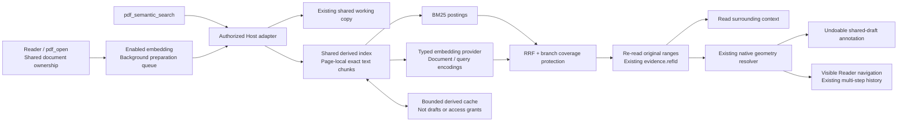

# Hybrid retrieval experiment

Branch: `feat/pdf-hybrid-retrieval`. Local pre-experiment snapshot:
`refs/codex/baselines/pdf-hybrid-retrieval` (`ba04ee5664472c15e90d43bbc58e3bc74148f519`).
The snapshot preserves earlier uncommitted source changes without changing `main`.

## Scope and acceptance

Single-document keyword/semantic/hybrid retrieval feeds the existing exact evidence,
annotation, navigation and multi-step history pipeline. Model edits continue to enter
the shared draft directly; saving still requires confirmation. No second document,
draft or anchor registry is introduced.

The original 2026-10-25 implementation indexed extracted text and reported
OCR/quality/empty-page coverage separately. Its measurements below do not cover
the later OCR and image-description pipeline. Raw page-image vector retrieval
and reranking remain extension work, not release claims.

1. [x] Validate the supplied local MLX embedding runtime with synthetic bilingual data.
2. [x] Original-offset chunks, BM25, cosine ranking and protected reciprocal-rank fusion.
3. [x] Implement bounded, resumable indexing, rebuildable cache and cancellation fencing; focused service tests pass.
4. [x] Implement dynamic embedding registration/settings and the existing evidence/tool integration.
5. [x] Run the frozen synthetic retrieval evaluation and component/cache performance comparison below.
6. [x] Verify the integrated tree: source/test/benchmark types, production build and all 1,256 Node tests pass with no skips; browser replay passes 37/37, including existing exact-navigation/back-history interactions.

Follow-up product evaluation, outside this implementation gate: real Desktop
reading sessions and broader, independently authored document/query sets. No
live Desktop was restarted or configured by this experiment.

The public-tool interface was subsequently updated to short search IDs as described
below. The benchmark measurements and 1,256-test / 37-browser-test acceptance
counts recorded here describe the original experiment run; they have not been
relabelled as validation of that interface update.

The short-ID update was verified separately on 2026-10-25:

- Source, test and benchmark type checks, production build and all 1,276 Node
  tests pass with no skips. Regression cases cover dense-page and multi-page
  continuation, preserved hybrid scope/options, invalid or foreign handles,
  expiry, concurrency, cancellation and suspended-document leases.
- The full 37-case browser suite passes before branch publication, including
  evidence-card navigation and exact evidence annotation/navigation with
  multi-level Reader history.
- The built embedding SDK with local Qwen and a generated six-page PDF passes
  the original-text evidence, shared-draft annotation and navigation checks.
  A separate one-input-batch probe requires two calls: the second sends only
  `searchId` and reaches `complete`. This is a real-model continuation check,
  not a new large-document performance or retrieval-quality claim.

Publication follow-up adds regression tests for document-retirement failures,
stale navigation, Host teardown, and invalid or changing embedding providers.
The translation-cancellation fixture now waits on an explicit response gate
instead of racing a short timer. The updated tree passes 1,300 Node cases
(the browser OCR Worker case was verified separately using local Chrome) and
all 37 browser cases; these changes do not alter production behavior.

## Runtime decision

Current source keeps a persistent index policy per PDF path. Global settings
provide new-document defaults; the Search panel saves document choices
automatically and leaves costly updates to the user. Native text, OCR and image
descriptions have independent caches. Changing one content source reuses the
others, and matching document-encoding identities reuse vectors across query or
batch-size changes. Disabling semantic indexing takes effect immediately;
otherwise pending choices replace the active plan only after a successful update.

The built-in OpenAI-compatible adapter now supplies `documentFingerprint`.
Old vector keys are not migrated or matched by guesswork, so the first upgrade
may recompute document embeddings. Existing aggregate `PageContent` records
remain readable and are split into per-source records when reused; subsequent
compatible records can be reused normally. Third-party providers without a
document fingerprint retain their conservative model key when its identity is
unchanged. The historical benchmark results below predate these policy and cache
changes; they are not new measurements of them.

The supplied `mlx-lm-local-demo` has a cached
`mlx-community/Qwen3-Embedding-0.6B-8bit` model. Its installed convenience helper
truncates to 512 tokens by default. The standalone
[`scripts/local-embedding-server.py`](../scripts/local-embedding-server.py) reuses
that Python environment and cached model directly, without the demo's vector
database, ingestion endpoints or conversation model. It tokenizes with truncation
disabled and rejects oversized requests.

The tested model revision is `b8d7100604f51da6d14eab4dd1805f596fa1ce3f`, producing
1,024-dimensional vectors. Query encoding adds the configured Qwen retrieval
instruction; document encoding does not. The launcher permits at most 8 inputs,
8,192 tokens per input and 16,384 padded tokens per batch. The adapter also bounds
each original input to 16,000 UTF-16 units. Character limits do not replace the
server's token check. This launcher reports model metadata and the response
revision; the adapter learns `/models`' `embedding.revision` and includes it in
the internal cache fingerprint, while checking response consistency within each
operation. A reported model revision change automatically separates old indexes;
no user-configured revision is needed. The generic service adapter also accepts
standard OpenAI-compatible model lists and embedding responses without those extensions.

Synthetic runtime probes encoded 2,028 tokens across long inputs, including
different tails after token 512; those tails produced distinct vectors (L2
distance 0.9367). An over-budget input was rejected with HTTP 422 rather than
truncated. These checks validate input handling, not general embedding quality.
Cancelling an active/queued request returned to the caller in 4.75 ms in one
probe, and a subsequent request completed in 81.3 ms. A running Metal operation
can continue until its bounded batch finishes despite that fast caller return.

From the plugin checkout on a compatible Apple Silicon machine:

```sh
/absolute/path/to/mlx-lm-local-demo/.venv/bin/python scripts/local-embedding-server.py --port 8001
```

The Python environment must already contain MLX embedding, FastAPI, Uvicorn and
their dependencies, with the pinned model cached. The launcher binds only
`127.0.0.1`; it does not download weights or install an environment. It is a
separate process whose startup/shutdown remains the operator's responsibility,
not a cross-platform bundled embedding runtime.

In PDF settings select **Embedding service**. Qwen3 is the default
configuration example: the built-in defaults target
`http://127.0.0.1:8001/v1/embeddings` and the model above. The stable engine ID
remains `local-qwen3-embedding` so existing configurations keep working; the
descriptor uses `execution: 'service'`. The same settings accept a local HTTP
service or a third-party HTTPS service implementing OpenAI-compatible `/models`
and `/embeddings` endpoints. Configure that service's model, vector dimensions
and limits; optional `apiKeyRef` points to a DSH Host credential. Custom model
metadata is not required; reported limits and truncation are checked against the
configuration. The adapter includes a learned service revision in the cache
fingerprint and checks revision consistency within the operation, so reported
version changes automatically separate old indexes. Cache identity is managed
internally; there is no `modelRevision` setting. If a service changes the model
behind the same name without reporting a new revision, use **Recompute entire
index** under **Search → Current PDF index** to refresh one PDF, or **Clear all
index caches** in PDF settings to reset this profile's retrieval caches and old
searches. The profile reset drains background work before clearing, then resumes
still-open PDFs with their active plans; pending choices still need an explicit
update. Other documents rebuild on their next open or search, leaving PDFs,
drafts and saved policies unchanged.
`queryInstruction` defaults to an empty string for every model; configure it according to the model's
requirements. To reproduce this Qwen3 experiment, enter
`Given a search query, retrieve relevant passages from the document that answer the query`.
The benchmark runner supplies that instruction explicitly. Clearing the setting
disables the instruction.

`embeddingEngine: none` is the default: ordinary use starts no model and performs
no download. The conversation model is not assumed to support embeddings. Other
protocols can use the same typed registration contract; see
[engine extensions](ENGINE_EXTENSIONS.md). The measurements below use only the
local launcher, not a third-party service.

The current Host prepares opened PDFs in the background when their active plan
enables an available embedding engine. Reader opens and `pdf_open` share this
path. Preparation always includes native text, can recognize scanned/damaged
text, and can generate whole-page image descriptions according to that plan's
two independent switches. It embeds the resulting text and reuses the same
index, caches and build jobs as search; it does not generate query vectors.
Opening or searching does not activate pending choices. Opening does not wait
for preparation, and an early search may still need the remaining work. Remote
services may receive clean page images and extracted or generated text during
preparation, before any query. The task panel retains green **Index ready**
records until acknowledged with **Done** or the Host removes the closed PDF's
task; acknowledging feedback does not remove index readiness. Other short-lived
save notices retain their existing timers.
The historical benchmarks below do not measure this opening/background behavior.

## Data flow and ownership



`modules/retrieval` owns chunking, ranking and index jobs. `embedding` owns the
typed provider registry. Host adapters own DSH authorization, provider selection,
storage, model-facing search sessions and evidence signing. There is no second
document table or anchor store.

Resident indexes and in-flight build steps are shared across authorized Sessions
within one Host instance by source-byte digest, page count, retrieval
scope/versions and embedding fingerprint/registration generation. Session-local document IDs, paths and
`contentVersion` are not shared-index keys. Each caller still validates its own
document binding and authorization; drafts, queries, continuation handles, results
and evidence references stay Session-scoped. Shared derived data grants no access
to the underlying file. Ready indexes remain bounded LRU residents and may be
evicted; this is not a permanent on-disk index.

### Public tool continuation

Start `pdf_semantic_search` with `documentId`, `query` and its optional `terms`,
`mode`, `topK`, `fromPage` and `maxPages`. The response contains `searchId: "rel_…"`
and a boolean `hasMore`. While `hasMore` is true, call the same tool with only
`{"searchId":"rel_…"}`. Do not repeat the query, document or options. The public
tool no longer accepts `cursor` or returns `nextCursor`; Host keeps the original
request, source/engine constraints and internal continuation progress.

`building` and `incomplete` still report progress and coverage without globally
ranked candidates. Only `complete` returns rankings for the requested scope and
sets `hasMore: false`. Inspect `effectiveMode` and `coverage` before describing a result as complete
text coverage. The current semantic-search tool requires an available embedding
engine; it does not expose the experiment's automatic lexical fallback.

The exact, case-sensitive `pdf_keyword_search` uses the same initial-call pattern, with
its optional `fromPage` and `offset`, then only `{"searchId":"txt_…"}` on that
same tool. Its results are paginated matches; `hasMore: false` means that search
has finished. It does not use related-index build statuses. Neither search ID is
a page-list cursor, and list tools such as `pdf_bookmark_list` retain their own cursor contracts.
The former locate/context model entrances are replaced by keyword search and
`pdf_evidence_read`; evidence replay remains source-bound.

Search IDs are opaque, session-scoped and tool-scoped. Reset, TTL expiry or budget
eviction invalidates them; unknown or expired IDs require a new initial call.
Changing a query, scope or option also starts a new search. IDs do not grant file
access, and source/version validation still prevents mixed-version results.

Each chunk retains its one-based physical page, original UTF-16 start/end and
whole-page text digest. Normalization is confined to scoring. Explicit paragraph
separators and conservative native layout boundaries keep short paragraphs
independent, even when the entire page is below the chunk-size limit. Wrapped
visual lines stay together; only oversized paragraphs use overlapping windows
bounded by 1,200 UTF-16 units or the smaller provider input limit. Boundaries
never split Unicode surrogate pairs or reorder extraction. Ambiguous layouts
can still produce broad candidates. Chunking changes invalidate derived page
and index caches; matching text/model fingerprints can still reuse vectors.

A reference denotes its entire stored quote, not an implicitly selected answer.
Check that scope before marking it. A reference annotation target may include
an exact `quote` to select a unique substring inside that parent reference;
`pdf_page_jump` accepts the same `refId` and `quote` to preserve the selected range.
The shared resolver revalidates the source and full page before deriving native
geometry for that subrange. Missing or ambiguous quotes fail without a draft
edit. Omitting `quote` deliberately keeps the full parent range; annotation does
not silently shorten an explicit whole-page reference.

Only returned candidates receive existing evidence references after their page
text has been re-read and compared. `annotationStatus: requires-geometry-check`
does not promise a writable target: annotation/navigation still invokes the
existing strict native glyph resolver, which may reject ambiguous layout or
missing geometry. OCR-derived candidates are not promoted to native coordinates.

## Budgets and lifecycle

- Embedding is disabled by default. Opened PDFs with an enabled, available active
  plan are prepared in the background; explicit searches reuse its progress and cache.
  Background preparation runs at most one document at a time and tracks up to 64
  open documents, with excess documents left to on-demand retrieval.
- Only UI/model owners keep preparation eligible. Last-owner close or cancellation
  detaches that Session's preparation without stopping other authorized subscribers
  to the same build. Shared work aborts once no subscribers remain. Disabling a
  document's index, changing its active plan or source, and provider unload fence
  obsolete work. Editing global defaults or a pending policy does not switch the
  active plan. Source changes can queue a replacement; unchanged annotation edits do not.
  Failed preparations do not retry indefinitely. Rebuild suspends and drains this
  queue before clearing caches, then resumes eligible still-open documents.
- The default search scope is the whole document; `fromPage/maxPages` restrict
  the scope, not the amount processed per call. This intentionally changes the
  old `pdf_semantic_search` page-window meaning of `maxPages`.
- Process at most 20 pages and 4 embedding batches per indexing step, yielding
  between work units. The model continues with only `searchId` while `hasMore`
  is true; short public handles do not remove the internal bounded steps.
- Host retains query continuation state and validates scope, query, source and
  engine generation. Incomplete coverage produces progress, not a global
  best-match or no-answer claim.
- Production keeps at most four immutable-plan runtimes. Each has at most two
  resident indexes, an estimated 64 MiB index budget, two simultaneous build jobs
  and eight admitted queries; each index is capped at 20,000 chunks. Across four
  runtimes this permits at most eight indexes and 256 MiB of indexed-data budget,
  allocated as data becomes resident rather than reserved up front.
  Build/query admission limits are per runtime, not Host-wide limits of two/eight;
  background document preparation still runs one document at a time. The generic
  retrieval service's standalone defaults remain eight indexes and 64 MiB per
  instance; production limits each instance to two indexes while preserving that
  original per-plan memory budget. Active indexes
  cannot be evicted mid-query; each build step retains its own document lease.
  These are admission estimates, not a guarantee of total process RSS; larger
  scopes may need to be split explicitly.
  Lexical estimates count one posting per distinct term/chunk pair. Resident
  cosine-search vectors use normalized Float32 storage shared by identical text;
  persisted vectors use versioned little-endian Float32/Base64 records with an
  integrity checksum. At a compatible cache key, existing numeric-array records
  migrate on a valid hit without requesting another embedding; this does not
  migrate the old built-in adapter's keys across the document-fingerprint change.
- The separate `pdf_retrieval_<profile>` Storage Domain stores derived text and
  vectors with default limits of 64 MiB serialized data, 12,000 records and 7 days.
  Individual records are limited to 2 MiB. Cache loss/corruption can be rebuilt
  and must not damage drafts. The cache may contain document text; it is local
  plugin storage, not an encrypted vault or an authorization token.
- Derived record keys use filename-safe `retrieval_<digest>` identifiers, as
  required by DSH's per-record JSON backend. Persistence is verified against the
  real backend, including closing and recreating the domain and retrieval
  service. An earlier colon-prefixed key was rejected by that backend; affected
  installations need one initial build because those records were never saved.
- After restart, the service restores text and vectors and reconstructs its
  in-memory search structures; it does not persist Session authorization or query
  cursors. The task panel distinguishes restoration, native page extraction and
  new embedding requests, and reports reused/newly computed passage counts.
  Missing, expired, evicted or invalid records are rebuilt individually. Unchanged
  valid records require neither source extraction nor document embedding.
- Reuse vectors by text/model identity after source revalidation; annotation-only
  edits do not rebuild the text index.
- Extraction-version changes invalidate cached page text and quality metadata.
  The native-quality revision excludes PDFium's recognized U+0002 line-wrap
  hyphen marker from invalid-control-character warnings; actual Unicode mapping
  errors still report a warning. Existing indexes re-extract page metadata, while
  unchanged text can reuse its document vectors.
- A save can change PDF bytes. Page text is verified/re-extracted for the new
  source, while unchanged text may reuse vectors. Changes in weights, tokenizer,
  query instruction, dimensions or provider configuration change the model
  fingerprint; unloading/re-registering also fences the runtime generation.
- Closing a Session cancels its queued work and fences its late results without
  cancelling another Session's shared build subscription or ready index. Plugin
  unload cancels all work. Cancellation of an HTTP request does not imply a running
  external model computation has stopped immediately.

Native PDFium calls and active Metal kernels are not preempted halfway through;
their bounded operation retains its execution slot until it finishes. No claim
is made that all CPU/GPU usage ends as soon as a caller receives cancellation.

## Coverage and limits

Native extraction requests `{ recover: false }`, disabling the Reader's fixed
character-repair path. This does not disable the active indexing plan's selected
OCR engine: its text-recognition switch handles missing/damaged native text, and
its independent image switch adds generated whole-page descriptions. Both may
run during background preparation and incur model calls. Ad-hoc OCR or page-image
tool output is not automatically inserted; indexing uses its own validated source
pipeline. Empty or failed representations remain visible in coverage/warnings.

Native text can retrieve a formula's or figure's page without understanding it.
Enabled OCR and description engines can add searchable derived text, with source
and approximate page/region evidence; they do not provide native text coordinates
or guaranteed formula, chart or table understanding. With those options disabled,
image-only content remains uncovered. The original synthetic complex-page cases
measure that older native-text-only scope, not the accuracy of later enrichment.
There is no raw-image vector index, reranker, semantic answer validator,
cross-document search or automatic section reconstruction. No-answer queries can
still return ranked candidates; the agent must read context and cannot infer that
a result proves the answer.

Production ranking cooperatively yields and rechecks cancellation/source fences
after 64 BM25 build chunks, 1,024 lexical posting contributions or 32 vectors.
These wrappers share algorithms with the synchronous component benchmark; they
are not a dedicated ranking worker or an ANN index. Work within one unit remains
synchronous. Dense/long pages near the chunk budget still need representative
UI/CPU testing. The experiment has no latency SLA.

## Validation record

The records below were produced on 2026-10-25, Apple M5 Pro / 24 GiB RAM,
macOS arm64, Node `v26.7.0`, with the real local Qwen model above. No personal PDFs,
form values or remote embedding service were used.

The corpus in [`bench/retrieval-corpus.ts`](../bench/retrieval-corpus.ts) contains
28 passages and 23 queries: 21 with authored relevant passages and 2 no-answer
cases. Labels were written before inspecting rankings and were not changed after
the failure below. Corpus SHA-256:
`e0d8cbb09ce7b9d985e2739fb7fbe686e119c45c107d933b6593f4157e751fcb`.
It covers bilingual exact/paraphrase/cross-language queries, negation and repeated
passages. Because it helped diagnose and choose the fusion policy, this is a
development corpus, not an untouched held-out evaluation.

### Quality and the failed first fusion

| Method | Recall@5 | Top-1 hit rate | Cross-language Recall@5 (7 queries) |
| --- | ---: | ---: | ---: |
| Frozen old lexical scanner | 66.67% | 66.67% | 0% |
| BM25 | 66.67% | 66.67% | 0% |
| Qwen semantic only | 100% | 90.48% | 100% |
| Naive RRF, up to 30 per branch | 66.67% | 66.67% | 0% |
| RRF, shorten each branch to 10 | 76.19% | 66.67% | 28.57% |
| RRF, protect each branch's first hit | 95.24% | 66.67% | 85.71% |
| Current protected hybrid candidates | 100% | 66.67% | 100% |

With only 28 passages, a long semantic shortlist included nearly the whole
corpus. Weak lexical matches therefore received two RRF contributions and pushed
out correct cross-language passages present only in the semantic branch. Reducing
the shortlist helped but did not fix that structural failure.

The current policy protects the first semantic candidate, first lexical candidate
and second distinct semantic candidate when the requested result count permits;
remaining slots follow RRF (`k=60`). Selected candidates are still presented in
RRF order. At `topK: 1`, only the semantic leader can be protected. This is a
candidate-coverage safeguard, not a relevance probability or a claim of the best
general fusion algorithm. In this corpus it recovered the lost passages but did
not improve Top-1 ordering. A small perfect Recall@5 is not production accuracy.

Both no-answer queries still returned candidates in the current hybrid mode.
There is no calibrated abstention threshold. Three independent unit scenarios
test semantic-only leaders, lexical-only identifiers, duplicates and `topK`
edges separately from the development corpus.

### Component timing and cache reuse

Three repetitions produced 69 query observations per method. These few mixed
queries do not establish stable tail percentiles. First document embedding was
against an already running model; it excludes model loading/download.

| Measurement | Observed |
| --- | ---: |
| Encode 28 synthetic chunks, already-loaded model | 175.96 ms |
| Old lexical query p50 / p95 | 0.122 / 0.222 ms |
| BM25 query p50 / p95 | 0.018 / 0.045 ms |
| Semantic query p50 / p95, including fresh query embedding | 15.69 / 17.18 ms |
| Protected hybrid query p50 / p95, shared work counted once | 15.72 / 17.24 ms |
| 100-page / 100-chunk cached-vector hybrid ranking p95 | 0.285 ms |
| 1,000-page / 1,000-chunk cached-vector hybrid ranking p95 | 2.532 ms |

The scale corpus repeats the 28 small passages, uses about 158,780 text characters
at 1,000 pages and reuses already computed document/query vectors. Those timings
exclude embedding, PDF extraction and disk IO; they do not represent an arbitrary
1,000-page textbook. The theoretical 1,000 × 1,024 × Float32 vector payload is
4,096,000 bytes, but that benchmark reused arrays and the then-current service
stored JavaScript numbers. This is not a measured memory bound for the current
Float32 storage or its production runtime budgets.

The same runner also calls the actual retrieval service, with a synthetic page
provider and a structured-clone in-memory KV adapter:

| Service state | Duration | Page reads | Document embedding inputs | Tool-style calls |
| --- | ---: | ---: | ---: | ---: |
| Empty derived cache | 205.05 ms | 28 | 27 unique texts | 2 |
| Warm same service | 27.12 ms | 0 | 0 | 1 |
| New service, restored derived cache | 54.88 ms | 0 | 0 | 2 |

Each query still encodes the query once. Duplicate page text shares one document
embedding. This validates reuse and continuation, not on-disk performance or the
full Desktop lifecycle.

The JSON report includes Node process CPU time, CPU percentage, RSS/heap snapshots
and coarse 10 ms event-loop timer lag. External MLX/GPU usage is excluded. A scale
stage runs 69 queries synchronously, so its lag includes the entire artificial
query series and must not be quoted as a single Host-query stall. These metrics
do not measure the whole app's memory or rendering performance.

### Real PDFium and local embedding integration

[`bench/retrieval-integration.ts`](../bench/retrieval-integration.ts) generates a
six-page PDF in memory and uses the real PDFium helper and local MLX server. Both
the source and built embedding SDK registry passed the same integration checks:
a Chinese question finds its English evidence, the exact reference creates a
highlight in the shared draft, a later UI-owner open sees that draft, and the
Host navigation contract receives its acknowledgement. No original-file writes
are performed.

| Built-SDK run | Duration | Document embedding inputs |
| --- | ---: | ---: |
| Empty retrieval cache, model already running | 180.32 ms | 6 |
| Warm query | 19.85 ms | 0 |
| Annotate the exact evidence reference | 3.12 ms | 0 |
| Query after draft annotation | 18.82 ms | 0 |
| New runtime/logical document, restored cache records | 337.45 ms | 0 |

The source-SDK cold/warm measurements were 185.09 / 20.91 ms. They are individual
observations, not a comparison of SDK speed. Restoring 12 cache records (132,780
serialized bytes) avoids document embedding but still starts a new native helper;
it is not expected to beat a warm same-runtime query. Built-SDK Node RSS snapshots
ranged from 198.1 to 213.5 MB and exclude the PDFium child and MLX process.

Cache persistence here is a JSON round-trip in memory, not a measurement of the
DSH storage driver. UI takeover and navigation are exercised at their Host
contracts, not by mounting a browser or testing viewport scrolling/back history.
These six synthetic text pages validate the integration path, not broad retrieval
quality, complex layouts or large-document performance.

### Reproduce

Lexical-only mode requires no model:

```sh
npm run bench:retrieval -- --repeats 3 --out /tmp/retrieval-lexical.json
```

After starting the cached local model:

```sh
npm run bench:retrieval -- \
  --embedding-endpoint http://127.0.0.1:8001/v1/embeddings \
  --repeats 3 --out /tmp/retrieval-qwen.json
```

After building the plugin and native helper, the separate integration runner is:

```sh
npm run bench:retrieval:integration -- \
  --endpoint http://127.0.0.1:8001/v1/embeddings \
  --sdk dist --out /tmp/retrieval-integration.json
```

The runner writes structured JSON to stdout and optionally creates an output file
exclusively; choose a new filename for each run. An explicitly requested but
unavailable backend fails the run rather than substituting fake vectors or
reporting a lexical result as semantic. The original failed RRF policy is still
evaluated alongside the current policy. `bench/legacy-related-text.ts` is the
frozen old baseline and is not shipped as a second production search path.

Local raw records from this session are
`/private/tmp/pdf-retrieval-qwen-benchmark-20261025.json` (initial failed fusion),
`/private/tmp/pdf-retrieval-verified-performance-20261025.json` (final component/cache
run), `/private/tmp/pdf-retrieval-lexical-benchmark-20261025.json` (model-free
run), and `/private/tmp/pdf-retrieval-verified-integration-20261025.json` (final
built-SDK/native/local model integration). Final timing tables above use these
verified runs, executed serially after repository tests finished. Earlier
source-SDK integration remains at `/private/tmp/pdf-retrieval-integration-source.json`.
They are temporary machine-local artifacts, not repository fixtures.

The original experiment's final `npm run check` passed source, test and benchmark type checks, the production
build and 1,256 Node tests with zero failures/skips (including the OCR browser
worker test using installed Chrome). The independent browser replay suite passed
37/37. Published SDK imports, declaration paths and package inclusion were checked.
Runtime tests cover continuation/source changes, cache bounds and restoration,
shared-job leases, query admission, cancellation/unload, real Cordis contributor
registration, current semantic capability reporting and the exact evidence-to-draft
chain. These gates do not establish broad semantic accuracy or real Desktop UX
acceptance; the development-corpus and environment limitations above still apply.
