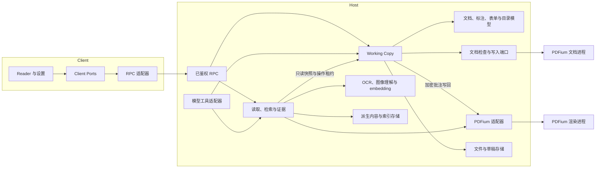

# PDF 插件架构

本文说明当前源码的职责、数据归属和运行时边界。工作副本四层契约见[Working-copy abstraction model](./working-copy-model.md)。功能与使用限制见[功能规范](../spec.md)，模型工具契约见[模型工具契约](./agent-tools.md)，扩展接口见[引擎扩展](./engine-extensions.md)，原生实现见[原生 PDF 实现](../native-pdf.md)，引擎分层见[PDF 引擎模块](./pdf-engine.md)。

## 运行时与职责

一个 DSH bundle 装配四个 Host 入口和一个 Client 入口。Host 拥有文件权限、文档事实、工作副本和持久化；Client 拥有阅读交互；PDFium 在受管理的独立进程中运行。

RPC 和模型工具共享领域能力与工作副本，不各自实现写入事务。入口可有不同交互和查询策略：Reader 的交互搜索与模型的有界关键词搜索共享文字内核，但不强制使用相同限额。读页、搜索和识别不会暗中导航；后台打开文档与在侧栏显示文档是两个操作。

## 源码地图

| 路径 | 职责 |
| --- | --- |
| `src/plugins/` | Cordis 服务注册、配置、依赖与释放；装配 Host 和 Client 入口 |
| `src/contracts/` | RPC、文档操作、引擎与 native 协议的跨边界 schema；发布包入口保持稳定 |
| `src/engines/spi/` | 引擎/provider 契约、目录、配置校验、路由与缓存身份 |
| `src/engines/{ocr,image,translation,embedding}/` | 独立引擎 SDK、服务生命周期和可替换后端实现 |
| `src/capabilities/` | 可执行能力注册；`pdfium/` 将工作副本操作接入 native boundary |
| `src/layers/document/` | 源 PDF、页面表示、工作副本、标注、表单和内置书签领域状态 |
| `src/layers/document/working-copy/` | `WorkingCopyRecord`、基线获取与分类、身份/owner/凭据驻留、原子状态转换及命令 facade |
| `src/layers/derived/content/` | 页面派生数据类型、可复用产物及其缓存 |
| `src/layers/derived/indexing/`、`src/layers/derived/storage/` | 检索分块与索引的缓存格式、检查点、校验及持久化 |
| `src/layers/facade/` | 页面内容生产、embedding 调用、索引编排、相似度检索、证据、导航和其他用例 |
| `src/surfaces/host/routes/`、`tools/`、`io/` | 鉴权 RPC、模型工具、文件与 DSH 存储适配；不拥有领域写入规则 |
| `src/surfaces/client/viewer/` | Reader 的组件、控制器、窗口化绘制、展示模型与外部端口 |
| `src/surfaces/client/adapters/`、`settings/` | RPC/会话适配、设置 UI、确认和合并逻辑 |
| `src/native-boundary/{client,host,protocol}/` | TypeScript↔Native API、双端进程适配和共享 wire contract；与 PDFium 领域适配分开 |
| `src/shared/` | 跨运行时共享类型、几何、缓存与纯工具 |
| `native/` | Worker runtime、稳定 Backend 接口、PDFium worker、构建依赖锁与原生回调测试 |
| `native/pdfium/patches/` | 版本化 unified `.patch` 队列与清单；按锁定 PDFium revision 顺序应用，扩展源码作为新增文件保存在补丁中 |

Cordis 插件/服务是组合根：Host 服务经 capability 与 engine SPI 选择并调用引擎实现，依赖箭头从服务侧出发；provider 不反向依赖 Cordis。`working-copy` 组合文档、标注、表单和目录算法，文件操作、PDF 物化与存储通过端口接入。Host 不导入 Client 运行时代码，Client 不导入 Host 实现。领域模块可脱离 DSH 装配测试，但并非全部模块都是无 Node 依赖的纯函数。

PDFium 文档进程负责检查、逐页指纹和写入，与前台渲染进程分开排队。`native/worker/worker-runtime.cpp` 只负责进程生命周期、二进制 framing、请求关联和错误 envelope；`native/backend/pdf-backend.h` 定义可替换的 Backend 边界，当前实现是 `PdfiumBackend`。两者共用 `src/native-boundary/protocol/` 契约。文档进程接收 PDF 字节与类型化操作，返回元数据或经重开校验的 PDF 字节。Host 负责文件授权、工作副本修订和原子发布。

加密与密码属于 `BaselineProvider` 的获取边界，不由 Reader、模型工具、证据或保存模块自行解析。Reader 已持有的基线可被模型入口复用；模型首次打开可收到 `pdf/password-required`，在用户提供密码后重试同一个 `pdf_open`。凭据只保留在 Host 工作副本内，绝不进入快照、草稿、RPC 或工具结果。另存为在独立原生句柄上应用草稿，分块读回密文，并重新打开核对加密、原始权限和批注后再原子发布。

## 文档身份与授权

文档表按资源会话和规范路径维护唯一工作副本。UI 手动打开和模型 `pdf_open` 取得同一副本；任一入口的编辑都会推进同一修订并通知其他视图。表单字段、标注、评论和书签都进入该副本的操作日志。

| 身份 | 含义 |
| --- | --- |
| `documentId` | 当前 Host 生命周期内的会话工作副本 ID；释放驻留资源后仍可重新接管，Host 重启后重新获取 |
| `baselineId` / `sourceDigest` / 草稿 `sourceHash` | 同一个固定基线字节版本的 SHA-256 身份；保存标注也会产生新的基线，不与文件系统版本混用 |
| `sourceVersion` | 文件适配器观察到的文件系统版本；不能替代字节摘要 |
| `WorkingCopyRecord` | 持久的资源路径、源版本和带 `baselineId` 绑定的 `OperationSet`；不要求驻留 native 句柄 |
| `BaselineResource` | Host 内固定基线（字节、解析文档和来源身份）；native 句柄由 PDFium 适配器按作用域单独持有，可淘汰后重获 |
| `ContentContext` | `baselineId`、工作副本 `revision`、`contentVersion`、正文/页摘要的不可变 fence；Reader 与模型 renderer 共享，不能携带句柄或密码 |
| `NativeBaselineRef` | Host-only `{ baselineId, documentId, generation }`；`documentId` 是 worker 进程内随机 ID，代次不符时释放不会启动新 worker |
| `contentVersion` | 工作副本的页面逻辑内容身份，当前为 UUID；不等于跨重启稳定哈希，也不足以判定页图或标注是否更新 |
| `revision` | 成功编辑、撤销/重做、保存或重载等状态转换推进的修订，用于写入 CAS 和并发校验 |
| `reader.bytesHash` + `generation` | 当前原生基线字节与 worker 代次；位图还须区分页、缩放、区域和方向 |
| `indexContentDigest` | 可复用正文身份，排除标注、目录和元数据；不能可靠规范化时退回源字节摘要 |
| `refId` / `inspectionId` | 会话限定的证据或表单检查句柄，不是永久 PDF 对象 ID，也不授予权限 |

外部页号从 1 开始，只有原生 `pageIndex` 从 0 开始。坐标须明确 PDF、viewport 或 image 空间，转换由共享几何模块承担。

`baselineId` 变化不会自动丢弃操作。刷新会返回 `conflict: true` 及 `baselineMismatch`（操作仍绑定的基线、当前可观察基线和 `adopt-current`/`retain-operations` 两个选择）；只有显式 reload/discard 或等价的模型决定才会采用新基线。基线获取失败只返回打开失败，原操作集保持不变；投影/物化失败也不发布部分结果。

Host 从连接或工具执行上下文取得可信身份，再按文件资源会话授权。当前聊天会话、资源所属会话和标签页 occurrence 不能混用。`pdf.info` 等无文件启动接口不需要虚构资源会话；读取和写入则必须核对工作副本归属、文件权限与期望版本。解释发送还要求资源会话与目标聊天相符。阅读上下文只是带有效期的提示，不是访问凭据。

## 写入、保存与恢复

`src/layers/document/working-copy/service.ts` 拥有每会话串行队列和唯一写入事务。UI 与模型共用校验、投影、修订比较及撤销历史。模型编辑直接进入未保存草稿；模型保存独立经过 DSH 用户审批，不能用模型自报的确认字段代替批准。

保存以基线优先：草稿记录持久化源摘要、`baselineId` 和操作集；是否同时落盘基线字节由存储适配器决定，不改变核心模型。物化以完整基线加操作集为输入，失败时保留整个操作集，不发布部分快照；发布前保存待写字节的 `renderedHash`。文件适配器执行规范路径队列、权限与观察版本检查、原子替换和最终摘要复核。恢复时只有磁盘摘要等于 `renderedHash` 才能认定此前已发布；否则保留草稿和冲突。成功发布后的清理失败只产生可重试警告，不把文件重新标成未保存。普通文件系统不能提供与无关外部写入者之间的跨进程事务，保存结果不确定时不冒充成功。

驻留策略区分逻辑工作副本和 native 资源：活动 Reader 的基线保持可用；非活动或仅模型引用的普通基线可释放，随后按同一 `baselineId` 和操作集重新获取；受保护基线和凭据只在至少一个 owner 存在时保留。模型入口优先复用活动 Reader 基线，否则通过同一 `BaselineProvider` 获取。外部文件变化在 open/refresh/save 的授权读点检查，普通 page/text 读取继续绑定当前工作副本；需要新源证明的图像或已保存证据会另做 source fence 校验。Client 的 `NativeDocument` 淘汰旧读取，由 `useReaderDocument` 合并当前 owner 的过期恢复请求；自动重试有界，旧响应不能覆盖新缓存，也不会重载源文件或丢弃草稿。

| 持久数据 | 位置与边界 |
| --- | --- |
| 草稿 | `pdf_drafts_<namespace suffix>` Storage Domain，`format: 1`；支持内联原始字节及独立 `baseKey` 基线；旧记录读取时以 `sourceHash` 回退 `baselineId`，校验失败按 `pdf/draft-damaged` 处理 |
| 阅读位置 | `pdf_positions_<namespace suffix>`；当前仍绑定源字节摘要 |
| 证据 | `pdf_evidence_<namespace suffix>`；保存有界文字或受保护附件引用，不复制 PNG |
| 文档索引偏好 | `pdf_index_policies_<namespace suffix>`；按规范路径保存两个内容开关及冻结的生效计划 |
| 完整索引与派生缓存 | `<DSH_HOME>/storages/dsh-plugin-pdf/<profile>/<namespace hash>/retrieval-v1/records.sqlite` |
| 索引诊断 | `<DSH_HOME>/logs/dsh-plugin-pdf/<profile>/`，有界 JSONL 轮转；不记录正文、图片、原始模型响应或文件路径 |

草稿格式号不变不代表旧二进制能理解新增操作。`groups`、`groupDates` 与 `cursor` 表示操作分支的活动前缀；撤销只移动 cursor，重做回到同一分支，失败批次不得写入半组。新版读取既有草稿，但含表单或目录编辑的草稿不能保证降级兼容；降级前应先保存或丢弃这些草稿并备份文件与存储。

## 页面内容与检索

`PageContent` 保留页几何、原生文字、UTF-16 范围及带来源的内容表示。`native-text`、`ocr-text` 和 `image-description` 分别记录生产者、配置身份、输入摘要、状态、警告与可选位置。当前视觉后备块是整页区域，不推断独立插图、公式或表格结构。OCR 和视觉描述可同时参与索引；它们是派生内容，不能冒充精确原生文字。

`src/layers/facade/search/retrieval/` 从已授权工作副本组合原生提取、OCR、图像描述和独立 embedding 引擎，读取并写入 derived 层的可重建缓存。文档偏好只保存 OCR 与图像描述两个内容选项；facade 每次按当前引擎配置和文档身份选择缓存，没有持久化的活动引擎计划。原生文字、OCR 和图像描述按路径、页码、逐页正文指纹及各自引擎身份缓存，向量按文字及文档编码指纹复用。正文指纹排除标注、批注和书签，包含页几何、资源与共享渲染依赖。已就绪的索引在同正文保存后保持就绪，在途读取和结果引用仍按文件版本校验。无法验证的页按文件字节保守复用，其他页仍可独立命中缓存。

读页的本地字符映射修复与新索引的内置 Tesseract OCR 共用 `page-ocr-artifacts` 原始产物链：相同源字节、路径、页、PDFium 构建、页几何、栅格参数和生产者身份才可复用。内置引擎统一使用不含标注和表单外观的 2048px 长边输入，保持读页修复密度；第三方 OCR 保留自己的引擎、配置、语言和 1024px 输入身份。产物只保存识别文字、图像坐标和来源，不保存图像或会话权限；每个订阅者独立复核授权与源，取消最后一个订阅者才取消共享生产。本地冷任务仍限制为一个 worker。历史 1024px 索引表示继续可读，不被强制重建，也不冒充新的原始产物。

证据引用固定其文字表示：Host 复读和解析沿用签发时的原生／OCR 来源，Reader 的文字 RPC、缓存及精确跳转也保持同一选择。自动修复只影响默认阅读，不改写已有原生引用的全文摘要或偏移；质量报告不授予标注权限。

SQLite 保存完整内容、向量和逐页检查点，内存只保留有界热缓存和当前页/候选工作集。向量先提交，再发布引用它的页检查点。`index-head` 和 `index-transaction` 管理已接受代次、候选代次与回收；查询绑定代次和数据修订，旧分片在没有使用者后回收。取消、失败或重启保留成功检查点，不重复有效 OCR 或向量计算；缺失可继续构建，损坏记录明确失败。索引不导入旧文件或旧 Storage Domain 缓存。

每份 PDF 只独立配置文字识别和视觉描述两个开关，引擎与连接配置由全局设置提供。目标计划与已生效计划分开：普通设置更新不删除已完成索引；明确更新才接纳新计划。`resume` 继续取消/失败任务原有计划和检查点，`start` 应用目标设置，重建是显式操作。全局停用是可逆门控，不删除持久结果。

构建、手动请求和后台预建复用同一调度器及操作租约。查询逐页扫描并只保留有界候选；BM25 使用全文统计，语义查询使用对应向量。可用内容与失败页同时存在时保留候选和覆盖限制，不能宣称整体就绪。构建性能和测量方法见[性能证据](../performance.md)与[检索文档](./retrieval.md)。

## 证据与精确操作

读取和检索签发的引用保存来源快照与精度。`text-target` 是模型标注、精确导航和历史工具卡共用的解析入口：重新授权当前副本、校验源与整页摘要、核对精确范围，再从当前原生字形重建坐标。不能把近似缓存边界、OCR 偏移或同文搜索当作精确定位。子引文和连续跨页范围由证据层解析，跨页标注一次原子写入，不能省略中间页。

图像引用保留受保护附件及来源摘要，发送前再次验证。页面图像生产与 OCR/图像理解分离，普通页图不自动合成未保存草稿覆盖层。表单 inspection 则保留单页编号映射：Host 恢复真实字段身份并在同一工作副本校验类型、依赖、共享字段和修订，不自动推断表单语义。具体输入输出由工具契约文档维护。

解释模式发送文字材料前，通过 `pdf.selection` 按原始引用成批重新验证整页文字摘要、精确偏移和原生字形。标注编辑或保存后的新修订可在验证通过后接纳，但整批必须绑定同一个当前来源与修订；验证不改写旧证据。图像及混合材料仍保留捕获来源约束，不能借文字重验更新旧图片的来源。

## 扩展与生命周期

`pdfCapabilities` 负责需求发现与提供者规划；引擎目录负责具体 OCR、图像理解、翻译和 embedding 实现的注册、配置及可用性。默认与第三方实现走同一生命周期接口。能力声明不能绕过真实执行路径：当前 PDF 页面由 PDFium 绘制，打开检查只接受该执行者实际提供的能力。实现和公开导出见[引擎扩展](./engine-extensions.md)。

| 所有者 | 状态及结束规则 |
| --- | --- |
| React 可见视图 | DOM、画布、测量和临时弹层；隐藏/卸载释放显示任务，不等于关闭逻辑文档 |
| 标签 occurrence | 返回栈、阅读位置及临时识别结果；以 `tab.id` 和其取消信号区分同 ID 的不同实例 |
| 工作副本登记表 | `WorkingCopyRecord`、UI 具名引用、模型所有权和内部操作 pin；普通文档最后一个 owner 离开后可回收驻留 baseline/native 资源并保留操作集，受保护文档的 Host 内存凭据与未持久化操作随最后 owner 释放 |
| 单次异步任务 | 独立取消、序号与期望版本；身份失效或 baseline/content fence 变化后丢弃迟到结果，不能复活已释放的引用 |
| Native ref | `NativeBaselineRef.generation` 绑定 worker；代次过期的 close 是 no-op，不通过 stale ID 拉起替代 worker |
| 引擎 Fiber | 注销实现并取消该实现的在途任务；未知选择保留并报不可用，不静默切换后端 |
| 会话 detach | 取消并排空该代模型任务、释放模型引用；不删除会话日志、持久草稿或证据 |
| 插件/Host | 停止接纳、取消并排空任务和位置写入，再关闭 worker 与存储；release/dispose 幂等，迟到 native 结果不能重新登记 baseline 或 owner |

后台文档策略只对工作副本登记表执行空闲/容量回收，不另建文档表。操作 pin 防止执行中的副本被回收。被动状态订阅有有限等待上限，不能等待插件卸载才结束，从而阻塞 Desktop 重启更新。

Reader 由 `src/surfaces/client/Reader.tsx` 组合功能 controller；窗口化页面、tile 和文字层位于 `viewer/rendering`。数值页布局、缩放交接、导航和历史共享坐标，不依赖可能已卸载的 DOM 锚点。面板共用 `ScrollablePanel`，弹层共用 Reader 内部定位与焦点规则；样式位于 `src/surfaces/client/`，不覆盖 DSH 全局选择器。

目录/非 React 文件使用 `kebab-case`，React 文件使用 `PascalCase.tsx`，hook 使用 `useXxx`；模型 PDF 工具使用 `pdf_*`，RPC 使用 `pdf.*`。公开包入口、声明生成及打包清单须随接口变化同步。架构边界与复杂度可通过 `npm run arch:report` 检查；当前测试与覆盖率口径见[测试指南](./testing.md)。
