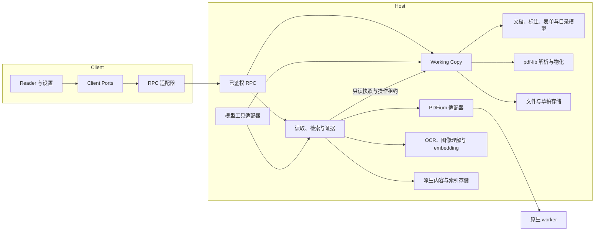

# PDF 插件架构

本文说明当前源码的职责、数据归属和运行时边界。功能与使用限制见[功能规范](../spec.md)，模型工具契约见[模型工具契约](./agent-tools.md)，扩展接口见[引擎扩展](./engine-extensions.md)，原生实现见[原生 PDF 实现](../native-pdf.md)。

## 运行时与职责

一个 DSH bundle 装配四个 Host 入口和一个 Client 入口。Host 拥有文件权限、文档事实、工作副本和持久化；Client 拥有阅读交互；PDFium 在受管理的独立进程中运行。

RPC 和模型工具共享领域能力与工作副本，不各自实现写入事务。入口可有不同交互和查询策略：Reader 的交互搜索与模型的有界关键词搜索共享文字内核，但不强制使用相同限额。读页、搜索和识别不会暗中导航；后台打开文档与在侧栏显示文档是两个操作。

## 源码地图

| 路径 | 职责 |
| --- | --- |
| `src/entrypoints/` | Cordis 服务注册、配置、依赖与释放；组合 Host 和 Client |
| `src/contracts/` | RPC、导航、索引、诊断及模型选择的跨端 schema |
| `src/modules/working-copy/` | 文档登记表、UI/模型引用、驻留、操作队列、草稿、撤销/重做与保存 |
| `src/modules/document/` | 不可变源、页面内容及原生/OCR 表示、渲染计划和文字恢复映射 |
| `src/modules/annotations/`、`forms/`、`outlines/` | 标注投影、表单身份与校验、内置书签树操作；不直接写文件 |
| `src/modules/evidence/`、`model-write/` | 来源引用、范围与几何验证、模型草稿编辑及保存审批 |
| `src/modules/search/`、`retrieval/` | 搜索会话、分块、排名、索引策略、检查点与代次管理 |
| `src/modules/navigation/`、`explanation/` | 阅读上下文、导航请求和阅读位置；解释材料与提词组合 |
| `src/modules/capabilities/`、`engines/` | 能力规划、类型化引擎目录、配置与缓存身份 |
| `src/modules/ocr/`、`image-understanding/` | 与 PDF 解耦的图像处理服务和任务生命周期 |
| `src/modules/viewer/` | `components` 视图、`controllers` 交互状态、`rendering` 窗口化绘制、`model` 纯展示逻辑、`ports` 外部依赖 |
| `src/adapters/host/dsh/` | DSH RPC、工具、会话、模型、授权和后台任务装配 |
| `src/adapters/host/{filesystem,storage,pdf-lib,pdfium,ocr,embedding}/` | 文件/存储及具体 PDF、OCR、embedding 实现 |
| `src/adapters/client/{remote,dsh}/` | RPC 客户端、订阅、快照同步和会话发送 |
| `src/client/` | Reader/Settings 组合、DSH 工具卡、会话生命周期与样式 |
| `src/shared/` | 共享契约、纯坐标换算、有界缓存和订阅辅助 |
| `src/core/pdf-types.ts`、`src/navigation/`、`src/engine/framing.ts` | PDF 数据类型、纯视口历史、原生帧协议 |
| `src/{ocr,translation,embedding}/`、`src/host/` | 已发布 SDK、注册接口及 Host 类型入口 |
| `native/` | PDFium worker、构建依赖锁与原生回调测试 |

`working-copy` 组合文档、标注、表单和目录算法；文件操作、PDF 物化与存储通过端口接入。Host 不导入 Client 运行时代码，Client 不导入 Host 实现。领域模块可脱离 DSH 装配测试，但并非全部模块都是无 Node 依赖的纯函数。

## 文档身份与授权

文档表按资源会话和规范路径维护唯一工作副本。UI 手动打开和模型 `pdf_open` 取得同一副本；任一入口的编辑都会推进同一修订并通知其他视图。表单字段、标注、评论和书签都进入该副本的操作日志。

| 身份 | 含义 |
| --- | --- |
| `documentId` | 当前 Host 生命周期内的会话工作副本 ID；释放驻留资源后仍可重新接管，Host 重启后重新获取 |
| `sourceDigest` / 草稿 `sourceHash` | 源 PDF 字节 SHA-256；保存标注也会改变，用于源校验和保存冲突 |
| `sourceVersion` | 文件适配器观察到的文件系统版本；不能替代字节摘要 |
| `contentVersion` | 工作副本的页面逻辑内容身份，当前为 UUID；不等于跨重启稳定哈希，也不足以判定页图或标注是否更新 |
| `revision` | 成功编辑、撤销/重做、保存或重载等状态转换推进的修订，用于写入 CAS 和并发校验 |
| `reader.bytesHash` + `generation` | 当前原生基线字节与 worker 代次；位图还须区分页、缩放、区域和方向 |
| `indexContentDigest` | 可复用正文身份，排除标注、目录和元数据；不能可靠规范化时退回源字节摘要 |
| `refId` / `inspectionId` | 会话限定的证据或表单检查句柄，不是永久 PDF 对象 ID，也不授予权限 |

外部页号从 1 开始，只有原生 `pageIndex` 从 0 开始。坐标须明确 PDF、viewport 或 image 空间，转换由共享几何模块承担。

Host 从连接或工具执行上下文取得可信身份，再按文件资源会话授权。当前聊天会话、资源所属会话和标签页 occurrence 不能混用。`pdf.info` 等无文件启动接口不需要虚构资源会话；读取和写入则必须核对工作副本归属、文件权限与期望版本。解释发送还要求资源会话与目标聊天相符。阅读上下文只是带有效期的提示，不是访问凭据。

## 写入、保存与恢复

`modules/working-copy/service.ts` 拥有每会话串行队列和唯一写入事务。UI 与模型共用校验、投影、修订比较及撤销历史。模型编辑直接进入未保存草稿；模型保存独立经过 DSH 用户审批，不能用模型自报的确认字段代替批准。

保存先持久化草稿和原始基线，再物化 PDF；发布前保存待写字节的 `renderedHash`。文件适配器执行规范路径队列、权限与观察版本检查、原子替换和最终摘要复核。恢复时只有磁盘摘要等于 `renderedHash` 才能认定此前已发布；否则保留草稿和冲突。成功发布后的清理失败只产生可重试警告，不把文件重新标成未保存。普通文件系统不能提供与无关外部写入者之间的跨进程事务，保存结果不确定时不冒充成功。

基线变化后，Client 的 `NativeDocument` 淘汰旧读取，由 `useReaderDocument` 合并当前 owner 的过期恢复请求，读取最新快照而不重载源文件、丢弃草稿或增加视图引用。自动重试有界，旧响应不能覆盖新缓存；新基线实际读取成功后，只清除属于这次恢复的错误。

| 持久数据 | 位置与边界 |
| --- | --- |
| 草稿 | `pdf_drafts_<namespace suffix>` Storage Domain，`format: 1`；支持内联原始字节及独立 `baseKey` 基线 |
| 阅读位置 | `pdf_positions_<namespace suffix>`；当前仍绑定源字节摘要 |
| 证据 | `pdf_evidence_<namespace suffix>`；保存有界文字或受保护附件引用，不复制 PNG |
| 文档索引偏好 | `pdf_index_policies_<namespace suffix>`；按规范路径保存两个内容开关及冻结的生效计划 |
| 完整索引与派生缓存 | `<DSH_HOME>/storages/dsh-plugin-pdf/<profile>/<namespace hash>/retrieval-v1/records.sqlite` |
| 索引诊断 | `<DSH_HOME>/logs/dsh-plugin-pdf/<profile>/`，有界 JSONL 轮转；不记录正文、图片、原始模型响应或文件路径 |

草稿格式号不变不代表旧二进制能理解新增操作。新版读取既有草稿，但含表单或目录编辑的草稿不能保证降级兼容；降级前应先保存或丢弃这些草稿并备份文件与存储。

## 页面内容与检索

`PageContent` 保留页几何、原生文字、UTF-16 范围及带来源的内容表示。`native-text`、`ocr-text` 和 `image-description` 分别记录生产者、配置身份、输入摘要、状态、警告与可选位置。当前视觉后备块是整页区域，不推断独立插图、公式或表格结构。OCR 和视觉描述可同时参与索引；它们是派生内容，不能冒充精确原生文字。

`adapters/host/dsh/page-content.ts` 从已授权工作副本组合原生提取和图像引擎；`modules/retrieval` 只拥有可重建索引，不拥有第二份 PDF 或草稿。原生文字、OCR、描述按各自身份独立缓存，向量按文字及文档编码指纹复用。正文身份排除标注等编辑，使同路径、正文未变的保存和重开可复用；所有读取仍重新授权，缓存键不能授予访问权。

SQLite 保存完整内容、向量和逐页检查点，内存只保留有界热缓存和当前页/候选工作集。向量先提交，再发布引用它的页检查点。`index-head` 和 `index-transaction` 管理已接受代次、候选代次与回收；查询绑定代次和数据修订，旧分片在没有使用者后回收。取消、失败或重启保留成功检查点，不重复有效 OCR 或向量计算；缺失可继续构建，损坏记录明确失败。旧缓存迁移验证来源与生产者，不以静默重算掩盖存储错误。

每份 PDF 只独立配置文字识别和视觉描述两个开关，引擎与连接配置由全局设置提供。目标计划与已生效计划分开：普通设置更新不删除已完成索引；明确更新才接纳新计划。`resume` 继续取消/失败任务原有计划和检查点，`start` 应用目标设置，重建是显式操作。全局停用是可逆门控，不删除持久结果。

构建、手动请求和后台预建复用同一调度器及操作租约。查询逐页扫描并只保留有界候选；BM25 使用全文统计，语义查询使用对应向量。可用内容与失败页同时存在时保留候选和覆盖限制，不能宣称整体就绪。构建性能和测量方法见[性能证据](../performance.md)与[检索文档](./retrieval.md)。

## 证据与精确操作

读取和检索签发的引用保存来源快照与精度。`text-target` 是模型标注、精确导航和历史工具卡共用的解析入口：重新授权当前副本、校验源与整页摘要、核对精确范围，再从当前原生字形重建坐标。不能把近似缓存边界、OCR 偏移或同文搜索当作精确定位。子引文和连续跨页范围由证据层解析，跨页标注一次原子写入，不能省略中间页。

图像引用保留受保护附件及来源摘要，发送前再次验证。页面图像生产与 OCR/图像理解分离，普通页图不自动合成未保存草稿覆盖层。表单 inspection 则保留单页编号映射：Host 恢复真实字段身份并在同一工作副本校验类型、依赖、共享字段和修订，不自动推断表单语义。具体输入输出由工具契约文档维护。

## 扩展与生命周期

`pdfCapabilities` 负责需求发现与提供者规划；引擎目录负责具体 OCR、图像理解、翻译和 embedding 实现的注册、配置及可用性。默认与第三方实现走同一生命周期接口。能力声明不能绕过真实执行路径：当前 PDF 页面由 PDFium 绘制，打开检查只接受该执行者实际提供的能力。实现和公开导出见[引擎扩展](./engine-extensions.md)。

| 所有者 | 状态及结束规则 |
| --- | --- |
| React 可见视图 | DOM、画布、测量和临时弹层；隐藏/卸载释放显示任务，不等于关闭逻辑文档 |
| 标签 occurrence | 返回栈、阅读位置及临时识别结果；以 `tab.id` 和其取消信号区分同 ID 的不同实例 |
| 工作副本登记表 | UI 具名引用、模型所有权和操作 pin；最后一个 owner 离开后可回收驻留快照与 native 资源，保留身份及恢复数据 |
| 单次异步任务 | 独立取消、序号与期望版本；身份失效后丢弃迟到结果，不能复活已释放的引用 |
| 引擎 Fiber | 注销实现并取消该实现的在途任务；未知选择保留并报不可用，不静默切换后端 |
| 会话 detach | 取消并排空该代模型任务、释放模型引用；不删除会话日志、持久草稿或证据 |
| 插件/Host | 停止接纳、取消并排空任务和位置写入，再关闭 worker 与存储；释放幂等 |

后台文档策略只对工作副本登记表执行空闲/容量回收，不另建文档表。操作 pin 防止执行中的副本被回收。被动状态订阅有有限等待上限，不能等待插件卸载才结束，从而阻塞 Desktop 重启更新。

Reader 由 `src/client/Reader.tsx` 组合功能 controller；窗口化页面、tile 和文字层位于 `viewer/rendering`。数值页布局、缩放交接、导航和历史共享坐标，不依赖可能已卸载的 DOM 锚点。面板共用 `ScrollablePanel`，弹层共用 Reader 内部定位与焦点规则；样式位于 `src/client/`，不覆盖 DSH 全局选择器。

目录/非 React 文件使用 `kebab-case`，React 文件使用 `PascalCase.tsx`，hook 使用 `useXxx`；模型 PDF 工具使用 `pdf_*`，RPC 使用 `pdf.*`。公开包入口、声明生成及打包清单须随接口变化同步。架构边界与复杂度可通过 `npm run arch:report` 检查；当前测试与覆盖率口径见[测试指南](./testing.md)。
