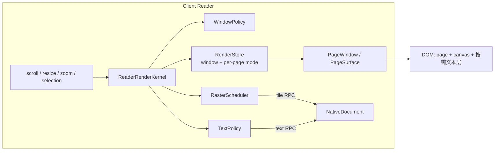

# PDF 插件重构计划 v2

状态：**Phase 0–1 完成；Phase 2 仅完成窗口上限与 preview 范围；完整 RenderStore/单调度器未实施；Phase 3 的 Native 契约清理已完成**。本文取代 [refactor-plan.md](./refactor-plan.md) 中与 Client 渲染、契约治理相关的部分；v1 的 Host 事务、Native patch queue、索引与迁移结论仍然有效。

范围：**Client 渲染管线重写 + 契约单一事实源 + 架构门禁**。Host 工作副本、保存事务和 Native 协议语义不做行为性改动。

## 0. 结论摘要

采用 **自适应渲染内核（Adaptive Render Kernel）**：

- 每个 Reader 滚动根只有一个帧循环和一个渲染调度器，页面不再各自监听 `scroll`、各自 `reconcile`。
- 虚拟窗口按**页数**封顶，不再按“上下各一视口”无限扩张。
- 文本层从“挂载页的默认产物”改为**按需资产**：低缩放不建、可读缩放只给可见页 + 当前页，并按缩放选择 glyph / run 两种精度。
- 文本命中框由 native 文本几何换算，不再逐 span 调 `getBoundingClientRect()`。
- 滚动和缩放只更新一个外部 store 的窗口/模式快照，React 不再每帧 diff 全部页面。

这条路线在真实 Reader 上验证过：**在 10% 缩放下隐藏全部文本层后，2 秒慢速滚动的最大帧从约 0.95–10.3 秒降到 16.8ms**（这是瓶颈验证和性能上界，不是实现本身）；仅限制页数或仅截断 span 都不够（见第 2 节）。因此目标不是“少渲染一点”，而是**把文本层从滚动热路径上彻底移走**，同时用内核把每帧的强制布局压到一次。

选择理由和备选方案见第 3 节。执行分两条工作流：

- **工作流 A（主线，性能）**：Phase 0–2，渲染内核。
- **工作流 B（并行，契约与边界）**：Phase 3，单一契约、命名、CI 门禁。
- **工作流 C（可选）**：Phase 4，10% 以下的缩略图总览模式。

## 0.1 实施进度（Phase 0–2）

已完成：

- `src/modules/viewer` 移到 `src/client/viewer`；所有导入、`tests/module-boundaries.test.ts`、`arch:report` 分类和架构文档同步。
- 新增 `npm run check:architecture`（Host/Client 导入、领域模块 React 导入、模块环、viewer/Reader 预算），并加入 `npm run check`。
- 文本策略：新增 `text-policy.ts`（none/run/glyph、可见/当前/固定页、最多 3 页），`WindowedPages` 按页选择精度，`Page` 在 `none` 时不建文本层。
- 低缩放选择：**低于 50% 为纯浏览模式**，不建文本层、不可选中/复制；越界时清空现有选区。链接、批注、表单、搜索高亮不受影响。native selection preview 也服从该阈值。
- 命中框：`computeTextLayerBoxes` 由 native 文本几何直接计算，删除逐 span `getBoundingClientRect()`。
- `scrollPreview` 不再作为文本层 effect 的依赖；快速滚动只影响 raster。
- 选中/导航页只保留已有精度，不把 run 升级为 glyph；否则替换 span 会让跨页 DOM Range 失效。
- 新增 `text-policy`、几何命中、Page 低缩放测试，以及 `low-zoom-selection.e2e.ts`。
- Phase 2 采用进入条件中的缩小方案：普通窗口最多 16 页、快速滚动最多 8 页；若一屏可见页超过上限则保留全部可见页，交互固定页不计入预算。没有为架构完整性强行引入第二套 `RenderStore`。
- 低缩放当前页通过 native selection geometry 复用纯文本，提供一个隐藏的 `role=document`；仍不启用选择或复制。
- Native transport schema 和 golden fixtures 已改为实际运行的扁平 v2（`requestId + command payload` / `{requestId,ok,value|error}`），删除旧 `nativeHandle`/`hostRevision`/事务字段。

验证：针对性 Node 测试覆盖窗口上限、语义文本与扁平 v2 fixtures；关键 Web E2E 覆盖 10% 窗口 ≤16、无文本层、当前页语义文本、50% 恢复选择、快速滚动 preview，以及连续缩放无白屏。完整套件结果以交付前最新运行记录为准。

实测（text-1000，真实 Reader，同协议临时 E2E；证据在 `.test-output/phase1-measure.json`）：

| 场景 | Phase 1 结果 |
| --- | --- |
| 100% | 2 个 glyph 文本层、3,492 span；慢速滚动 p95 16.7ms / max 50ms；快速滚动 p95 116ms / max 117ms |
| 100% → 10% 提交 | 688ms；1 个 long task（108ms） |
| 10% | **0 个文本层**、0 span；滚动不差于移除前（16.8ms 慢速 / 33.4ms 快速） |
| 10% 挂载页 | ≤16（Phase 2 上限；若一屏本身超过 16 页则保留全部可见页） |

偏差与后续：

- 低缩放已提供当前页隐藏纯文本；它是页面级语义兜底，不等同 tagged PDF 的结构化阅读顺序。
- 没有引入 feature flag；回退点仍是 `text-policy.ts` 与 `WindowedPages` 的窗口预算。
- `low-zoom-selection.e2e.ts` 已固化 10% 的窗口、文本层、语义文本和选择阈值验收；更细的长帧分位数仍由一次性性能测量记录承担。
- 100% 快速滚动仍使用既有 preview raster 调度；本轮只实施进入条件允许的“窗口上限”，未强行重写为完整 `RenderStore`。

## 1. 范围与非目标

### 1.1 范围内

- `src/client/viewer` 的渲染、窗口、文本层、raster 调度和滚动/缩放集成。
- `src/client/Reader.tsx` 的渲染组合方式。
- `src/contracts/rpc`、`src/engine/protocol`、`src/shared/contracts.ts` 的契约收敛。
- `client/viewer` 的归属与命名、`npm run arch:report` 的门禁化。
- 与上述改动直接相关的测试、基准和文档。

### 1.2 非目标

- 不改 Host 工作副本的写入、保存、撤销、恢复事务。
- 不改 Native 命令语义、PDFium 版本或 patch queue；只改版本/命令的单一来源和契约测试。
- 不引入 Canvas/WebGL 全量阅读器（见 3.2 的取舍）。
- 不做跨端状态迁移，不改变文档身份模型。
- 不承诺 10% 以下继续用 DOM 页面渲染；低于 10% 需要 Phase 4 的总览模式。

## 2. 基线证据

### 2.1 测量方法

- 语料：`bench/.generated/text-1000.pdf`（1000 页、密集文本）。
- 环境：真实 Web scaffold + 真实 Reader + Chromium（与本机 Web 测试相同）。
- 操作：打开文档 → 设为 100% → 一次捏合手势缩到 10%（当前下限）→ 等待提交 → 从顶部慢速滚动 500px / 2s。
- 指标：rAF 帧间隔、`getBoundingClientRect` 调用次数与累计耗时、挂载页数、文本层 span 数、DOM 节点数、long task。
- 缓解手段的对比在**同一次运行**内完成；缩放提交数据来自另一组同协议测量。数值是相对证据，不是硬性 SLA。

### 2.2 结果

| 场景（10% 缩放） | 挂载页 | 文本 span | 2s 内帧数 | 最大帧 | `getBoundingClientRect` 累计 |
| --- | ---: | ---: | ---: | ---: | ---: |
| 当前实现 | 19–28 | 33.5k–49.7k | 13 | **0.95–10.3s** | 1.3–10.6s |
| 隐藏全部文本层 | 24 | 40.6k（不参与布局） | 121–122 | **16.8ms** | 0.17s |
| 只保留视口内文本层 | 23 | 35.3k | 15 | **1.43–1.47s** | 2.2–2.3s |
| 每页截断到 500 span | 23 | 14.8k | 31–33 | **0.42–0.57s** | 1.35–1.5s |
| 每页截断到 200 span | 24 | 10.9k | 58–60 | **0.47–0.50s** | 1.35–1.41s |
| 限制到 6 页 | 23 | 15.8k | 29 | **0.55s** | 1.57s |
| 6 页 + 隐藏文本 | 24 | 17.6k（不参与布局） | 121 | **16.8ms** | 0.09s |
| 页级 `contain: strict` | 23 | 33.5k | 11 | **1.77s** | 3.04s |

> “限制到 6 页”和“只保留视口内文本层”是通过隐藏其余已挂载 DOM 模拟的，span 数仍按全量统计；真实内核会卸载这些页，因此实际收益只会更好，不会更差。`contain` 变体在 `windowed-page`、`dsh-pdf-page`、`dsh-pdf-text-layer` 上都试过，均未改善。

其他基线：

- **100%**：3–4 页、5.2k–7.1k span；慢速滚动 p95 16.8ms，快速滚动 p95 约 100ms、最大 166ms。即高缩放也有可感知卡顿，只是没有 10% 那么致命。
- 10% 是当前缩放下限（[use-pdf-wheel-zoom.ts:261](../src/client/viewer/controllers/use-pdf-wheel-zoom.ts#L261)），所以它是必须通过的真实最坏场景，而不是人为构造的极端值。
- **10% 的缩放提交本身**：一次手势整体约 12.1s，其中 32 个 long task 合计阻塞约 10.9s。
- 14 次 `TileSurface.reconcile` 的 `getBoundingClientRect` 各约 670ms；CPU profile 的样本几乎全部落在该原生调用上。

### 2.3 证据说明了什么

1. **文本层是主因，不是 raster**。同一页面、同一 canvas 数量下，隐藏文本层后滚动完全恢复 16.8ms；tile 仍在请求，说明 raster 不是瓶颈。
2. **只做“可见页文本”不够**。10% 时视口内约 10 页，仍有 1.4s 级卡顿。
3. **只截断 span 不够**。每页 200 span（总量约 1 万）仍有约 0.5s 最大帧，且 `getBoundingClientRect` 累计没有明显下降。真正贵的是**每个挂载页的文本宿主参与布局 + 每个页面的强制布局次数**，不是单纯 span 数量。
4. **页数上限有效但不充分**。6 页仍约 0.55s；6 页 + 无文本才回到 16.8ms。
5. **CSS 隔离不是答案**。`contain: strict`、`content-visibility`、页级 containment 都实测更慢（1.8–1.9s），不能作为主方案。
6. **只做“批量读取”也不够**：把 `getBoundingClientRect` 缓存为每个元素一次布局后，最大帧仍约 0.48–0.50s。批量读取能减少强制布局次数，但不能消除文本层参与布局的成本。
7. 因此必须同时做两件事：**低缩放不建文本层**，以及**把每帧的同步布局从“每页一次”收敛为“至多一次”**。

## 3. 方案探索

### 3.1 候选

| 方案 | 做法 | 性能上限 | 风险 | 语义/无障碍 | 工作量 |
| --- | --- | --- | --- | --- | --- |
| A. 热修 | 页数上限 + 低缩放隐藏文本 + 去掉 preview 重建 | 中（10% 可达标，100% 仍约 100ms） | 低 | 基本保持 | 小 |
| **B. 渲染内核（选定）** | 单帧循环 + 页数窗口 + 自适应文本 + 几何命中 + 单一 raster 调度 | **高** | 中 | 保持（文本按可读性分级） | 中–大 |
| C. Canvas/WebGL 阅读器 | 页面和文本都画到 canvas，选择走几何 | 最高 | 很高 | 破坏 DOM 选择/无障碍，需重做命中、搜索高亮、表单 | 很大 |
| D. 缩略图总览 | 低于阈值时用一张 canvas 条带替代 DOM 页面 | 低缩放最高 | 中 | 需新的交互/选择规则 | 中 |
| E. CSS 隔离 | containment / content-visibility | 无提升（实测更差） | 低 | 保持 | 极小 |
| F. 独立 viewer 包/iframe | 把 Reader 隔离到独立包或 iframe | 无提升（同一浏览器布局） | 中 | 保持 | 中 |

### 3.2 决策

**选 B，D 作为 Phase 4 可选扩展。**

- 不选 A：热修能把 10% 救回来，但 100% 的快速滚动 p95 仍约 100ms，且 `Reader` 每帧 diff 全部页面、每页一个监听的结构还在，文档变长或加标注后会再次退化。用户明确要求“大改动”和“性能最好”，A 不够。
- 不选 C：虽然上限最高，但 DOM 文本选择、无障碍、表单控件、搜索高亮、链接命中和 OCR 叠加都要重做；而 B 已经能用更小的代价达到 16.8ms 级滚动，C 的额外收益不值得。
- 不选 D 作为核心：10% 是当前缩放下限，先让 10% 可用；如果以后要下探到 5%，D 是正确工具，但不应在第一阶段引入新的交互语义。
- 不选 E/F：实测无收益或收益与成本不匹配。
- 另评估过 **Worker/OffscreenCanvas** 与 **React 并发渲染**：前者只能把 raster 移出主线程，DOM 文本布局仍在主线程；后者不能减少同步布局，均不采用。

### 3.3 为什么不是“只加页数上限”

6 页仍有约 0.55s 最大帧；10% 下用户看到的是“滚动一下停半秒”。页数上限只能把 10s 降到 0.5s，必须配合文本策略和单帧调度才能进 16.7ms。

## 4. 目标架构

### 4.1 总览



核心原则：**滚动帧内只做一次读取、一次计划、一次提交**；页面组件不拥有滚动监听、不拥有 IntersectionObserver、不在滚动路径上测量 DOM。

### 4.2 状态所有权

| 状态 | 所有者 | 生命周期 |
| --- | --- | --- |
| 页面数值布局（top/height/scale） | `RenderStore`（由 `buildPageLayout` 产生） | zoom / resize / rotation 变化时重建 |
| 活动页窗口 | `WindowPolicy` | 滚动、缩放、导航时更新；带滞回 |
| 每页模式（off/mounted/raster/text） | `RenderStore` | 窗口变化或文本策略变化时更新 |
| 文本层内容与精度 | `TextPolicy` + `PageTextCache` | 按需构建，LRU，滚动时取消 |
| raster tile 任务 | `RasterScheduler` | 每帧计划、异步执行、可取消 |
| 选区、输入、弹层 | 现有 controller / Reader state | 不变 |
| 文档事实、修订、草稿 | Host 工作副本 | 不变 |

`RenderStore` 只保存**派生渲染状态**，不复制 Host 的文档事实；任何需要持久化或跨会话的状态仍由 Host 拥有。

### 4.3 ReaderRenderKernel

每个 `scrollRoot` 一个实例，`useReaderRenderKernel(scrollRoot, layout, document)` 创建，tab 卸载时销毁。

```ts
interface ReaderRenderKernel {
  /** 唯一输入：滚动/缩放/尺寸/DPR 变化时由宿主调用。 */
  invalidate(reason: 'scroll' | 'zoom' | 'resize' | 'selection' | 'content'): void
  /** 每帧只读一次的快照，供页面组件订阅。 */
  subscribe(listener: () => void): () => void
  getSnapshot(): RenderSnapshot
  dispose(): void
}
```

帧循环：

1. **sample（≤2ms）**：读 `scrollTop/scrollLeft/clientWidth/clientHeight` 和 DPR；数值布局已在 store 中，不读页面 DOM。
2. **plan（纯函数）**：计算可见页范围、窗口（页数上限 + 滞回）、每页的 `raster/text` 模式、文本精度、tile 优先级。
3. **commit（≤4ms）**：一次性更新 `RenderStore`；React 只收到窗口/模式变化的通知；canvas 的增删在同一个写阶段完成。
4. **async**：raster 请求和文本构建在帧外执行；完成后只更新对应页的 store 条目。

约束：

- 帧内不允许“写 DOM 后再读布局”。需要尺寸时用数值布局或上一帧缓存。
- 现有热点代码的落点：[WindowedPages](../src/client/viewer/rendering/WindowedPages.tsx#L95-L117)、[Page](../src/client/viewer/rendering/Page.tsx#L110-L229)、[TileSurface](../src/client/viewer/rendering/TileSurface.tsx#L91-L122)、[windowForViewport](../src/client/viewer/rendering/page-layout.ts#L78-L86)。
- `invalidate` 合并到下一帧；同一帧多次滚动只处理最后一次。
- 文本构建、tile 完成都通过 store 更新，不直接触发父级全量 render。
- 页面组件不注册 `scroll` 监听；`scrollPreview` 由内核计算，不再由单独的 hook 驱动窗口。

### 4.4 窗口策略

```ts
interface WindowPolicy {
  maxLivePages: number        // 硬上限 16；正常 = 可见页 + 2*overscan + 1，最小 8
  overscanPages: number       // 1
  hysteresisPages: number     // 1
  pinnedExtra: number         // 2（选区、导航目标、当前页）
  fastScrollPages: number     // 8（不低于可见页数）
}
```

- 可见范围由数值布局二分查找得到，与现有 `pageIndexAtOffset` 一致。
- 窗口 = 可见范围 ± `overscanPages`，再按 `maxLivePages` 截断；接近边缘时保持至少 `hysteresisPages` 的余量，避免来回挂载/卸载。
- 固定页（选区、导航目标、当前页）可以超出上限，但计入总预算的 `pinnedExtra`。
- 快速滚动时窗口至少覆盖可见页（`fastScrollPages=8`）、不建文本层；停止 96ms 后恢复普通窗口并重建可见文本。
- 页间距 `PAGE_GAP` 保持在布局层，不参与窗口计算；如果 10% 下观感仍然稀疏，再单独评估是否按缩放收缩，不与本计划耦合。

上限不是固定 10：10% 时一屏约 10 页，窗口需要约 13–14 页才能覆盖可见区 + 上下 overscan；因为低缩放没有文本层，这些页的成本很低。真正的硬上限是 16，正常窗口按 `可见页 + 2*overscan + 1` 计算；100% 时自然落在 8 以内。数值在 Phase 2 用基准校准。

### 4.5 文本层策略

这是本次改动收益最大的部分。

| 缩放范围（PDF scale） | 文本精度 | 说明 |
| --- | --- | --- |
| `< 0.5` | **none** | 10% 属于此档；所有页都不建 text layer，选区被禁用，只能浏览 |
| `0.5 – 0.9` | **run** | 每个 text run 一个 span（约 100–300/页），不做逐 glyph |
| `>= 0.9` | **glyph** | 保持现有逐 glyph 精度 |

规则：

1. **只给可见页 + 当前页 + 固定页建文本层**，同时最多 3 页；其余挂载页只有 raster。
- **固定页不升级精度**：已在 run 的页被选中/导航固定后保持 run；替换 glyph 节点会使现存的 DOM Range 失效。
2. **低缩放一刀切**：低于 50% 不建文本层，也不接受拖选/双击/键盘选择/复制；缩小越过阈值时清空选区。链接、批注、表单、搜索高亮仍按几何工作。
3. 文本层在 raster 完成后**空闲时**构建（`requestIdleCallback`，超时兜底）；滚动开始立即取消未完成构建，保留已完成页。
4. **`scrollPreview` 不再出现在文本层 effect 的依赖里**。快速滚动只影响 raster 和窗口，不销毁/重建文本层；停止后只补当前可见页，不一次性重建全部。
5. **命中框由几何计算**：用 `NativeTextContent.items` 的 `transform`、`width` 和 viewport 变换直接算 PDF/Viewport 四边形；DOM 测量只用于选区绘制的 `Range.getClientRects()`，且只在 `selectionchange` 时执行。
6. **文本构建按页分块**：单页超过预算（例如 8ms）时分片，避免一次长任务；构建期间不阻塞 raster。
7. **无障碍（已实施）**：低缩放没有文本层时，当前页提供一个 `visually-hidden` 的纯文本 `role=document` 节点。

文本层 DOM 的约束：

- 每个 span 仍绝对定位，但不再参与滚动路径上的测量（替换现在 [Page.tsx:215-219](../src/client/viewer/rendering/Page.tsx#L215-L219) 的逐 span 测量）。
- `run` 精度下每个 span 覆盖一个 run/行，不再逐字符；50%–90% 的选区是行级近似。
- 文本层只在 `PageSurface` 内部，由 store 的 `text` 模式决定是否挂载；不会随每次滚动重新创建。

**已确认的产品语义**：`< 0.5` 时纯浏览，不支持选中；越过阈值缩小会清空选区。这是本计划唯一改变用户可见行为的地方。

### 4.6 Raster 调度

- 一个 `RasterScheduler` 管理所有页面的 tile 任务；`PageSurface` 只渲染 canvas 宿主，不再注册 `scroll` 监听或 `ResizeObserver`。
- 每帧根据数值布局和视口计算每页的可见区域与目标 DPR；tile 请求全局并发 4，按“离视口中心距离”排序，滚动时取消优先级低的任务。
- 保留现有“最后一次完整 epoch”语义：新 epoch 未完成时继续显示旧 canvas，避免白页。
- 快速滚动使用 preview 比例（0.75）和单 tile 覆盖；停止后按目标 DPR 重绘。
- 每页 raster 预算与总像素预算沿用现有 `12M` 上限；如果某页超过预算，仍按 tile 切分，但 canvas 的增删由调度器批量执行。

### 4.7 React 集成

- `RenderStore` 通过 `useSyncExternalStore` 暴露；`PageWindow` 订阅窗口列表，`PageSurface` 订阅自己那一页的模式。
- 快照只在**窗口范围或某页模式变化**时更新；普通滚动不触发页面列表 re-render。
- `WindowedPages` 删除 `position` state 和每帧 `setPosition`；容器高度/页面 top 只在布局变化时更新。
- `Page` 删除 `IntersectionObserver` 和 `scroll` 监听；可见性由内核计算。
- `Reader.tsx` 只负责创建 kernel、把 scrollRoot 交给它；不再在渲染路径上拼 20 个与滚动相关的 props。
- 保持现有 wheel zoom 的 CSS 预览和一次提交语义；提交后由 kernel 重算布局，不改变锚点逻辑。

### 4.8 选择、命中与无障碍

- 文本命中：几何四边形 + 现有 `createRectHitIndex` / 选区模型，不再依赖逐 span 的 DOM 矩形。
- 选区绘制：保留 `selection-highlight.ts` 的 `Range.getClientRects()`，只在选区变化时执行。
- 链接/批注/表单命中：继续用 viewport 变换后的 PDF 几何；它们本来就不依赖文本层。
- 低缩放：默认无文本层、不可选中；`nativeSelectionPreview` 也被阈值关闭。当前页另有页面级隐藏语义文本供屏幕阅读器读取。
- OCR/解释/搜索高亮：都基于 overlay 矩形，不依赖文本层存在。

### 4.9 缩放、滚动、导航的兼容

- 轮盘缩放的手势预览、锚点恢复、`wheelZoomReflow` 保持不变；kernel 只消费最终的 scale。
- 导航仍使用数值布局；`currentLayout()` 的校验不变。
- 阅读位置、历史、恢复逻辑不改。
- `scrollPreview` 由 kernel 统一判定，删除 `useReaderScrollPreview` 的独立状态源；保留其阈值作为 kernel 的输入参数。

## 5. 工作流 B：契约与边界治理

这部分与 A 并行，不阻塞渲染优化，但必须在 Phase 3 收口。

### 5.1 Native 契约单一来源

现状问题：

- `src/engine/protocol/commands.ts` 的 `NativeRequest` 联合类型、C++ 的 22 项命令表、`native/backend/pdfium/pdfium-worker.cpp` 的 `hello` 版本号、`engine/host/native-worker.ts` 的版本检查、`entrypoints/native-host.ts` 的 manifest 检查各自手写。
- （已修复）`schemas/native/transport.schema.json` 与 `tests/contracts/fixtures/*.json` 已从带 `nativeHandle`/`hostRevision` 的旧计划协议迁移到实际运行的扁平 v2。

目标：

- 以 `native/dependencies.json` 为版本/构建号的唯一来源；构建时生成 `native/build-info.json` 和 `src/engine/protocol/version.ts`（或等价生成物），C++ 用生成头文件，TS 不再硬编码 `156.0.8076.0`。
- 以 TS 命令表为命令名的唯一来源；新增 `scripts/check-native-contract.mjs`，解析 C++ 命令表与 TS 联合类型，缺一即失败。
- 删除或重写 `schemas/native/transport.schema.json` 与 fixtures，使其匹配 v2；真正的契约测试改为启动 worker 的 `hello/open/render` 往返（现有 native 测试已具备基础设施）。
- 保留握手校验，但把它作为最后防线，而不是唯一同步机制。

### 5.2 RPC wire 与领域类型

现状：`src/contracts/rpc`（zod）和 `src/shared/contracts.ts`（TS 接口）各自维护；`WorkspaceSnapshot` 与 `WireSnapshot` 没有编译期等价关系，映射靠手写。

目标：

- `src/contracts/rpc` 保持为唯一 wire 事实源。
- 新增 `src/shared/snapshot-codec.ts`，只在这里做 wire → 领域映射；所有 Client adapter 使用它。
- 增加类型级测试：wire 的每个字段都有明确的消费/映射，新增字段未处理时测试失败（可用 `satisfies` + 显式字段表）。
- 将 `src/shared/contracts.ts` 重命名为 `src/shared/api.ts`，减少“两个 contracts”的歧义。

### 5.3 模块归属与命名

- `src/modules/viewer` → `src/client/viewer`（或 `src/ui/reader`）：`modules/` 只保留与运行环境无关的领域模块，`client/` 放 UI 应用。**Phase 0 已完成移动**，避免 kernel 写完后再次搬迁。现状参考 [viewer/index.ts](../src/client/viewer/index.ts)。
- `src/modules/engines` → `src/modules/ai-providers`（或 `engine-directory`）：与 `src/engine`（PDF 引擎/协议）区分。
- `src/host`（5 行 SDK 类型）→ 合并到 `src/entrypoints` 或 `src/sdk/host.ts`。
- 可选：`src/engine` → `src/pdf-engine`，让“PDF 引擎”和“AI provider”在名字上不再冲突。
- 所有重命名单独提交、纯机械改动、不混行为变更；`arch:report` 的 `isClient/isHost` 分类同步更新。

### 5.4 架构门禁

当前 `npm run arch:report` 只是手动报告。改为：

- `npm run check:architecture`（新增脚本）：
  - `hostToClientDirectImports === 0`、`clientToHostDirectImports === 0`；
  - 值级循环依赖为 0（`import type` 单独统计，允许类型环但要有清单）；
  - `modules/**` 不得导入 React（`viewer` 移走后）；
  - viewer/Reader 文件数与复杂度按**棘轮**约束：不得超过当前值，只能下降。
- 先以 report-only 进 CI 一周，再改为 blocking；从 `npm run check` 调用。
- 增加性能 smoke：paper-12 的 `reader.scroll` 在 PR 上跑；text-1000 的 10%/100% 场景在 nightly 跑。

### 5.5 Host 组合根（可选，Phase 3）

`entrypoints/reader-host.ts` 目前手工打开 4 个 storage domain，失败时嵌套关闭。抽一个 `openScopedDomains()`（逆序释放、聚合错误）即可，不需要新模块。此项与性能无关，放在最后，避免和渲染改动混在一起。

## 6. 迁移阶段

### Phase 0：基线与门禁（2–3 天）

- 记录当前 100% / 25% / 10% 的滚动、缩放提交、选区基线；把测量脚本固化为 bench 场景。
- 把 `modules/viewer` 移到 `client/viewer`；更新导入和 `arch:report`（已完成）。
- 加 `check:architecture`（report-only）；给 `Reader`/viewer 记录复杂度与文件数基线。
- 结果：后续每个 Phase 都有可对比的数字和回滚开关。

退出条件：移动后全量测试通过；基线报告归档；CI 能看到架构报告。

### Phase 1：文本策略 + 几何命中（4–6 天）

- 实现 `TextPolicy` 与 `PageTextCache`：none/run/glyph、可见页 + 当前页、最多 3 页、空闲构建、滚动取消。
- 删除 `scrollPreview` 对文本层 effect 的依赖；停止后只补可见页。
- `Page` 的命中框改为几何计算；删除逐 span `getBoundingClientRect()`。
- 低缩放阈值（50%）、越界清空选区；隐藏纯文本无障碍兜底已在 Phase 2 实施。
- 默认用 feature flag 关闭新策略，做 A/B。

退出条件：10% 慢速滚动最大帧 ≤33ms、缩放提交 ≤1s；100% 无明显回退；选区/链接/搜索高亮回归通过。

### Phase 2：渲染内核（7–10 天）

> 进入条件：Phase 1 结束后先复测。如果 100% / 25% 的滚动 p95 已经达标，Phase 2 可以缩小为“单一调度器 + 窗口上限”，不强行引入完整的 `RenderStore`；只有复测仍不达标，才按本节完整执行。这样避免为了架构而架构。

- 引入 `RenderStore` / `WindowPolicy` / `RasterScheduler` / 帧循环。
- `WindowedPages` 删除每帧 `position` state；页面窗口只在范围变化时更新。
- `TileSurface` 的 scroll/RO/每页 reconcile 收敛到内核；页面组件变成纯展示。
- 自适应窗口（硬上限 16，正常 = 可见页 + 2*overscan + 1；快速滚动不低于可见页）+ 滞回；快速滚动只降 raster，不重建文本。
- 保留 wheel zoom 的预览和锚点。

退出条件：100% p95 ≤16.7ms（1000 页密集文本 ≤33.3ms）、最大帧 ≤50ms；10% 保持 Phase 1 指标；挂载页 ≤16（10% 约 13–14）、文本层 ≤3、长任务 ≤100ms；raster 清晰度不回归。

### Phase 3：契约与边界收口（4–6 天）

- Native 命令/版本单一来源 + 契约测试修正。
- `snapshot-codec` + 类型级一致性测试；`shared/contracts.ts` 重命名。
- 命名收敛、`check:architecture` 转 blocking、性能 smoke 进 CI。
- 可选：Host 组合根 scoped domains。

退出条件：`npm run check` 包含架构门禁；native 契约测试跑真实 worker；旧 schema/fixtures 删除或对齐。

### Phase 4（可选）：10% 以下总览模式

- 低于 `OVERVIEW_SCALE`（例如 0.1）时，用单张 canvas 条带显示页面缩略图，不挂载 DOM 页面和文本层；点击页面回到 DOM 渲染并放大。
- 是否降低缩放下限、是否保留选择语义，需要产品确认后再做。

## 7. 性能验收

固定环境、同一语料、同一协议；数值是目标，不是当前结果。

| 指标 | 100% | 25% | 10% | 说明 |
| --- | ---: | ---: | ---: | --- |
| 滚动 p95 帧间隔 | ≤16.7ms | ≤16.7ms | ≤16.7ms | 1000 页密集文本允许 ≤33.3ms |
| 滚动最大帧 | ≤50ms | ≤50ms | ≤50ms | 不允许 >100ms 的 long task |
| 缩放提交阻塞 | ≤300ms | ≤300ms | ≤1s | 当前 10% 约 10.9s |
| 挂载页数 | ≤8 | ≤12 | ≤16（约可见页+3） | 硬上限 16；固定页最多 +2 |
| 文本层页数 | ≤3 | ≤3 | 0 | 低缩放纯浏览 |
| 文本 span 总数 | ≤6k | ≤6k | 0（按需 ≤2k） | 逐 glyph 时按页预算 |
| DOM 节点 | 基线 +10% 内 | — | — | 与同比例缩放比 |

附加：

- `page.tile` 的 p95 请求数不高于当前；raster 清晰度（可见面积、采样密度）不低当前基线。
- 滚动停止后的 raster settle 不比当前差 10% 以上。
- 内存：文本层按 3 页 LRU；raster 沿用现有预算；不新增无界缓存。

测量场景：

- `reader.scroll`（100% / 25% / 10%）
- `reader.zoomout`（100% → 10%，单手势）
- `reader.selection`（正常缩放选词、跨页选择）
- `reader.jump`（远页跳转）
- 语料：`paper-12`、`text-1000`、一份扫描件（OCR 文本层）

## 8. 测试计划

### 8.1 单元

- `WindowPolicy`：页数上限、滞回、固定页、边界页。
- `TextPolicy`：阈值、精度、可见页/当前页、LRU 淘汰、取消。
- 几何命中：run/glyph 两种精度的四边形、旋转页、混合页尺寸。
- `RenderStore`：快照稳定性（同一帧不重复通知）。

### 8.2 浏览器 E2E

- 10% 慢速滚动、快速滚动、滚轮缩放、页面跳转。
- 选区（正常缩放；低缩放禁用并清空）、链接、批注、搜索高亮、OCR 叠加。
- 侧栏展开/收起、窗口 resize、旋转页、表单控件。
- 无障碍：Phase 1 未覆盖；Phase 2 已提供低缩放当前页隐藏文本。

### 8.3 性能

- PR smoke：paper-12 的 scroll / zoom；门槛用相对回归（≤10%）。
- nightly：text-1000 的 100% / 25% / 10%；输出帧、long task、DOM、文本 span、raster settle。
- 与本次基线对比，不以绝对机器阈值代替配对比较。

## 9. 删除清单

完整 RenderStore 路线（仅当后续配对基准证明仍需要）才删除：

- `WindowedPages` 的每帧 `position` state 和每帧全量 diff。
- `TileSurface` 的每页 `scroll`/`ResizeObserver`/`reconcile` 入口。
- `Page` 的 `IntersectionObserver`、`scroll` 监听（逐 span `gBCR` 已删除）。
- `useReaderScrollPreview` 作为独立状态源（逻辑并入 kernel）。

本轮已完成：旧 Native transport schema 与 fixtures 已重写为 v2。旧 `refactor-plan.md` 保留为历史设计记录，由本文声明取代其冲突章节。

不删除：Host 工作副本、Native 命令语义、证据/索引、表单/批注模型。

## 10. 风险与待确认决策

| 决策 | 选项 | 建议 |
| --- | --- | --- |
| 低缩放文本选择 | A. 关闭；B. 选择意图时构建单页；C. 点击先放大 | **A，已确认**：低于 50% 纯浏览 |
| 文本阈值 | `<0.5` none / `0.5–0.9` run / `≥0.9` glyph | 先用这组值，Phase 1 用真实字体校准 |
| 缩放下限 | 保持 10%；或 Phase 4 降到 5% + 总览 | 先保持 10%，总览另开需求 |
| viewer 归属 | 移到 `client/viewer`；或保留 `modules/viewer` | **已移动**，否则 `modules` 的语义继续被稀释 |
| 命名 | `engine` vs `engines` 是否重命名 | **重命名**，成本最低的时点是现在 |
| Native 契约同步 | 完整 JSON Schema 生成；或命令表检查脚本 | 先做检查脚本，完整生成留到有第二 Backend 时 |
| 是否包含 Host 组合根 | 本轮做；或单列 | 本轮只做可选，不阻塞性能 |

风险：

- **文本策略改变选择语义**：已确认 `<50%` 纯浏览、不支持选中；以后如需低缩放选择，走 native selection，而不是恢复 DOM 文本层。
- **低缩放没有文本层**：搜索高亮/链接/批注不受影响（它们走 overlay）；选区被明确禁用，用户需要放大到 50% 以上。
- **raster 与文本解耦后的事件顺序**：用 store 的版本号保证旧文本不会覆盖新布局；沿用现有 epoch/取消语义。
- **React 外部 store 的撕裂**：`useSyncExternalStore` 的快照必须不可变；每帧只生成一次新快照。
- **Phase 2 期间两套渲染路径并存**：只允许在 feature flag 内共存，Phase 2 退出时删除旧路径，不保留双实现。

## 11. 完成定义

- 10% 缩放下滚动不再出现 >50ms 的帧；缩放提交 ≤1s。
- 100% 缩放下 p95 ≤16.7ms（1000 页密集文本 ≤33.3ms）。
- 挂载页有硬上限（16）且随可见页收紧；文本层 ≤3；DOM/内存有界且可测。
- 选区、链接、批注、表单、搜索高亮、OCR 在正常缩放下无回归；低缩放按“<50% 纯浏览”工作。
- `npm run check` 包含架构门禁；native 版本/命令只有一个来源；过期 schema/fixtures 已清理。
- 文档（architecture、performance、native-pdf）与代码同步；本计划中的阈值和常量有对应测试或基准。

## 附录 A：本次证据

- 基线/缓解对比：临时 Web E2E（text-1000，真实 Reader），输出保存在 `.test-output/zoom-mitigation.json`；临时测试文件已删除。
- Phase 1 验收：同一语料与协议，输出保存在 `.test-output/phase1-measure.json`；临时测试文件已删除。
- 相关代码：`client/Reader.tsx`、`viewer/rendering/{WindowedPages,Page,TileSurface,page-layout}.tsx`、`viewer/controllers/{use-reader-pages,use-reader-page-tracking,use-pdf-wheel-zoom}.ts`。
- 复现命令（Phase 0 会固化为 bench 场景）：Web scaffold + `bench/.generated/text-1000.pdf`，滚轮 12 × 200 到 10%，慢速滚动 500px/2s。

## 附录 B：与 v1 的关系

- 保留：Host 事务、revision/CAS、草稿/保存、证据/索引身份、Native patch queue、迁移矩阵。
- 替换：Client 渲染（v1 的 P7 只做到“UI 不持有文档事实”，没有解决渲染热路径）、Native 协议的生成/契约同步（v1 的 P0 承诺未完全落地）、契约类型一致性。
- v1 的 `NativePdfPort` 章节按“历史设计”阅读；实际运行协议以 `src/engine/protocol` + `native-pdf.md` 的 v2 为准，Phase 3 统一。
