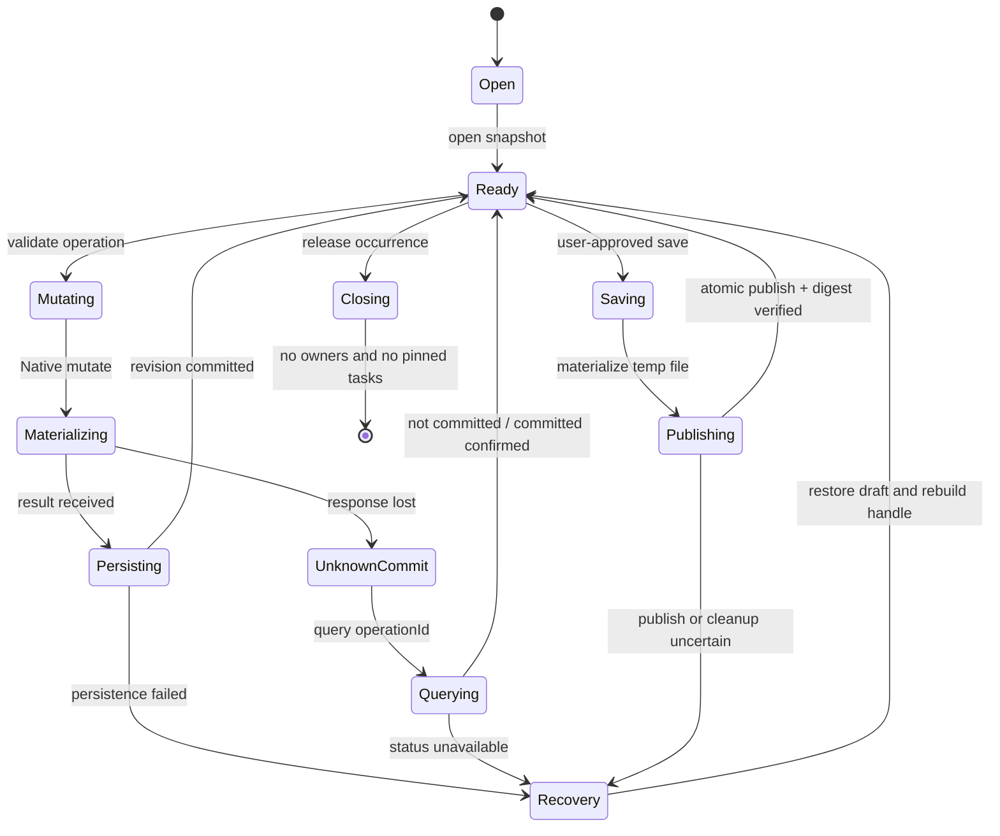

# 工作副本事务状态机

> 状态说明：本文件记录 P0 阶段的设计决策，作为实现参考；当前运行时行为以代码和 [架构文档](./architecture.md) 为准。

状态：P0 草案。Host 采用操作日志 + Native 隔离物化快照模型。

## 提交规则

1. Host 保存不可变源版本和操作日志。
2. Native 只处理指定快照和操作批次，不持有跨请求权威草稿。
3. `operationId` 在 Host 事务表中去重；`requestId` 只用于传输关联。
4. Native 返回物化结果、实际文档事实和摘要；Host 原子提交 revision。
5. 无法确认写入是否提交时，先查询事务状态，不直接重放。
6. 保存先物化临时文件，再做权限、加密、摘要和重新打开校验，最后原子发布。
7. 发布成功但清理失败只记录可重试警告，不重新标记为未保存。
8. Worker 重启时丢弃 Native handle，Host 从源版本和操作日志重建。

## 失败语义

| 失败 | Host 行为 | 用户可见结果 |
| --- | --- | --- |
| Native 拒绝操作 | 不推进 revision | 显示具体权限或格式错误 |
| 响应丢失 | 查询 `operationId` | 显示“正在确认”，不重复写入 |
| Host 持久化失败 | 保留内存草稿并标记恢复 | 显示可重试保存 |
| Worker 崩溃 | 重建 Native handle | 阅读位置保留，当前操作按状态恢复 |
| 原文件外部变化 | 拒绝发布 | 要求重新加载或另存为 |
| 另存为发布失败 | 原文件不变 | 保留草稿和错误信息 |
